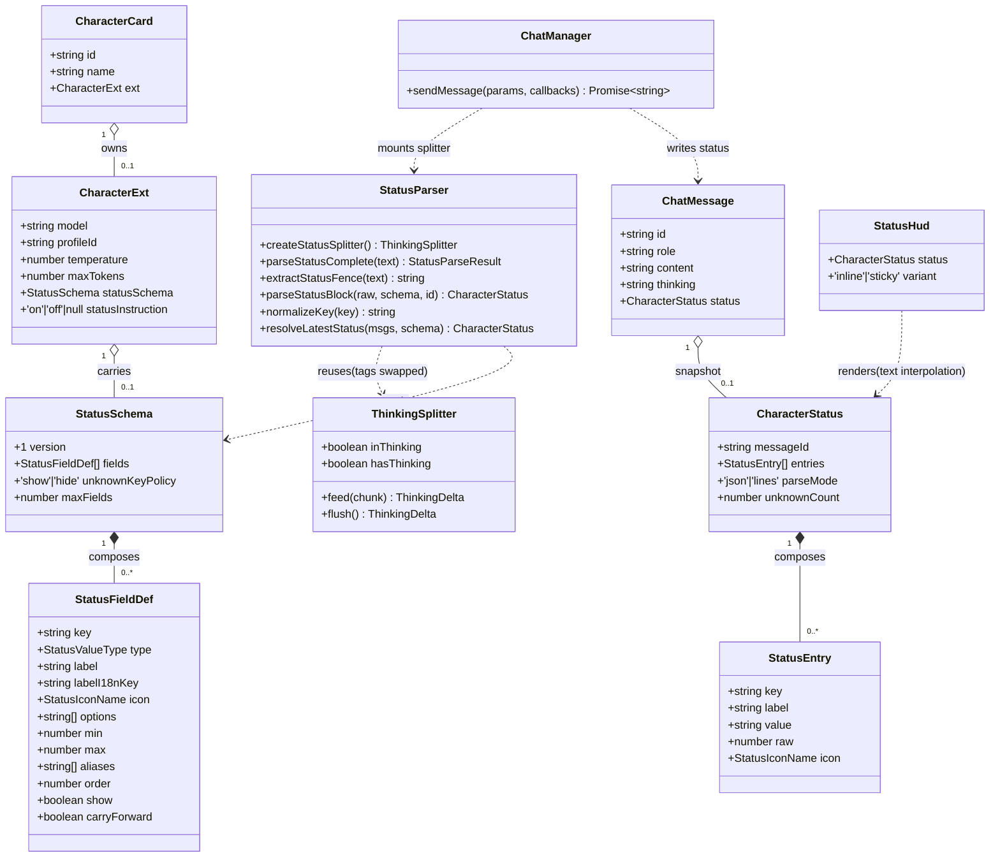
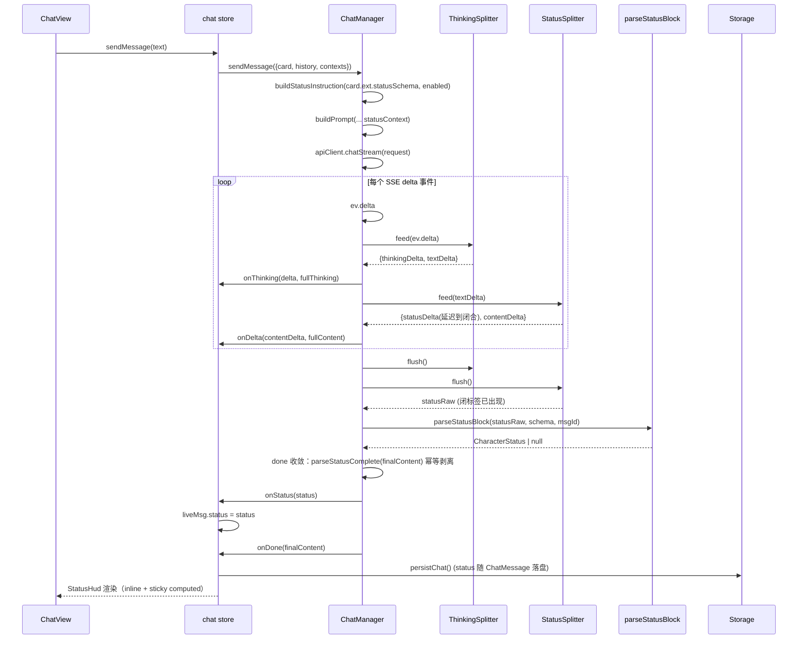
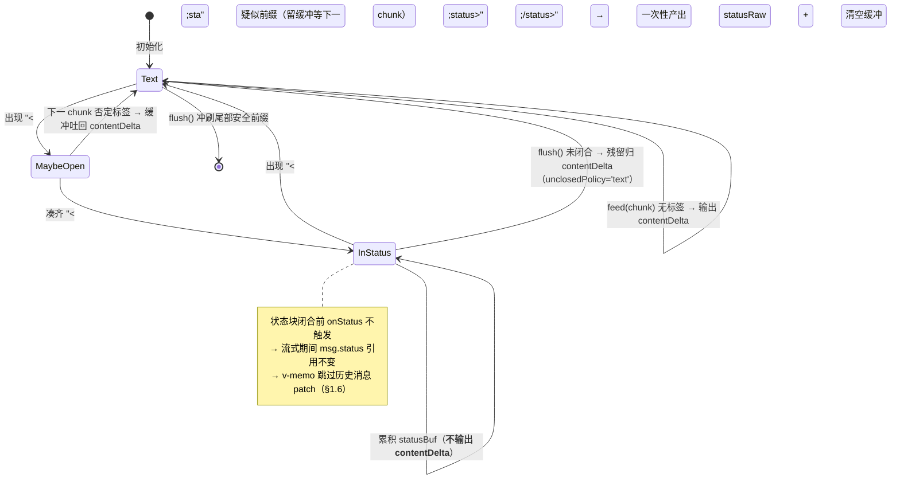
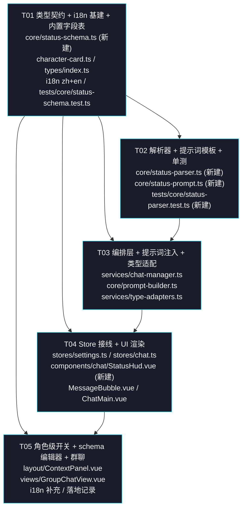

# P1 角色状态栏（Character Status HUD）—— 增量设计 + 任务分解

> 作者：高见远（架构师） · 版本：v1.0 · 状态：待评审 · 日期：2026-09-20
> 需求来源：`docs/other/tifa-ollama-webui-架构评审.md` §2.4 / §7.2②、`docs/other/tifa-ollama-webui-产品分析.md` §3.4 / §4 #4
> 上游定位：竞品三项借鉴点里**与我们多角色形态契合度最高**的一项
> 原则：**增量开发 · 最小变更 · 抄产品直觉不抄工程实现 · 复用 P0 已落地基建**
> 约束：7 道门禁（lint → i18n strict → CSS 约定 → 对比度 → 覆盖率 → build → CSP）

---

## 0. 现状勘察结论（读码核实，非转述）

### 0.1 核实结果

| 项 | 上游描述 | 读码核实结果 |
|---|---|---|
| 全新功能 | `statusSchema`/`characterStatus`/`statusBar` 在 `src/` 0 匹配 | ✅ 复核确认，三个词全部 0 匹配，无任何历史包袱 |
| 消息渲染 | `MessageBubble.vue` 文本插值 | ✅ `MessageBubble.vue:80` `{{ msg.content }}`，**无 v-html**；`ThinkingBlock.vue:97` 同样 `{{ thinking }}` |
| 列表性能 | `v-memo` + `RENDER_WINDOW` | ✅ `ChatMain.vue:676-680`：`v-memo="[msg.content, msg.thinking, msg.generating, msg.narration, msg.narrationAfter]"`；`RENDER_WINDOW = 100`（`:91`）双向窗口化 |
| 思维链已落地 | `thinking` 与 `content` 分字段 | ✅ `character-card.ts:53` `ChatMessage.thinking?`；`thinking-parser.ts` 增量状态机 `ThinkingSplitter`（265 行，已过 560 组随机切分验证）；挂载点 `chat-manager.ts:284` |
| ext 收纳约定 | `CharacterExt` | ✅ `character-card.ts:71-90` 已含 `model`/`profileId`/`temperature`/`maxTokens`/`reasoningEffort`/`sampling`/`avatarType`/`gradientFrom`/`gradientTo`/`storyId`/`boundWorldBookIds` |
| 类型适配 | `type-adapters.ts` 打包/解包 | ✅ `uiCharToCard:56-70` 打包、`cardToUiChar:131-194` 解包（带 `legacy()` 顶层回退） |
| 群聊 mock | `GroupChatView.vue` setTimeout | ✅ `:377` `setTimeout(() => { const reply = t('group.mockReply', ...) }, 500)`，**无真实流式链路** |
| 群聊消息类型 | — | ✅ `group-chat.ts:43` `GroupChatMessage extends ChatMessage` + `characterId?/characterName?` → **状态字段天然继承，群聊按发言人分组零成本** |
| 图标白名单 | `icons.ts` | ✅ 已注册 70+ 图标，**含 `map-pin`/`clock`/`heart`/`user`/`users`/`star`/`chat-circle`/`archive`** → **本轮无需新增图标**（见 §4.4） |
| 扩展机制 | `extension-loader.ts` | ✅ 存在，但扩展点只有 4 类，**全部不适合承载本功能**（见 §1.1） |
| i18n 豁免机制 | — | ✅ `prompt-builder.ts:5` 与 `:258` 有 `// i18n-ignore-start/end` 整文件块豁免；`scripts/i18n-scan.mjs:74-88` 支持块级与行级豁免 |
| 复用已有 JSON 容错 | — | ✅ `core/json-utils.ts` 已导出 `parseAiJson`（剥围栏 + 截取 `{…}` + `fixJsonString` 兜底），**无需重写** |

### 0.2 关键代码锚点（工程师按图施工）

| 关注点 | 文件:行 | 现状 / 改动点 |
|---|---|---|
| 核心消息类型 | `src/core/character-card.ts:40-54` | 加 `status?: CharacterStatus` |
| 角色扩展命名空间 | `src/core/character-card.ts:71-90` | 加 `statusSchema?: StatusSchema \| null` |
| UI 消息类型 | `src/types/index.ts:33-51` | 加 `status?: CharacterStatus` |
| UI 角色类型 | `src/types/index.ts:75-118` | 加 `statusSchema?: StatusSchema \| null` |
| 全局设置 | `src/types/index.ts:241-279` | 加 `statusHudConfig?: StatusHudConfig` |
| 流消费唯一入口 | `src/services/chat-manager.ts:284-360`（`ThinkingSplitter` 建于 `:284`，流循环始于 `:298`） | **新增 StatusSplitter 串联挂载点（唯一）** |
| 流式回调契约 | `src/services/chat-manager.ts:106-129` | 加 `onStatus?: (status: CharacterStatus \| null) => void` |
| done 收敛 | `src/services/chat-manager.ts:340-360` | 末尾补一次 `parseStatusComplete` 幂等剥离 |
| 提示词注入位 | `src/core/prompt-builder.ts:54-67 / 173-176` | `PromptContexts` 加 `statusContext?`；systemContent 追加 |
| 上下文组装 | `src/stores/chat-context.ts:142-190` | 可选：注入 `statusContext`（见 §3.5 取舍） |
| ext 打包 | `src/services/type-adapters.ts:56-70` | 加 `statusSchema` |
| ext 解包 | `src/services/type-adapters.ts:131-194` | 加 `statusSchema`（含 legacy 回退） |
| 消息双向转换 | `src/services/type-adapters.ts:202-240` | `uiMsgToChatMsg` / `chatMsgToUiMsg` 透传 `status` |
| Store 流回调 | `src/stores/chat.ts:516-545 / 834-837` | 加 `onStatus`；重新生成清空（`:759`、`:882` 同款） |
| 设置 Store | `src/stores/settings.ts:103 / 738 / 845` | 加 `statusHudConfig` ref + 持久化 + patch |
| 消息渲染 | `src/components/chat/MessageBubble.vue:71-93` | 挂 `<StatusHud>` |
| 列表 v-memo | `src/components/chat/ChatMain.vue:676-680` | v-memo 数组加 `msg.status` |
| 角色级参数 UI | `src/components/layout/ContextPanel.vue:450-455` | 加状态开关 + schema 编辑器段 |
| 群聊渲染 | `src/views/GroupChatView.vue:377` | mock 链路下仅数据结构 + 渲染覆盖 |

### 0.3 既有问题（本轮不修，但影响设计）

> **G-1：群聊无真实流式链路。** 与 P0 §8b-7 同一结论，本轮群聊侧**只能覆盖数据结构 + 渲染**，
> 代码留 `TODO` 注明"待群聊接入真实流式链路后生效"。
>
> **G-2：`cardToUiChar` 的 `legacy()` 回退是双刃剑。** 迭代 33 前的旧数据把 UI 字段直接存顶层索引签名。
> 新增 `statusSchema` 必须**同时支持 ext 与顶层回退**，否则旧卡读出来会丢 schema（见 §5.3）。

---

## 1. 实现方案与关键取舍

### 1.1 决策一：**内置，不做成扩展**（明确回答 team-lead 的问题）

**结论：直接内置。** 读 `extension-types.ts` 后给出四条硬理由（不是"为了不用而不用"）：

| # | 扩展系统的能力 | 为什么撑不住角色状态栏 |
|---|---|---|
| 1 | `settingsPanelItems.render(): string` 返回 **HTML 字符串**（`extension-types.ts:63`） | 与我们的 **CSP 红线（禁 innerHTML 渲染）** 直接冲突；且扩展**无法注册 Vue 组件**，而状态 HUD 必须嵌在 `MessageBubble.vue` 组件树里（与 `ThinkingBlock` 同级） |
| 2 | `messageProcessors.process(text, ctx): string`（`extension-types.ts:81`） | **只能文本进文本出**：拿不到 `UIMessage` 对象、无法产出结构化 `CharacterStatus`、无法按角色取 `statusSchema`、无法参与 `status` 字段的持久化 |
| 3 | `ExtensionStorageAPI`（KV，`extension-types.ts:170`） | 是**扩展私有**存储，不与角色卡绑定；而 `statusSchema` 必须随角色卡导出/导入/备份 |
| 4 | 沙箱运行时（`extension-loader.ts:234` 权限守卫，默认拒 `dom`/`network`） | 状态提取必须挂在 `chat-manager` 的**流编排管线**里（见 §1.3），扩展运行时进不去这条链路 |

**附加理由**：状态栏是角色扮演的**一等公民 UX**，与思维链同级；做成用户可选扩展会让默认体验缺失，
也违背"最小变更"（要为了它改扩展协议，改动面反而更大）。

> **未来预留（本轮不动）**：若将来真要开放给扩展，最小改动是给 `MessageProcessor` 增加
> `afterReceiveStructured?: (text, ctx) => Record<string, unknown> | null` 返回类型。
> 本轮**不预留代码**，只在本文档记录路径，避免空接口污染。

### 1.2 决策二：**状态块协议 = `<status>…</status>` 标签，不是代码块**

| 候选 | 判定 | 理由 |
|---|---|---|
| 末尾 ``` 代码块（竞品做法） | ❌ | 竞品"只取最后一个代码块"被自己坑了：RP 正文里出现任何代码块都会误判。且代码块与 markdown 语法耦合，流式下无法判断围栏何时结束 |
| ```` ```status ```` 围栏（产品分析 §4 #285 建议） | ⚠️ **降级兼容，非首选** | 与 markdown 耦合；但作为**收尾兜底**识别成本很低，保留（见 §3.2 的 `extractStatusFence`） |
| YAML front-matter | ❌ | 必须在开头，与"状态在回复末尾"的 RP 习惯相悖 |
| **`<status>…</status>`** | ✅ **首选** | ① 与 P0 的 `<think>` **同构** → 可直接复用 `ThinkingSplitter`，零新状态机；② 不与 markdown 冲突；③ `@` 与尖括号在 RP 正文里极罕见 |

**注入提示词只教 `<status>` 一种格式**（模型只需要记住一种），解析侧额外兼容 fence 作为兜底。

### 1.3 决策三：**复用 P0 的 `ThinkingSplitter`，不写第二个状态机**（不重复造轮子）

`StatusSplitter` 就是换了标签与策略的 `ThinkingSplitter`：

```ts
// src/core/status-parser.ts
import { ThinkingSplitter, parseThinkingComplete } from '@core/thinking-parser';

export const STATUS_OPEN_TAG = '<status>';
export const STATUS_CLOSE_TAG = '</status>';

/** 状态块标签常量（纯技术常量，英文，无需 i18n） */
export const STATUS_SPLITTER_OPTIONS = {
  openTag: STATUS_OPEN_TAG,
  closeTag: STATUS_CLOSE_TAG,
  /** 未闭合时残留**归正文**（而非归状态）—— 见 §1.5 的"绝不丢内容"原则 */
  unclosedPolicy: 'text',
} as const;

export function createStatusSplitter(): ThinkingSplitter {
  return new ThinkingSplitter(STATUS_SPLITTER_OPTIONS);
}
```

**为什么能直接复用**：`ThinkingSplitter` 已验证的能力恰好是我们需要的全部——
跨 chunk 标签撕裂（`'<sta'` + `'tus>'`）、UTF-8/emoji 代理对截断、缓冲区恒 ≤ 一个 chunk + 标签长度、
`unclosedPolicy` 双策略、`flush()` 幂等。**零新增状态机代码，零新增性能风险。**

**代价与收益**：`unclosedPolicy:'text'` 下状态内容会**延迟到闭标签出现**才产出 →
流式过程中 `onStatus` 最多触发一次（回合末）。这正好符合需求：**状态只在回合末显示一次**，
反而省掉了"每 chunk 重渲染状态栏"的性能问题（直接回应 §1.6）。

### 1.4 决策四：**嗅探免费、注入授权**（仿"渐进增强"的开关设计）

这是本设计对竞品思路最重要的产品化改造：

| 能力 | 是否需要开关 | 默认值 |
|---|---|---|
| **解析 + 渲染**（模型自己输出了 `<status>` 我们就渲染） | ❌ 不需要，**永远开启** | 开 |
| **提示词注入**（要求模型产出状态块） | ✅ 需要用户授权 | **关** |

理由：
- 解析是**纯前端、零成本、零副作用**的——不需要它就不出现，出现了就是白捡的沉浸感。
- 注入提示词是**改变模型行为**的：会多消耗 token、会约束弱模型、对没有 schema 的角色是凭空加要求。
  竞品把两者绑在一个开关上，导致"关了就没得看、开了就被强加要求"。
- 用户只需在角色卡里配好 `statusSchema` + 打开开关，即可获得稳定结构化输出；不配也能靠嗅探白捡。

**两级作用域**（不引入 Profile 级——状态是**角色属性**不是模型属性，与 P0-2/3 的三档不同）：

```
角色级 ext.statusInstruction: 'on' | 'off' | null(默认=继承全局)
        ↓ null
全局   settings.statusHudConfig.enabled: boolean (默认 false)
```

### 1.5 决策五：**"绝不因模型输出不规范而崩"，且绝不丢内容**

| 异常 | 降级行为 |
|---|---|
| 无状态块 | `content` 原样输出，`status` 为 `undefined` → 组件 `v-if` 不渲染。**零影响** |
| `<status>` 未闭合 | 残留**归正文**（`unclosedPolicy:'text'`）→ 原样可见，不丢一个字 |
| 状态块是合法 JSON | 结构化解析 |
| JSON 解析失败 | 降级为按行 `key: value` 切分（兼容半角 `:` 与全角 `：`，竞品只支持半角是明确的 Bug） |
| 按行切完一条都不成立 | 返回 `null` → 不渲染（不会渲染一个空壳 HUD） |
| key 不在 schema 也不在内置表 | 按 `unknownKeyPolicy`（默认 `'show'`）**降级展示**（label = 模型原始 key，无图标）；`'hide'` 则丢弃 |
| enum 值不在 `options` 里 | **仍显示**（降级为 string），不静默丢弃——沿用 P0 §8b-2 的原则：**宁可显示得丑，也不静默丢用户/模型的东西** |
| number 型给了非数字 | 降级为 string 显示 |
| 字段数超过 `maxFields` | 截断（防模型刷屏） |

**与竞品的关键差异**：竞品"只取最后一个代码块"，误判时把**正文**当状态渲染；
我们只认 `<status>` 标签，误判时**最多不显示状态**，正文**永不**被吞。

### 1.6 决策六：**渲染位置与性能**

- **消息级**：每条 assistant 消息在正文下方（旁白之后）渲染自己的状态条 → 回溯时能看到"当时的好感度"。
- **会话级**：`ChatMain` 顶部 sticky 条显示"截至当前最新状态"（`computed` 派生，**零额外持久化**）→ HUD 沉浸感。
- 两者**共用同一个 `StatusHud.vue`**（props 不同），成本近乎为零。
- **性能三保险**：
  1. `msg.status` **只在状态块闭合后才写入**（对象引用一次性从 `undefined` → 对象），
     流式期间**历史消息的 status 引用完全不变**；
  2. `ChatMain.vue` 的 `v-memo` 数组追加 `msg.status` → 历史消息被 Vue **直接跳过 patch**；
  3. 会话级 HUD 是 **1 个 DOM 节点**的 computed，不随消息数增长。
  → 与竞品"每 chunk 全量 `innerHTML` 重建"是量级差异。

- **CSP 红线**：`StatusHud.vue` 内**只允许** `{{ }}` 文本插值 + `<Icon :name="...">`（`Icon.vue` 走 `getIconPath` 白名单，
  已有 `eslint-disable vue/no-v-html` 豁免）。模型输出的 key/value **全程是 JS 字符串**，永不进 HTML 解析器。

### 1.7 放弃的东西（明确不做的）

- ❌ **中文关键词表**（竞品核心实现）：见 §4，我们用结构化 key，源码里一个中文都不出现。
- ❌ **可拖动的浮动状态卡**（竞品有）：需要 pointer 事件 + 位置持久化，超出 P1 预算；本轮用 sticky 条 + 消息内条。
- ❌ **状态数值的自动累加/合并引擎**：我们**不替模型做数值决策**。好感度递增由模型在上下文里看到上一次的值后自己输出（见 §5.4 的 `carryForward`）。
- ❌ **状态历史时间轴**（产品分析 §4 #285 提到关联故事引擎）：P2+。
- ❌ **`innerHTML` / `v-html`**：CSP 门禁，红线。

---

## 2. 数据结构与 TS 接口定义

### 2.1 状态类型（`src/core/status-schema.ts` —— 新建）

> 放 **core 层**而非 `@/types`：`ChatMessage`（core）要引用 `CharacterStatus`，
> core 不能反向依赖 UI 层类型（`character-card.ts` 目前只 import `@/i18n` 与 `@api/types`）。

```ts
/**
 * P1 角色状态栏 —— 类型与内置字段注册表
 *
 * 设计红线（详见 docs/design/character-status-hud-增量设计.md §4）：
 * 1. 本文件**不得出现任何中文字符**（i18n strict 门禁扫 src/ 源码）。
 *    展示名的中文只存在于 ① i18n locales ② 角色卡数据（用户数据）③ 模型输出（运行时数据）。
 * 2. 匹配只用**结构化 key**（英文标识符），绝不用自然语言词做匹配。
 * 3. core 层不依赖 components，图标名用字面量联合类型，由渲染层映射到 IconName。
 */

/** 状态字段值类型 */
export type StatusValueType = 'string' | 'number' | 'enum';

/**
 * 状态图标名（与 src/components/common/icons.ts 白名单一一对应）
 *
 * 不用 import IconName：core 依赖 components 会形成 core→components 的反向依赖。
 * 由 tests/core/status-schema.test.ts 断言每个名字在 PATHS 中存在（见 §7.3）。
 */
export type StatusIconName =
  | 'map-pin'
  | 'clock'
  | 'heart'
  | 'user'
  | 'users'
  | 'star'
  | 'chat-circle'
  | 'archive';

/** 单条状态字段的 schema 定义（角色卡自带） */
export interface StatusFieldDef {
  /**
   * 结构化 key（英文标识符，小写 snake/camel 均可，匹配前会归一化）
   * 这是**匹配与持久化的唯一依据**，不是展示名。
   */
  key: string;
  /** 值类型，缺省 'string' */
  type?: StatusValueType;
  /**
   * 展示名（角色卡创作者填写，属**用户数据**，可含中文，不受 i18n 门禁管辖）
   * 优先级：labelI18nKey > label > 内置表 i18nKey > key 原样
   */
  label?: string;
  /** i18n key（内置字段预设用；命中时优先于 label） */
  labelI18nKey?: string;
  /** 图标（必须命中 icons.ts 白名单，否则降级为无图标） */
  icon?: StatusIconName;
  /** type='enum' 时的值域（仅作校验与 UI 下拉，**不在值域内也不丢弃**） */
  options?: string[];
  /** type='number' 时的取值范围（同样不强制） */
  min?: number;
  max?: number;
  /** 嗅探别名（归一化后参与匹配；可填任何语言，因为是用户数据） */
  aliases?: string[];
  /** 排序权重，升序；缺省 0，同权重按 schema 声明顺序 */
  order?: number;
  /** 是否在 HUD 显示（false = 只做类型声明不展示），缺省 true */
  show?: boolean;
  /**
   * 本轮未输出该 key 时，是否**结转**上一轮的值（缺省 true）
   * true  = 从后往前找最近一次出现过的非空值（好感度等累积语义）
   * false = 只认最后一条有状态的消息，没出现就是不显示
   */
  carryForward?: boolean;
}

/** 角色卡自带的状态 schema（核心差异化：竞品是全局硬编码关键词表） */
export interface StatusSchema {
  /** schema 版本（当前固定 1，为未来演进留位） */
  version: 1;
  /** 字段定义列表 */
  fields: StatusFieldDef[];
  /** 未匹配到任何 schema/内置字段的 key 如何处理，缺省 'show'（渐进增强） */
  unknownKeyPolicy?: 'show' | 'hide';
  /** 单次状态最多渲染多少字段（防模型刷屏），缺省 12 */
  maxFields?: number;
}

/** 解析出的单条状态（已面向渲染，值统一为 string） */
export interface StatusEntry {
  /** 归一化后的 key（持久化与去重用） */
  key: string;
  /** 已解析的展示名（i18n 或角色卡 label 或原始 key） */
  label: string;
  /** 展示值（**统一字符串**，渲染层只做文本插值） */
  value: string;
  /** type='number' 且解析成功时的数值（供未来图表/进度条用；本轮不渲染） */
  raw?: number;
  /** 图标名（未命中时为空 → 无图标） */
  icon?: StatusIconName;
}

/** 一条消息解析出的状态快照 */
export interface CharacterStatus {
  /** 产出该状态的消息 id（溯源/调试用） */
  messageId: string;
  /** 字段列表（已按 schema order 排序；无 schema 时按出现顺序） */
  entries: StatusEntry[];
  /** 解析方式：'json' = 状态块解析为 JSON；'lines' = 按行 key:value 降级 */
  parseMode: 'json' | 'lines';
  /** 未命中 schema/内置表、按 unknownKeyPolicy='show' 降级展示的字段数（诊断用） */
  unknownCount: number;
}

/** 内置规范字段预设（源码常量，纯 ASCII） */
export interface StatusFieldPreset {
  /** 规范 key */
  key: string;
  /** i18n key（zh/en 双语，形如 'status.field.location'） */
  i18nKey: string;
  /** 图标（icons.ts 白名单内） */
  icon: StatusIconName;
  /** 建议值类型 */
  type: StatusValueType;
}

/**
 * 内置规范字段注册表（8 项）
 *
 * 这是"不依赖中文关键词"的方案核心：源码里只有英文标识符，
 * 展示名全部走 i18n key。新增字段只需改这里 + zh.ts/en.ts 两处（见 §4.3 迁移路径）。
 */
export const STATUS_FIELD_REGISTRY: readonly StatusFieldPreset[] = [
  { key: 'location',     i18nKey: 'status.field.location',     icon: 'map-pin',     type: 'string' },
  { key: 'time',         i18nKey: 'status.field.time',         icon: 'clock',       type: 'string' },
  { key: 'affection',    i18nKey: 'status.field.affection',    icon: 'heart',       type: 'number' },
  { key: 'identity',     i18nKey: 'status.field.identity',     icon: 'user',        type: 'string' },
  { key: 'relationship', i18nKey: 'status.field.relationship', icon: 'users',       type: 'string' },
  { key: 'mood',         i18nKey: 'status.field.mood',         icon: 'star',        type: 'string' },
  { key: 'thought',      i18nKey: 'status.field.thought',      icon: 'chat-circle', type: 'string' },
  { key: 'inventory',    i18nKey: 'status.field.inventory',    icon: 'archive',     type: 'string' },
] as const;

/** 全局状态栏偏好（落 AppSettings，与 P0 的 ThinkingConfig 同构） */
export interface StatusHudConfig {
  /** 是否向模型注入"输出状态块"的指令（默认 false = 不注入；解析与渲染不受此开关影响） */
  enabled: boolean;
  /** 是否在聊天区顶部显示 sticky "当前状态"条（默认 true） */
  showSticky: boolean;
  /** 是否在每条 assistant 消息内显示该轮状态（默认 true） */
  showInline: boolean;
}

/** 默认值 */
export const DEFAULT_STATUS_HUD_CONFIG: StatusHudConfig = {
  enabled: false,
  showSticky: true,
  showInline: true,
};

/** 值最大长度（超出截断，防模型把整段正文塞进状态） */
export const STATUS_VALUE_MAX_LEN = 200;
/** 单次状态最多字段数缺省值 */
export const STATUS_MAX_FIELDS = 12;
/** 单条值超过此长度时渲染切竖排（抄竞品的响应式降级思路，阈值按 CJK 观感调） */
export const STATUS_STACK_THRESHOLD = 24;
```

### 2.2 核心 / UI 类型增量（改现有文件，全部**可选字段**）

```ts
// ── src/core/character-card.ts ──
import type { CharacterStatus, StatusSchema } from '@core/status-schema';

export interface ChatMessage {
  id: string;
  role: 'system' | 'user' | 'assistant';
  content: string;
  timestamp: string;
  swipes: string[];
  swipeIndex: number;
  /** P0-1：思维链（既有） */
  thinking?: string;
  /**
   * P1：本条消息解析出的角色状态快照。
   * 与 thinking 同构 —— 独立于 content 存储，**不参与回传**（prompt-builder 只读 content）。
   * 旧数据无此字段 → undefined → 不渲染。仅 assistant 消息有值。
   */
  status?: CharacterStatus;
}

export interface CharacterExt {
  /* ...既有字段全部不变... */
  /**
   * P1：角色自带状态 schema（沿用 P0 的 ext 收纳约定，不散落到顶层索引签名）。
   * null / undefined = 无 schema → 解析器退化到"纯嗅探模式"（内置 8 字段 + 降级展示）。
   */
  statusSchema?: StatusSchema | null;
  /**
   * P1：该角色是否注入"输出状态块"的提示词指令。
   * 'on' / 'off' 显式覆盖；null / undefined = 继承全局 settings.statusHudConfig.enabled。
   */
  statusInstruction?: 'on' | 'off' | null;
}

// ── src/types/index.ts ──
export interface UIMessage {
  /* ...既有... */
  thinking?: string;
  /** P1：本条消息的状态快照（流式下在状态块闭合后一次性写入） */
  status?: CharacterStatus;
  narrationAfter?: string;
  generating?: boolean;
  timestamp: number;
}

export interface UICharacter {
  /* ...既有... */
  /** P1：角色自带状态 schema（ext 打包/解包，见 type-adapters） */
  statusSchema?: StatusSchema | null;
  /** P1：'on'|'off'|null —— null = 继承全局 */
  statusInstruction?: 'on' | 'off' | null;
}

export interface AppSettings {
  /* ...既有... */
  /** P1：状态栏全局偏好 */
  statusHudConfig?: StatusHudConfig;
}
```

### 2.3 解析器 API（`src/core/status-parser.ts` —— 新建）

```ts
import { ThinkingSplitter, parseThinkingComplete } from '@core/thinking-parser';
import { parseAiJson } from '@core/json-utils';
import type { CharacterStatus, StatusSchema } from '@core/status-schema';

/** 一次性剥离结果（与 ThinkingParseResult 同构） */
export interface StatusParseResult {
  /** 已剥离状态块的正文 */
  content: string;
  /** 状态块原文（未解析，交给 parseStatusBlock） */
  statusRaw: string;
  /** 是否检测到状态块（标签存在但内容为空串时仍为 true） */
  hasStatus: boolean;
}

/** 创建串联在 ThinkingSplitter 之后的状态切分器（复用 P0 状态机，见 §1.3） */
export function createStatusSplitter(): ThinkingSplitter;

/** 一次性剥离（非流式场景 / done 收敛；与流式累积幂等） */
export function parseStatusComplete(text: string): StatusParseResult;

/**
 * 兜底：从整段文本里找 ```status 围栏（仅收尾时用一次，不参与流式）
 * 模型若在正文里用了普通代码块（无 status info string）不会被误判。
 */
export function extractStatusFence(text: string): string;

/**
 * 纯函数：状态块原文 → 结构化状态
 * @param raw    状态块原文（`<status>` 内 / fence 内）
 * @param schema 角色自带 schema；null/undefined = 纯嗅探模式
 * @param messageId 溯源用
 * @returns 没有任何可用字段时返回 null（调用方据此不渲染，**不渲染空壳**）
 */
export function parseStatusBlock(
  raw: string,
  schema?: StatusSchema | null,
  messageId?: string
): CharacterStatus | null;

/** key 归一化：trim + 小写 + 去掉空白/下划线/连字符/冒号 */
export function normalizeKey(key: string): string;

/**
 * 会话级派生：取"截至当前的最新状态快照"（零持久化，纯 computed 友好）
 *
 * 算法：从后往前遍历消息；key 首次出现即锁定（= 最新值）。
 * - field.carryForward !== false（默认）→ 一直回溯到找到该 key 为止（好感度结转语义）
 * - field.carryForward === false       → 只取最后一条有 status 的消息，不再回溯
 *
 * 群聊用法：先按 characterId 过滤再调用（GroupChatMessage 已带 characterId，零额外类型改动）。
 */
export function resolveLatestStatus(
  messages: readonly { id: string; status?: CharacterStatus | null }[],
  schema?: StatusSchema | null
): CharacterStatus | null;
```

### 2.4 提示词模板（`src/core/status-prompt.ts` —— 新建）

```ts
/**
 * P1：生成"要求模型输出状态块"的指令（模型面文本，**纯英文**）
 *
 * 为什么必须英文：解析侧的匹配层只认英文标识符（§4），
 * 若提示词教模型输出中文 key，模型照做 → 匹配不到 → 功能失效。
 * 这是硬约束，改动前请先读设计文档 §4。
 *
 * 文件整体用 // i18n-ignore-start/end 块豁免（与 prompt-builder.ts 同款），
 * 且本文件本来也不含中文。
 */
export function buildStatusInstruction(
  schema: StatusSchema | null | undefined,
  enabled: boolean
): string;
```

产出示例（有 schema 时）：

```
[Character Status]
After your reply, append exactly one status block at the very end, outside any <think> block:
<status>
{"location": "<string>", "affection": <number>, "mood": "<string>"}
</status>
Rules:
- Use only the keys listed above, in English, lowercase.
- Keep each value short (under 200 characters).
- The block is stripped from the visible reply, so never repeat its content in the reply body.
```

无 schema（纯嗅探）时列出 8 个内置 key 作为**建议**（不是强制）。

### 2.5 类图



### 2.6 时序图（流式：思维链 + 状态 + 正文 三者分流）



---

## 3. 解析器设计

### 3.1 管线：串联两级剥离（关键，回答"与思维链共存"）

```
原始 delta
   │
   ├─ ThinkingSplitter（<think> / </think>, unclosedPolicy 沿用 P0）
   │      ├── thinkingDelta → onThinking
   │      └── textDelta
   │              │
   │              └─ StatusSplitter（<status> / </status>, unclosedPolicy='text'）
   │                     ├── statusRaw（闭标签出现时一次性产出）→ parseStatusBlock → onStatus
   │                     └── contentDelta → roundContent / onDelta
```

**为什么是串联而不是并联**（这是 team-lead 第 6 问的正解）：

| 场景 | 结果 |
|---|---|
| `<think>…思考…</think>正文<status>…状态…</status>` | ✅ 正常：思考 → thinking 字段，状态 → status 字段，正文 → content |
| `<think>…<status>x: 1</status>…</think>正文` | ⚠️ **状态不提取**（它在 `<think>` 内，被第一级剥走了）→ 已知取舍，见 §3.5 E-28。缓解：提示词明确要求"status block must be outside any `<think>` block" |
| 正文里出现字面量 `<status>` | ⚠️ 会被当作状态块开标签（与 P0 对 `<think>` 的取舍一致：非嵌套语义） |
| `<status>` 未闭合 | ✅ 残留归正文（`unclosedPolicy:'text'`），内容不丢 |

**`done` 收敛**（防 `fullContent` 回冲带标签，与 P0 §1.1.3 同款）：

```ts
// 既有：先按 P0 规则收敛 thinking / content
// 新增：**无条件**再跑一次状态幂等剥离（无论走哪条分支）
const sp = parseStatusComplete(finalContent);
finalContent = sp.content || finalContent;
// 若流式已产出 statusRaw，二者应一致（幂等不变量）；不一致时以一次性解析为准
if (sp.hasStatus) {
  const parsed = parseStatusBlock(sp.statusRaw, schema, msgId);
  if (parsed) { statusOut = parsed; callbacks?.onStatus?.(parsed); }
}
// 兜底：标签型没命中时，补一次 ```status 围栏识别（仅此处调用，不参与流式）
if (!sp.hasStatus) {
  const fenced = extractStatusFence(finalContent);
  if (fenced) {
    const parsed = parseStatusBlock(fenced, schema, msgId);
    if (parsed) { finalContent = finalContent.replace(fenceWithBackticks, ''); statusOut = parsed; callbacks?.onStatus?.(parsed); }
  }
}
```

> **围栏兜底只在收尾跑一次**（`done` / 流自然结束 / `flush` 之后），**不参与流式**。
> 因为围栏在流式下无法判断何时结束（可能是正文里任意长度的代码块），
> 且只认 info string 为 `status` 的围栏 → 不会误吞普通代码块（§3.5 A-08）。

**`statusInstructionEnabled` 的来源**：由 `src/stores/chat.ts` 的 `applyRuntimeLlmControls()`
同步进 `ChatManagerConfig`（与 `thinkingConfig` / `samplingDefaults` 完全同款），
解析优先级：`card.ext.statusInstruction === 'on'|'off'` > `settings.statusHudConfig.enabled`。

### 3.2 `parseStatusBlock` 算法（纯函数，零 DOM、零 i18n 依赖）

```
输入 raw（状态块原文）, schema, messageId
 1. raw.trim() === ''                     → return null
 2. 结构化优先：obj = parseAiJson(raw)     → 命中走 4（复用 json-utils，含围栏剥离 + 尾逗号修复）
 3. 降级按行：lines = raw.split(/\r?\n/)
      逐行：去 markdown 前缀 /^[-*>#\s]+/ → 按**第一个** ':' 或 '：' 切（取先出现者）
      key 或 value 为空 → skip 该行
      → 走 4
 4. 对每个 (key, value)：
      nk = normalizeKey(key)
      a) schema.fields 精确：normalizeKey(f.key) === nk                       → 命中（最高优先）
      b) schema.fields 别名精确：f.aliases 任一归一化 === nk                   → 命中
      c) schema.fields 子串：nk.includes(normalizeKey(f.key)) 且 f.key 长≥4   → 命中
      d) 内置 STATUS_FIELD_REGISTRY 同 a/b（registry 无别名，走 a + c）        → 命中
      e) 未命中：unknownKeyPolicy==='show' → 降级 entry{key:nk, label:原始key, value}
                                    'hide' → 丢弃
 5. value 归一化：trim；长度 > STATUS_VALUE_MAX_LEN 截断
    type==='number' → Number(value) 有限则写 raw，否则降级 string
    type==='enum'   → 不在 options 也**保留**（不静默丢弃）
 6. show===false 的字段不进 entries
 7. 排序：order 升序 → 声明/出现顺序
 8. 截断到 schema.maxFields ?? STATUS_MAX_FIELDS
 9. entries.length === 0                  → return null（不渲染空壳）
```

**`normalizeKey`**（`src/core/status-schema.ts` 导出，供单测直接打）：

```ts
export function normalizeKey(key: string): string {
  return key.trim().toLowerCase().replace(/[\s_\-:：]+/g, '');
}
```

> 子串匹配（4c）是**有意保留竞品的容错**：`"Current Location"` → `currentlocation`.includes('location') → 命中。
> 限制 `f.key.length >= 4` 是为了避免 `hp`/`id` 这类短 key 误命中。

### 3.3 状态图（StatusSplitter 的生命周期）



### 3.4 降级路径总表

| 层 | 正常 | 降级 1 | 降级 2 | 最终兜底 |
|---|---|---|---|---|
| 容器识别 | `<status>…</status>` | 收尾兜底 ```status fence | — | 无容器 → 不渲染 |
| 块内容解析 | JSON | 按行 `key: value` | 全角 `：` | 无有效行 → 不渲染 |
| 字段匹配 | schema 精确 | schema 别名/子串 | 内置 8 字段 | 未知 key 降级展示（label=原 key） |
| 值类型 | number/enum | 非数字 → string | 越界 → 仍显示 | 超长 → 截断 |
| 未闭合 | — | — | — | 残留**归正文**，内容不丢 |

### 3.5 边界用例清单（**必须全部落单测**，对应 `tests/core/status-parser.test.ts`）

**A. 容器识别**
- A-01 无状态块 → `content` 原样、`statusRaw===''`、`hasStatus===false`
- A-02 `<status>` + 内容 + `</status>` 完整 → 剥离后 content 不含任何状态原文
- A-03 状态块在正文**中间**（非末尾）→ 仍提取（我们不限定末尾）
- A-04 状态块在正文**开头** → 仍提取
- A-05 `<status>` 未闭合，残留含合法 `key: value` → **仍归正文**（`'text'` 策略既定），`status===null`
- A-06 `<status></status>` 空块 → `hasStatus===true` 但 `entries` 空 → `parseStatusBlock` 返回 `null`
- A-07 ```status 围栏（无 `<status>` 标签）→ 收尾兜底识别成功
- A-08 普通 ``` 代码块（info string 为空）→ **不识别**（防竞品式误判）
- A-09 正文含字面量 `<status>` 文本（非块）→ 按开标签处理（已知取舍，固化行为）
- A-10 状态块内含字面量 `</status>` → 提前闭合（已知取舍，固化行为）

**B. 块内容解析**
- B-01 JSON 对象 `{"location":"tavern","affection":7}`
- B-02 JSON 带尾逗号 / 单引号 → `parseAiJson` 的 `fixJsonString` 兜底成功
- B-03 按行 `location: tavern`
- B-04 全角冒号 `location：tavern`
- B-05 值含冒号 `time: 18:30` → 值保留 `18:30`（只切第一个分隔符）
- B-06 无分隔符行 `just a sentence` → 跳过
- B-07 key 为空 `: tavern` → 跳过
- B-08 value 为空 `location:` → 跳过
- B-09 重复 key → 后者覆盖前者，`entries` 内不重复
- B-10 markdown 前缀 `- location: tavern` / `* location: tavern` → 剥离前缀后命中
- B-11 值超 200 字符 → 截断
- B-12 字段数超过 `maxFields` → 截断到上限
- B-13 多行值（换行后还有内容）→ 取第一行；后续行若含分隔符会被当新 key（已知取舍）

**C. 匹配与 i18n**
- C-01 `Location` / `LOCATION` / ` location ` → 归一化命中 `location`
- C-02 `current_location` / `current-location` / `Current Location` → 子串命中 `location`
- C-03 schema `aliases:['place']` + 模型输出 `place` → 命中
- C-04 未知 key `foobar` + `unknownKeyPolicy:'show'` → 降级展示，`unknownCount===1`
- C-05 未知 key + `'hide'` → 丢弃
- C-06 **中文 key `地点`** → **不命中**（明确取舍），`'show'` 时 label 显示为 `地点`（原始 key 透传，不丢失）
- C-07 schema 精确优先于内置表（同名 key 时 schema 的 label/icon 生效）
- C-08 `show:false` 字段不进 `entries`
- C-09 `order` 排序生效

**D. 流式与幂等**
- D-01 标签跨 chunk 撕裂：`<sta` + `tus>` / `</stat` + `us>`（逐字符切分穷举）
- D-02 UTF-8 / emoji 代理对跨 chunk 截断重建
- D-03 **幂等不变量**：`parseStatusComplete(s)` === 流式任意切分累积（复用 P0 的随机切分验证法：语料 × 切分数 × 种子）
- D-04 `flush()` 重复调用幂等
- D-05 多组 `<status>` 块 → 后者覆盖前者

**E. 与思维链共存**
- E-28 `<think>…<status>x:1</status>…</think>正文` → 状态**不提取**（在思考内），`thinking` 含该文本（固化取舍）
- E-29 `<think>…</think>正文<status>…</status>` → thinking / status / content 三者正确分离
- E-30 只有状态无思考 → 正常
- E-31 只有思考无状态 → 正常，status 为 null

**F. 性能与安全**
- F-01 1 万字符状态块解析 < 20ms（阈值放宽到 50ms 防 CI 抖动）
- F-02 值含 `` → 字符串原样存；**渲染层单测**断言 DOM 中无 `img` 元素
- F-03 `resolveLatestStatus([])` → null
- F-04 `resolveLatestStatus` carryForward=true 跨消息回溯；=false 只认最后一条
- F-05 群聊按 `characterId` 过滤后调用 → 各成员独立快照

### 3.6 `resolveLatestStatus` 语义（回答"会话级 vs 消息级"）

- **消息级** `msg.status`：**忠实快照**，每条消息记录它自己那一轮的状态（可回溯）。
- **会话级** `resolveLatestStatus(messages, schema)`：**纯派生**，不落盘、不占存储。
  从后往前遍历，key 首次出现即锁定 → 天然实现"好感度结转"（模型某轮没输出 affection，
  上一轮的 7 仍然显示）。
- **不做**任何数值累加/合并引擎：**好感度从 7 变 8 是模型的决策，不是前端的**。

---

## 4. i18n 方案（正面回答"中文关键词表"难题）

### 4.1 问题重述

竞品的匹配表是 `['地点','位置','地址','场景']` 这类**中文自然语言词**。
我们有 `i18n strict` 门禁：`scripts/i18n-scan.mjs` 扫 `src/` 下 `.vue/.ts` 的**非注释有效代码**，
命中 `/[\u4e00-\u9fa5]/` 即失败。→ **源码里不能出现中文关键词表**。

### 4.2 方案：**三层分离 —— 匹配用结构化 key，展示用 i18n 或用户数据**

```
┌─────────────────────────────────────────────────────────────┐
│ ① 匹配层（源码，纯 ASCII）                                    │
│    STATUS_FIELD_REGISTRY: location / time / affection / ...   │
│    StatusFieldDef.key / aliases                              │
│    normalizeKey()：trim + 小写 + 去空白/下划线/连字符/冒号      │
│    → 源码内**零中文**，i18n strict 天然通过                    │
├─────────────────────────────────────────────────────────────┤
│ ② 展示层（i18n 或用户数据）                                   │
│    label 优先级：                                             │
│      a. field.labelI18nKey → t(key)   ← 内置字段（中英双语）    │
│      b. field.label                   ← 角色卡自带（用户数据）  │
│      c. 内置表 preset.i18nKey → t()   ← 嗅探命中内置字段       │
│      d. 模型输出的原始 key             ← 未知字段降级（运行时）  │
├─────────────────────────────────────────────────────────────┤
│ ③ 提示层（模型面，纯英文）                                     │
│    status-prompt.ts 输出的指令**必须是英文 key**，否则模型       │
│    输出中文 key → 匹配层不认 → 功能失效（见 §4.5 硬约束）        │
└─────────────────────────────────────────────────────────────┘
```

### 4.3 为什么这样不违反 i18n strict（逐条对账）

| 中文出现的位置 | 是否违规 | 依据 |
|---|---|---|
| `src/core/status-schema.ts` 的常量与类型 | ❌ 不出现 | 全部 ASCII（key / i18nKey / icon / type 都是英文标识符） |
| `src/core/status-parser.ts` | ❌ 不出现 | 纯逻辑，无文案 |
| `STATUS_FIELD_REGISTRY` 的展示名 | ✅ 走 i18n | `status.field.location` → zh `'地点'` / en `'Location'` |
| 角色卡 `StatusFieldDef.label`（创作者写的中文） | ✅ **用户数据** | 存在 IndexedDB / Tauri JSON 里，与 `CharacterCard.name`/`description`/`personality` 同性质。**门禁只扫 `src/` 源码，不扫运行时数据** |
| 角色卡 `aliases`（创作者可能填中文） | ✅ **用户数据** | 同上 |
| 模型输出的未知 key（如 `地点`） | ✅ **运行时数据** | 与 `msg.content` 同性质，直接文本插值渲染 |
| `status-prompt.ts` 的提示词 | ⚠️ 双重保险 | ① 本来就是英文（**必须**是英文，见 §4.5）；② 即便写中文，`prompt-builder.ts:5/258` 已证明 `// i18n-ignore-start/end` 块豁免有效 |
| `StatusHud.vue` 模板 | ❌ 不出现 | 全部 `{{ t('status.*') }}` 与 `{{ entry.label }}` |

### 4.4 图标：本轮**零新增**（规避白名单改动风险）

`src/components/common/icons.ts` 的 `IconName` 是**字面量联合类型 + `PATHS: Record<IconName, string>`**，
新增图标要同时改联合类型与 PATHS 两处（P0 加 `brain` 时走过一次）。

本轮内置 8 字段**全部映射到已注册图标**：

| key | icon（已注册） | zh | en |
|---|---|---|---|
| `location` | `map-pin` | 地点 | Location |
| `time` | `clock` | 时间 | Time |
| `affection` | `heart` | 好感 | Affection |
| `identity` | `user` | 身份 | Identity |
| `relationship` | `users` | 关系 | Relationship |
| `mood` | **（无图标）** | 心情 | Mood |
| `thought` | `chat-circle` | 想法 | Thought |
| `inventory` | `archive` | 持有 | Inventory |

> **⚠️ 主理人裁定（2026-09-20，覆盖本节原方案 `star`）：`mood` 不配图标，只显示 label。**
> 理由：`icons.ts` 白名单（63 个）里**没有任何情绪 / 表情类图标**，`star` 是"收藏 / 评分"语义，
> 用来表示"心情"会让用户困惑——这是"看起来有图标而已"的假满足。
> **"少一个图标"是正确的降级，不是缺陷。** 不要为了填满 8 个字段而硬凑语义不符的图标。
> 连带：内置字段表场景下 `icon` 应为**可选**。

> 为什么 `thought` 不用 `brain`：`brain` 已被 `ThinkingBlock` 占用（语义="思考过程"），
> 复用会造成"想法"与"思考链"的视觉混淆。改用 `chat-circle`。

**防漂移单测**（`tests/core/status-schema.test.ts`）：
```ts
// 断言每个 registry 图标都在 icons.ts 白名单里有实际路径（防改名后静默降级为空白）
for (const p of STATUS_FIELD_REGISTRY) {
  expect(getIconPath(p.icon)).not.toBe('');
}
```

### 4.5 迁移路径（工程师照做即可，不会踩坑）

**场景 A：新增一个内置语义字段**（如 `weather`）
1. `src/core/status-schema.ts`：`STATUS_FIELD_REGISTRY` 加一行 `{ key:'weather', i18nKey:'status.field.weather', icon:'compass', type:'string' }`
2. `src/i18n/locales/zh.ts` 加 `'status.field.weather': '天气'`
3. `src/i18n/locales/en.ts` 加 `'status.field.weather': 'Weather'`
→ 完成。**全程无中文进源码**（zh.ts 在 `IGNORED_DIRS` 里，是文案源）。

**场景 B：想让中文 key 也能命中**
→ **不要**在源码里写中文词表。正确做法是**角色卡 schema 的 `aliases` 字段**：
```json
{ "key": "location", "aliases": ["地点", "位置", "场景"] }
```
`aliases` 是角色卡数据（用户数据），写入/编辑都在 UI 里完成，源码零改动，i18n 门禁天然无害。
→ **这条路径要写进 schema 编辑器的 placeholder 提示**（`status.schemaAliasesHint`）。

**场景 C：展示名想中英双语**
→ 内置字段用 `labelI18nKey`（走 i18n）；角色卡自定义字段用 `label`（创作者自填，单语，
与角色卡其他文本一致）。**不要**试图给角色卡 label 做 i18n —— 那是用户数据。

### 4.6 硬约束（写进共享约定，改动前必读）

> **① 提示词注入必须用英文 key。**
> `buildStatusInstruction` 输出的示例 JSON 里，key 必须是 `location`/`time`/`affection`…
> 若有人"为了让中文模型更好理解"把示例改成中文 key，模型会照抄中文 → 匹配层（只认英文）
> 全部落空 → 功能静默失效。**这是本设计最脆弱的一处，务必在代码注释里写死原因。**
>
> **② `normalizeKey` 不得加入任何语言特判。** 需要其他语言支持 → 走 `aliases`（场景 B）。

---

## 5. 持久化与迁移策略

### 5.1 存哪（三处，各司其职）

| 数据 | 落点 | 理由 |
|---|---|---|
| `statusSchema` | `CharacterCard.ext.statusSchema` | 角色卡自带（**沿用 P0 的 ext 收纳约定**），随角色卡导出/导入/备份 |
| `statusInstruction` | `CharacterCard.ext.statusInstruction` | 同上（角色级开关） |
| 每轮状态快照 | `ChatMessage.status` | 状态是**会话事实**不是人设；与 `thinking` 同构。**不写回角色卡** |
| 全局开关 | `AppSettings.statusHudConfig` | 与 `ThinkingConfig` 同构（用户偏好而非角色人设） |
| 会话级"当前状态" | **不存** | 由 `resolveLatestStatus()` 纯派生（computed） |

### 5.2 对已存数据的影响：**零迁移**

| 层 | 影响 |
|---|---|
| `ChatMessage.status?:` | 旧数据无此字段 → `undefined` → `StatusHud` `v-if` 不渲染。**行为完全不变** |
| `UIMessage.status?:` | 同上 |
| `CharacterExt.statusSchema?:` | 旧卡 `ext` 无此字段 → `undefined` → 解析器退化为**纯嗅探模式**（内置 8 字段 + 降级展示） |
| `AppSettings.statusHudConfig?:` | 缺省 → `DEFAULT_STATUS_HUD_CONFIG`（`enabled:false` = 不改模型行为） |
| 存储层（`Chat` / IndexedDB / Tauri JSON） | `messages: ChatMessage[]` 里多一个可选字段，**JSON 序列化自动包含，无需 schema 版本迁移** |
| 备份/恢复（`backup.ts`） | 走整体 JSON 序列化，自动覆盖 |

> **结论：不需要写任何 migration 脚本。** 这是"全可选字段 + 不回写"的收益。

### 5.3 `type-adapters.ts` 改动（含 legacy 回退，见 §0.3 G-2）

```ts
// uiCharToCard：打包（与 sampling 同款：剔除 null，避免空对象污染 schema）
...(ui.statusSchema ? { statusSchema: cloneStatusSchema(ui.statusSchema) } : {}),
...(ui.statusInstruction ? { statusInstruction: ui.statusInstruction } : {}),

// cardToUiChar：解包（ext 优先 + 顶层 legacy 回退，与 storyId/boundWorldBookIds 同款）
const statusSchema = ext?.statusSchema ?? (legacy('statusSchema') as StatusSchema | null | undefined) ?? null;
const statusInstruction = ext?.statusInstruction ?? (legacy('statusInstruction') as 'on'|'off'|null|undefined) ?? null;
```

- 新增 `normalizeStatusSchema(raw)`：逐字段校验（`key` 非空字符串、`type` 在枚举内、`icon` 在白名单内否则剔除），
  全部非法 → 返回 `undefined`（**fail-open，绝不因脏数据抛错**）。沿用 `readSampling`/`readReasoningEffort` 的风格。
- `uiMsgToChatMsg` / `chatMsgToUiMsg`：透传 `status`（与 `thinking` 完全同款：只在非空时写）。

### 5.4 好感度累积：**不引入合并引擎**（重要取舍）

- 模型在上下文里**看不到**上一轮的 `<status>`（因为 `prompt-builder` 只读 `content`，状态块已被剥离）。
  → **待确认 #3**：是否要把上一轮状态以"系统消息"形式注入上下文（成本可控，效果好，但改动 `PromptContexts`）。
  **本轮默认不做**，靠 `carryForward` 在 UI 侧保住显示连续性。
- 即便将来做注入，也**只做"展示上一次的值"**，不做前端数值累加。

### 5.5 群聊

- `GroupChatMessage extends ChatMessage`（`group-chat.ts:43`）→ `status` 字段**天然可用，零类型改动**。
- `GroupChatView` 按 `characterId` 过滤后调 `resolveLatestStatus` → 每个成员一行状态。
- ⚠️ 当前 AI 回复是 mock（`§0.2`），**无法产出真实状态**。本轮只做"数据结构 + 渲染覆盖"，
  代码留 `TODO`：*待群聊接入真实流式链路后生效*。与 P0 §8b-7 处置一致。

---

## 6. 任务列表（按依赖顺序，5 个）

> 每任务含：涉及文件（相对路径）+ 验收点。**不得拆成超过 5 个任务**。

### T01 — 类型契约 + i18n 基建 + 内置字段表（P0，无依赖）

**涉及文件**
- `src/core/status-schema.ts`（**新建**）：`StatusValueType` / `StatusIconName` / `StatusFieldDef` /
  `StatusSchema` / `StatusEntry` / `CharacterStatus` / `STATUS_FIELD_REGISTRY` /
  `StatusHudConfig` / `DEFAULT_STATUS_HUD_CONFIG` / `normalizeKey` / 常量
- `src/core/character-card.ts`（改）：`ChatMessage.status?`、`CharacterExt.statusSchema?` / `statusInstruction?`
- `src/types/index.ts`（改）：`UIMessage.status?`、`UICharacter.statusSchema?/statusInstruction?`、
  `AppSettings.statusHudConfig?`
- `src/i18n/locales/zh.ts` + `src/i18n/locales/en.ts`（改）：`status.*` 双语 key（约 20 条）
- `tests/core/status-schema.test.ts`（**新建**）：图标白名单断言、`normalizeKey`、常量默认值

**验收点**
- `vue-tsc --noEmit` 0 错；`eslint .` 0 错
- `npm run i18n:check:strict` 通过（**新增文件内零中文**）
- `tests/i18n.test.ts` 的 zh/en key 对齐断言通过
- `STATUS_FIELD_REGISTRY` 每个 `icon` 在 `getIconPath()` 中非空

### T02 — 解析器 + 单测（P0，依赖 T01）

**涉及文件**
- `src/core/status-parser.ts`（**新建**）：`createStatusSplitter` / `parseStatusComplete` /
  `extractStatusFence` / `parseStatusBlock` / `resolveLatestStatus`
- `src/core/status-prompt.ts`（**新建**）：`buildStatusInstruction`（英文模板 + `// i18n-ignore-start/end`）
- `tests/core/status-parser.test.ts`（**新建**）：§3.5 的 A/B/C/D 组全部用例
- `tests/core/status-prompt.test.ts`（**新建**）：有/无 schema、enabled=false 返回空串、**输出不含中文**

**验收点**
- §3.5 的 A-01..A-10 / B-01..B-13 / C-01..C-09 / D-01..D-05 **全部覆盖**
- 幂等不变量：随机切分（语料 × 切分数 × 种子）下流式累积恒等于 `parseStatusComplete`
- 性能：1 万字符 < 50ms
- `npm run test:coverage` 四项指标**不低于** 86.47 / 85.31 / 86.12 / 86.47

### T03 — 编排层挂载 + 提示词注入 + 类型适配透传（P0，依赖 T01、T02）

**涉及文件**
- `src/services/chat-manager.ts`（改）：`ChatManagerCallbacks.onStatus`、
  `ChatManagerConfig.statusInstructionEnabled?`、串联 `StatusSplitter`、
  `done` 收敛补 `parseStatusComplete`、`contexts.statusContext` 注入
- `src/core/prompt-builder.ts`（改）：`PromptContexts.statusContext?` + systemContent 追加（1 处）
- `src/services/type-adapters.ts`（改）：`ext.statusSchema/statusInstruction` 打包/解包 + legacy 回退；
  `uiMsgToChatMsg`/`chatMsgToUiMsg` 透传 `status`；`normalizeStatusSchema`
- `tests/services/type-adapters.test.ts`（改）：statusSchema round-trip、legacy 回退、脏数据 fail-open

**验收点**
- **四个 API client（`openai`/`anthropic`/`tauri`/`local`）零改动**（验证"编排层统一挂载"成立）
- 旧 `ChatMessage`（无 `status`）→ `chatMsgToUiMsg` → `status` 为 `undefined`
- `cardToUiChar` 对无 `ext` 的旧卡读 `statusSchema` 不抛错
- 注入关闭（`enabled=false`）时 `statusContext` 为空，请求体与改动前**逐字节一致**

### T04 — Store 接线 + UI 渲染 + 会话级 HUD（P0，依赖 T01、T03）

**涉及文件**
- `src/stores/settings.ts`（改）：`statusHudConfig` ref + 持久化读取 + `toSave` + patch 方法
- `src/stores/chat.ts`（改）：`onStatus` → `liveMsg.status`；重新生成时清空（`:759` / `:882` 同款）
- `src/components/chat/StatusHud.vue`（**新建**）：纯 props + `{{ }}` 文本插值 + `<Icon>`
- `src/components/chat/MessageBubble.vue`（改）：assistant 分支挂 `<StatusHud variant="inline">`
- `src/components/chat/ChatMain.vue`（改）：`v-memo` 数组加 `msg.status`；顶部 sticky `<StatusHud variant="sticky">`
- `tests/views/status-hud-ui.test.ts`（**新建**，对齐既有 `tests/views/llm-controls-ui.test.ts` 的放置约定）：
  空状态不渲染、XSS 值不产生 DOM 元素、长值竖排、aria 属性、sticky/inline 两 variant

**验收点**
- `src/` 下除 `Icon.vue` / `icons.ts` 白名单外**零 `v-html` / `innerHTML`**（CSP 门禁 + 静态守卫用例）
- `npm run check:css-conventions` 5/5 通过（**`!important` 总数 ≤ 46**；hover 包在
  `@media (hover: hover) and (pointer: fine)`；断点只用 ≤640 / 641–1024 / ≥1025；无裸 `100vh`）
- `npm run a11y:contrast` 0 项低于 AA（**复用 `ThinkingBlock` 的配色方案**：
  `color-mix(in srgb, var(--muted-foreground) 6%, transparent)` + `var(--border)`，已过门禁）
- 移动端可编辑控件字号 ≥16px（`i7-control-font-size` 守卫）——schema 编辑器的 input/select 需注意
- 覆盖率不下降

### T05 — 角色级开关 + schema 编辑器 + 群聊覆盖 + 门禁全绿（P1，依赖 T01、T04）

**涉及文件**
- `src/components/layout/ContextPanel.vue`（改）：角色级"状态指令"三态开关（继承/开/关）+
  折叠式 schema 编辑器（增删字段：key / label / type / icon / options）
- `src/i18n/locales/zh.ts` + `en.ts`（改）：`status.schema*` 编辑器文案双语
- `src/views/GroupChatView.vue`（改）：按 `characterId` 分组渲染成员状态 + `TODO` 注释
- `docs/dev/character-status-hud-落地记录.md`（**新建**）：落地记录（对齐 P0 的记录格式）

**验收点**
- 7 道门禁全绿（lint → i18n strict → CSS 约定 → 对比度 → 覆盖率 → build → CSP）
- `!important` 棘轮**只降不升**（≤46）
- 群聊侧代码有 `TODO` 注明"待接入真实流式链路后生效"
- schema 编辑器保存后 `ext.statusSchema` 正确落盘并能被 `cardToUiChar` 读回

---

## 7. 共享约定（跨文件必读）

### 7.1 i18n key 命名规范

统一前缀 **`status.`**，与既有 `bubble.` / `ctx.` / `modelPanel.` 同级：

```
status.hudTitle            角色状态 / Character Status
status.hudAria             角色状态栏 / Character status bar
status.stickyTitle         当前状态 / Current status
status.empty               暂无状态 / No status yet
status.instruction         状态指令 / Status instruction
status.instructionHint     开启后会在提示词中要求模型输出状态块 / ...
status.instructionInherit  继承全局 / Inherit global
status.instructionOn       开启 / On
status.instructionOff      关闭 / Off
status.showSticky          顶部显示当前状态 / Show current status on top
status.showInline          消息内显示状态 / Show status in messages
status.unknownField        未识别字段 / Unrecognized field
status.schemaTitle         状态字段 / Status fields
status.schemaAdd           添加字段 / Add field
status.schemaRemove        删除字段 / Remove field
status.schemaKey           字段 key / Field key
status.schemaKeyHint       英文标识符，用于匹配模型输出（如 location）/ ...
status.schemaLabel         显示名 / Display name
status.schemaType          类型 / Type
status.schemaTypeString    文本 / Text
status.schemaTypeNumber    数值 / Number
status.schemaTypeEnum      枚举 / Enum
status.schemaIcon          图标 / Icon
status.schemaIconNone      无 / None
status.schemaOptions       可选值（逗号分隔）/ Options (comma separated)
status.schemaAliases       别名（逗号分隔，可填任意语言）/ Aliases (comma separated)
status.schemaAliasesHint   需要匹配非英文 key 时填这里，不要在源码里加关键词表 / ...
status.field.location      地点 / Location
status.field.time          时间 / Time
status.field.affection     好感 / Affection
status.field.identity      身份 / Identity
status.field.relationship  关系 / Relationship
status.field.mood          心情 / Mood
status.field.thought       想法 / Thought
status.field.inventory     持有 / Inventory
```

**规则**：zh / en **同 key 同数量**；插值用 `{count}` 形式；不得在 `src/` 写中文字符串字面量。

### 7.2 图标约定

- **本轮零新增图标**，只用 `src/components/common/icons.ts` 已注册的 8 个（§4.4）。
- `core` 层用 `StatusIconName` 字面量联合（**不 import `IconName`**，避免 core → components 反向依赖）。
- 渲染层 `<Icon :name="entry.icon">` 前必须判空（未命中 → 不渲染图标，不是渲染空白）。
- 由 `tests/core/status-schema.test.ts` 断言 registry 图标全部在 `PATHS` 中存在（防改名漂移）。
- 若未来必须新增图标：改 `IconName` 联合 + `PATHS` 两处，并复用 `Icon.vue` 已有的
  `eslint-disable vue/no-v-html` 豁免注释（**不新增任何 `v-html`**）。

### 7.3 状态字段语义约定

| 约定 | 值 |
|---|---|
| `undefined` / `null` | **未设置**。绝不用空字符串或 0 表示"已设置但为空" |
| `StatusEntry.value` | **统一 string**。渲染层只做文本插值；`raw` 仅供未来数值可视化 |
| `ChatMessage.status` | 只写 assistant 消息；user/system 恒空 |
| 状态块归属 | 从 `content` **剥离**，不留在正文（与 `thinking` 一致） |
| 回传 | **永不回传**（`prompt-builder` 只读 `content`，天然剥离，零 replace） |
| 匹配 | 只认结构化 key；自然语言匹配只能走角色卡 `aliases` |
| 字段上限 | `maxFields ?? 12`；值上限 200 字符 |

### 7.4 CSS 约定速查（改动前先看）

| 守卫 | 要求 |
|---|---|
| 断点 | 只认 `≤640` / `641–1024` / `≥1025`，不得自造 768/1024 |
| `:hover` | 必须包在 `@media (hover: hover) and (pointer: fine)` 内；与 `:focus-visible`/`:active` 同列表时**拆成两条** |
| `100vh` | 禁用裸 `100vh`（用 `dvh` 或既有变量） |
| `!important` | 棘轮基线 **46，只许降不许升** |
| 可编辑控件字号 | 移动端 ≥16px（schema 编辑器的 `input`/`select` 必检） |
| 配色 | 复用 `ThinkingBlock` 方案：`color-mix(in srgb, var(--muted-foreground) 6%, transparent)` 底 + `var(--border)` 边 + `var(--muted-foreground)` 字（已过对比度门禁） |

### 7.5 门禁速查

```
npm run lint                    → 0 错
npm run i18n:check:strict       → 0 违规（新增文件零中文）
npm run check:css-conventions   → 5/5（!important ≤ 46）
npm run a11y:contrast           → 0 项低于 AA
npm run test:coverage           → ≥ 86.47 / 85.31 / 86.12 / 86.47
npm run build                   → vue-tsc 0 错 + vite build 通过
npm run check:csp               → 0 违规（无 innerHTML/v-html 渲染模型输出）
```

---

## 8. 任务依赖图



**并行建议**：T02 只依赖 T01 的类型定义，可与 T03 的 `type-adapters` 部分并行。
T04/T05 的 i18n 文案可提前与 T01 一起写完，避免最后补 key 触发门禁失败。

---

## 9. 待明确事项（不要猜，请决策）

| # | 事项 | 我的倾向 | 影响面 |
|---|---|---|---|
| 1 | **全局 `statusHudConfig.enabled` 默认 true 还是 false？** | **false**（不默认改变模型行为；解析/渲染永远开着，白捡） | 默认体验。若选 true，所有角色的每轮请求都会多一段提示词 |
| 2 | **消息级 + 会话级双渲染是否都要？** | **都要**（共用组件，成本极低；消息级可回溯、会话级有 HUD 感） | 若只要一个，我选**会话级**（沉浸感更强、DOM 更少） |
| 3 | **是否把"上一轮状态"注入上下文**（让模型看到当前好感度以便递增）？ | **本轮不做**（改动 `PromptContexts` + 多耗 token；靠 `carryForward` 在 UI 侧保连续） | 好感度是否真的会"累积演进"。不做的话数值演进完全靠模型自己记 |
| 4 | **状态块是否从正文移除？是否留 `keepRaw` 开关？** | **移除，不留开关**（与 `thinking` 一致；最小变更） | 若用户想看原始 `key: value`，本轮看不到 |
| 5 | **未闭合残留归属 `'text'`（归正文）还是 `'status'`（归状态）？** | **`'text'`**（"绝不丢内容"优先） | 未闭合时状态不显示，但原文可见 |
| 6 | **模型把 `<status>` 写在 `<think>` 内 → 不提取**，是否接受？提示词要显式禁止吗？ | **接受**（与 P0 对 `<think>` 的非嵌套取舍一致）；提示词**已写**"outside any `<think>` block" | 若模型不遵守，状态会静默丢失 |
| 7 | **schema 编辑器放 `ContextPanel.vue` 还是 `CharacterEditorView.vue`？** | **`ContextPanel.vue`**（角色级参数都在这；`CharacterEditorView` 改动面大） | 编辑器 UI 的一致性 |
| 8 | **群聊 mock 链路是否要塞一个假的 `<status>` 样例**（让 UI 可演示）？ | **不要**（mock 数据会误导；留 TODO 即可） | 演示效果 |
| 9 | **是否需要"状态历史时间轴"**（产品分析 §4 #285 提到关联故事引擎）？ | **P2+**，本轮不做 | 明确排除在 P1 外 |
| 10 | **`maxFields` 默认 12 是否合适？** | **12**（够用且防刷屏） | 极端角色卡可能需要更多 |

---

## 10. 与竞品的对照小结（为什么我们更鲁棒）

| 维度 | 竞品 Tifa WebUI | 本设计 |
|---|---|---|
| 状态来源 | 取**最后一个代码块** | 只认 `<status>` 标签（+ 收尾兜底 ```status 围栏）→ 正文有代码块也不误判 |
| 格式要求 | 无（正则猜） | 三级：JSON → 按行 → 放弃；**永远不崩** |
| 字段识别 | **硬编码中文关键词表** | 结构化英文 key + i18n 展示名 + 角色卡 `aliases`（源码零中文） |
| schema | 全局固定 5 类 | **角色卡自带 `statusSchema`**（核心差异化）；无 schema 退化为内置 8 字段嗅探 |
| 分隔符 | 只支持半角 `:` | 半角 `:` + 全角 `：` |
| 切分 | 按第一个 `:`（值含 `:` 会截断——实为竞品 Bug） | 同样按第一个分隔符，但**值保留剩余部分**（`time: 18:30` 正确） |
| 渲染 | `innerHTML`（XSS 高危 S5） | Vue 文本插值 + Icon 白名单（CSP 门禁） |
| 性能 | 每 chunk 全量 `innerHTML` 重建 | `v-memo` + 状态只在闭合后写入 + 会话级单节点 computed |
| 未闭合 | 无处理（整块错乱） | 残留归正文，内容不丢 |
| 未知字段 | 原样显示 | 原样显示（`unknownKeyPolicy:'show'`），可配 `'hide'` |
| 我们的额外代价 | — | 需要角色卡配 schema 才有稳定结构化输出（但嗅探模式白捡） |
