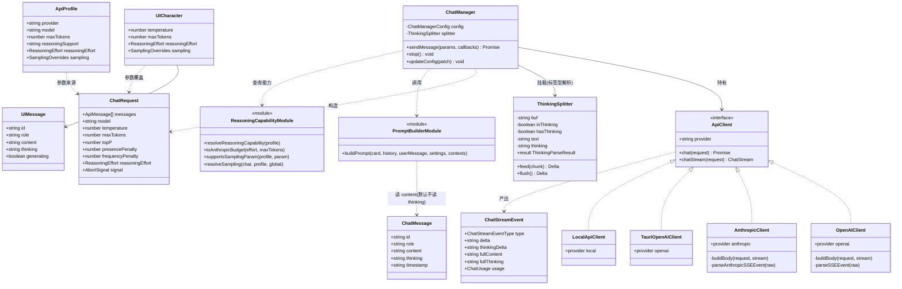
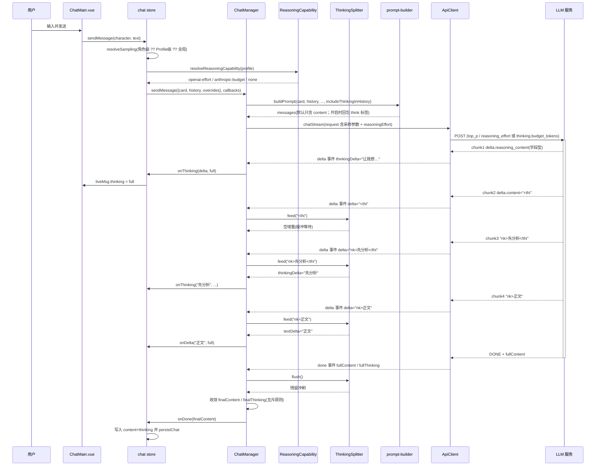
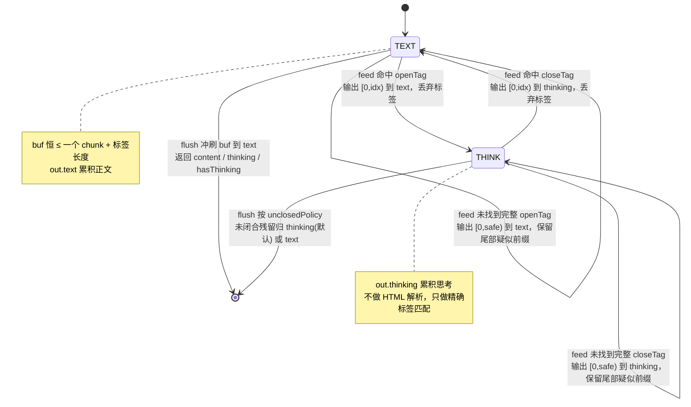
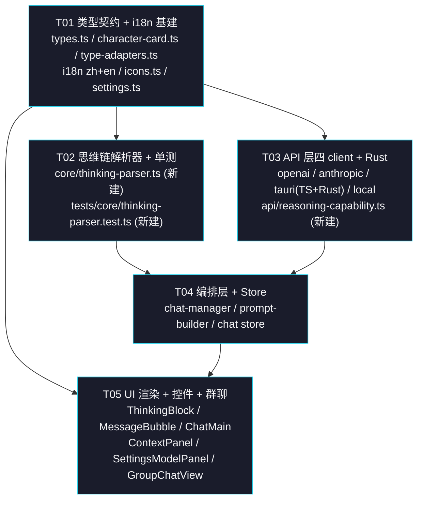

# LLM 控制能力 P0 三项 —— 增量设计 + 任务分解

> 作者：高见远（架构师） · 版本：v1.0 · 状态：待评审
> 需求来源：`docs/other/tifa-ollama-webui-分析汇总.md §5 P0`（P0-1 思维链 / P0-2 思考强度 / P0-3 采样参数）
> 原则：**增量开发、最小变更、抄交互范式不抄工程实现**

---

## 0. 现状勘察结论（读码核实，非转述）

### 0.1 对上游描述的修正与补充

| 项 | 上游描述 | 读码核实结果 |
|---|---|---|
| API 层 | 4 个 client | ✅ 确认 5 个文件：`openai-client.ts` / `anthropic-client.ts` / `local-api-client.ts` / `tauri-openai-client.ts` / `api-client.ts`（接口 + `mergeDefaultParams`），另有 `openai-protocol.ts` / `anthropic-protocol.ts` 两个协议辅助 |
| Ollama 结论不适用 | 正确 | ✅ 确认。我们是 **OpenAI Chat Completions 兼容** + **Anthropic Messages 原生** + **WebLLM 本地**，无 Ollama 原生 client。§5 的 `num_predict` / `options` 结论**整体作废**，改用 OpenAI 标准字段 |
| 思维链不存在 | `src/` grep 0 匹配 | ✅ 复核：`thinking` / `reasoning` / `reasoning_content` 在 `src/` 下**全 0 匹配**。唯一近似项是 `src/core/local-model-engine.ts` 的 `top_p`（WebLLM 采样，与思维链无关） |
| 采样参数现状 | 只有 temperature + maxTokens | ⚠️ **部分修正**：`top_p` **已存在于** `local-model-engine.ts:423` 与 `local-api-client.ts:42/90`，但 `LocalApiClient` **硬编码 `?? 0.95`，从不读 `ChatRequest`**（既有漏洞）；云端 client 侧确实完全没有 top_p |
| 群聊要覆盖 | 别漏 | ⚠️ **重要修正**：`GroupChatView.vue:351-380` 的 AI 回复**当前是 mock**（`setTimeout` + `t('group.mockReply')`）。群聊**没有真实流式对话链路**，`group-chat.ts:709` 的 `createApiClient` 只用于 LLM 生成随机 NPC。→ 群聊本轮只能做**数据结构 + 渲染组件覆盖**，无法真接思维链流式 |

### 0.2 关键代码锚点（工程师按图施工）

| 关注点 | 文件:行 | 现状 |
|---|---|---|
| 请求参数契约 | `src/api/types.ts:43-56` | `ChatRequest` 仅 `temperature?` / `maxTokens?` / `tools?` / `signal?` |
| 流式事件契约 | `src/api/types.ts:72-86` | `ChatStreamEvent` 仅 `delta` / `fullContent` / `error` / `finishReason` / `toolCalls` / `usage` |
| OpenAI body 组装 | `src/api/openai-client.ts:341-362` | 只写 `temperature` / `max_tokens` |
| OpenAI SSE 解析 | `src/api/openai-client.ts:422-521` | `parseSSEEvent` 只读 `choices[0].delta.content` |
| Anthropic body | `src/api/anthropic-client.ts:50-67` | `max_tokens` 协议必填（`DEFAULT_MAX_TOKENS = 4096`），只写 `temperature` |
| Anthropic SSE 解析 | `src/api/anthropic-client.ts:370-421` | 只处理 `text_delta` / `input_json_delta` |
| Tauri 请求体 | `src/api/tauri-openai-client.ts:139-147 / 229-239` | 只传 `temperature` / `max_tokens` |
| Tauri Rust 请求结构 | `src-tauri/src/commands/chat_stream.rs:62-83` | `ChatStreamRequest` 仅 `temperature` / `max_tokens` |
| Tauri Rust body 组装 | `src-tauri/src/commands/chat_stream.rs:227-237` | 只注入 `temperature` / `max_tokens` |
| Tauri Rust 事件 | `src-tauri/src/commands/chat_stream.rs:88-109` | `StreamEvent::Delta { delta }` 无思考字段 |
| 本地 client | `src/api/local-api-client.ts:42 / 90` | `topP` 硬编码 `?? 0.95`，忽略 `request.topP` |
| 参数合并 | `src/api/api-client.ts:42-51` | `mergeDefaultParams` 只合 `temperature` / `maxTokens` |
| 编排层请求构造 | `src/services/chat-manager.ts:189-198` | 只透传 `temperature` / `maxTokens` / `tools` |
| 编排层流消费 | `src/services/chat-manager.ts:224-259` | `delta → roundContent/fullContent → onDelta` |
| 编排层 overrides | `src/services/chat-manager.ts:50-61` | `overrides: Partial<Pick<ChatManagerConfig,'model'|'temperature'|'maxTokens'|'userName'>>` |
| 历史组装（回传入点） | `src/core/prompt-builder.ts:170-172` | `messages.push({ role: msg.role, content: msg.content })` —— **只读 content** |
| Store Profile 注入 | `src/stores/chat.ts:213-261` | `maxTokens: profile.maxTokens`，**未注入 temperature** |
| Store 发送 overrides | `src/stores/chat.ts:394-398 / 687-691` | `{ temperature: character.temperature, maxTokens: character.maxTokens }` |
| 消息类型（核心） | `src/core/character-card.ts:40-47` | `ChatMessage { id, role, content, timestamp, swipes, swipeIndex }` |
| 角色扩展字段 | `src/core/character-card.ts:59-76` | `CharacterExt { model, profileId, temperature, maxTokens, avatarType, ... }` |
| 消息类型（UI） | `src/types/index.ts:14-26` | `UIMessage { id, role, narration?, content, narrationAfter?, generating?, timestamp }` |
| 角色类型（UI） | `src/types/index.ts:74-75` | `temperature: number` / `maxTokens: number`（**必填**，有默认值） |
| Profile 类型 | `src/types/index.ts:91-107` | `ApiProfile { id,name,provider,baseUrl,apiKey,model,category,isPrimary,maxTokens? }` |
| 类型适配 | `src/services/type-adapters.ts:55-65 / 115-116 / 140-174` | `ext` 打包/解包；`uiMsgToChatMsg` / `chatMsgToUiMsg` 只搬 `content` |
| 角色级参数 UI | `src/components/layout/ContextPanel.vue:102-111 / 306-339` | temperature / maxTokens 两个 range，走 `updateCharacter` |
| 全局参数 UI | `src/components/settings/SettingsModelPanel.vue:47-48` | T-16：`maxTokens` 允许 `undefined` = 不传 = 供应商默认 |
| 气泡渲染 | `src/components/chat/MessageBubble.vue:47-50` | `{{ msg.content }}` 文本插值（**安全，无 v-html**）✅ |
| 消息列表 | `src/components/chat/ChatMain.vue:672-678` | `v-for` + `:key`，**无 `v-memo`**；`RENDER_WINDOW = 100` 双向窗口化 |
| 图标注册表 | `src/components/common/icons.ts` | **无 `brain` 类图标**（需新增，走白名单 v-html，安全） |

### 0.3 既有问题（本轮不修，但影响设计）

> **P-0：`profile.maxTokens` 实际永不生效。**
> `chat.ts:231` 把 `profile.maxTokens` 写进 `ChatManagerConfig.maxTokens`，但 `chat.ts:394/687` 的
> `overrides: { maxTokens: character.maxTokens }` 无条件覆盖它 —— 而 `UICharacter.maxTokens` 是
> **必填 number**（默认 4096）。因此 Profile 级 maxTokens 是死代码。
> → **本轮新参数不能再踩这个坑**，见 §1.3 的三档合并规则。已在 §8 列为待明确（是否顺手修）。

---

## 1. 实现方案与关键取舍

### 1.1 P0-1 思维链渲染 + 回传前剥离

#### 1.1.1 核心决策：**分字段存储**（`thinking` 与 `content` 分离）

这是整个 P0-1 的地基，一条决策同时解决三件事：

1. **回传剥离变成"天然默认"**：`prompt-builder.ts:170-172` 只读 `msg.content`，`thinking` 独立成字段后
   **不发请求体就已经剥离了**，无需任何正则 replace（对比竞品的 `innerHTML` 全量 replace，成本为零）。
2. **对已存历史零影响**：旧数据没有 `thinking` 字段 → 读取时 `undefined` → 行为完全不变。
   切换"是否回传思考"开关**不修改任何持久化数据**，只改变发请求时的**临时组装**。
3. **渲染可控**：折叠态可直接 `v-if` 不渲染思考 DOM，避免长思考撑爆 DOM 树。

#### 1.1.2 解析器的挂载位置：**编排层统一挂载，不塞进各 client**

两种来源走两条路，最终在 `chat-manager` 汇聚：

| 来源类型 | 识别方 | 载体 |
|---|---|---|
| **字段型**（OpenAI 兼容推理模型 `reasoning_content`；Anthropic `thinking_delta`） | 各 **client** 在 SSE 解析处识别 | `ChatStreamEvent.thinkingDelta` / `done.fullThinking` |
| **标签型**（`<think>…</think>`，开源/本地模型） | **编排层** `ThinkingSplitter` 增量状态机 | 对 `ChatStreamEvent.delta` 做切分 |

**为什么放编排层而不是各 client？**
- 四个 client 各包一层 → 4 处改动 + 4 份状态机生命周期管理；放编排层 **1 处挂载、4 个 client 全部受益**，
  未来新增 client（如 Ollama 原生）零成本接入。
- `chat-manager.ts:224-259` 已是唯一的流消费点，是天然挂载位。
- 非流式 `apiClient.chat()` 在编排层之外调用（如 `chat.ts:897` 随机事件），
  提供 `parseThinkingComplete(text)` 一次性 API 即可覆盖。

#### 1.1.3 `done` 事件的收敛规则（关键，防 `fullContent` 回冲）

现状 `chat-manager.ts:247`：`if (ev.fullContent) fullContent = ev.fullContent;`
而流的 `fullContent` 是**含 `<think>` 标签的原始串**，会覆盖掉已剥离的正文。收敛规则：

```
done 时：
  const parsed = parseThinkingComplete(ev.fullContent ?? roundContent)
  // 互斥原则：字段型优先，标签型兜底（同一轮不会同时出现两种来源）
  if (thinkingBuf !== '') {            // 字段型
    finalThinking = ev.fullThinking ?? thinkingBuf
    finalContent  = ev.fullContent ?? roundContent
  } else {                             // 标签型
    finalThinking = parsed.thinking
    finalContent  = parsed.content || roundContent
  }
```

- 字段型：`fullContent` 本身不含思考 → 直接用，不做二次解析。
- 标签型：对 `fullContent` 跑一次**完整解析**（幂等，与流式累积一致，见 §3.4）。
- 两者都空 → 走现有兜底 `roundContent`。

#### 1.1.4 渲染：**折叠态不渲染思考 DOM** + `v-memo`

- 折叠态只有"标题行 + chevron"，思考正文 `v-if="expanded"` —— **不进 DOM**。
  （竞品每 chunk 全量重建；我们折叠时零 DOM、展开时仅单条 patch。）
- `ChatMain.vue` 的 `MessageBubble` 加
  `v-memo="[msg.content, msg.thinking, msg.generating, msg.narration, msg.narrationAfter]"`：
  历史消息的这些值不变 → **Vue 直接跳过 patch**；仅最后一条（流式写入中）参与更新。
- 展开态记忆放**组件内 `Set<string>`**（不污染 `UIMessage` 数据结构），组件卸载即失效，无持久化成本。
- 生成中未展开时，折叠标题行显示"思考中…" + 脉冲点（复用既有 `.gen-dot` 视觉语言）。

#### 1.1.5 回传剥离开关

- 落点：**全局 settings**（`AppSettings.thinkingConfig`），不落角色级。
  语义是"我是否愿意为上下文连贯多付 token"，是用户偏好而非角色人设。
- 实现：`PromptSettings.includeThinkingInHistory`，`prompt-builder.ts:170-172` 组装历史时
  按需把 `thinking` 以 `<think>…</think>` 前缀回包进 `content`。**只在内存组装，不落盘**。

#### 1.1.6 放弃的东西

- ❌ 放弃"思考时长 / 思考 token 数"展示（需额外计时与 usage 拆解，P1 再说）。
- ❌ 放弃把思考存进 `swipes`（UI 层 `swipes` 恒为 `[]`，重新生成直接清空 `thinking` 即可）。
- ❌ 放弃 Markdown 渲染思考内容（现状正文就是纯文本插值，保持一致，也规避 CSP 风险）。

---

### 1.2 P0-2 思考强度三档

#### 1.2.1 统一抽象

对外只有一个概念：`ReasoningEffort = 'low' | 'medium' | 'high'`。
对内由 `resolveReasoningCapability(profile)` 翻译成三种能力之一：

| capability | 目标后端 | 实际下发 |
|---|---|---|
| `'openai-effort'` | OpenAI 兼容推理模型 | `reasoning_effort: 'low' \| 'medium' \| 'high'` |
| `'anthropic-budget'` | Anthropic Messages | `thinking: { type:'enabled', budget_tokens: N }`，N = 1024 / 4096 / 16384 |
| `'none'` | 其余（含 local） | **不下发任何字段** |

#### 1.2.2 降级策略：三层递进，**不暴露无效开关**

```
第 1 层（硬边界）：provider === 'local' → 'none'
        WebLLM 无对应参数，控件整个不渲染（不是禁用，是隐藏）
第 2 层（用户显式）：profile.reasoningSupport === 'on' | 'off' → 直接采信
第 3 层（启发式 auto）：模型名命中 REASONING_MODEL_RE → 支持；否则不支持
        REASONING_MODEL_RE = /(^o\d|gpt-5|deepseek-r1|qwq|qwen3|glm-4\.5|-reasoner|thinking)/i
```

- capability === `'none'` → UI **隐藏**三档控件（满足"不为统一而暴露无效开关"）。
- Profile 编辑表单提供 `reasoningSupport` 的 `自动 / 支持 / 不支持` 三态，纠正启发式误判。
- 若 capability 为 `'none'` 但数据里硬设了 `reasoningEffort` → **静默丢弃**（不报错、不打断对话）。

#### 1.2.3 协议冲突的优雅降级（Anthropic）

Anthropic 启用 extended thinking 时与 `temperature` / `top_p` **冲突**（协议不接受）。
处理：在 `anthropic-client.ts:buildBody` 内 —— 命中 `anthropic-budget` 时**主动抑制**
`temperature` / `top_p` 写入 body，并加注释说明原因。
**用户可见的滑块值不变**（只是本轮不生效），避免"改了滑块没反应"的困惑。

> ⚠️ 该约束来自 Anthropic 官方 extended thinking 文档。**实现时请对照最新官方文档二次确认**，见 §8-待明确 2。

Anthropic `budget_tokens` 还必须 **< `max_tokens`**。`buildBody` 内做 clamp：
`budget = min(BUDGET[effort], max(1, (maxTokens ?? DEFAULT_MAX_TOKENS) - 1))`；
若 clamp 后 `< 256` 则**放弃启用 thinking**（降级为不传）+ 注释，避免协议 400 打断对话。

#### 1.2.4 作用域

**Profile 级（默认）+ 角色级覆盖**，与既有 `maxTokens` 的作用域层次保持一致。
角色级 `reasoningEffort` 为 `undefined` / `null` 时跟随 Profile。

---

### 1.3 P0-3 采样参数补齐

#### 1.3.1 补哪几个

| 参数 | OpenAI 字段 | Anthropic 字段 | 本地 WebLLM | 本轮 |
|---|---|---|---|---|
| `top_p` | `top_p` ✅ | `top_p` ✅ | `top_p` ✅（已有） | **P0，必做** |
| `presence_penalty` | ✅ | ❌ 不支持 | ❌ | **P0，带降级** |
| `frequency_penalty` | ✅ | ❌ 不支持 | ❌ | **P0，带降级** |

> 竞品汇总里的 `repeat_penalty` 是 **Ollama** 键名，OpenAI 兼容层**不存在** —— 不采用。
> 加上既有的 temperature / maxTokens，共 5 个，覆盖 OpenAI 兼容层的完整常用集。

#### 1.3.2 语义约定：`undefined` / `null` = 不传 = 供应商默认

**严格沿用 `SettingsModelPanel.vue:47-48` 的 T-16 既有约定**（maxTokens 允许为空 = 不传）。
新参数完全一致：`undefined | null` → client **不写进 body** → 供应商用自己的默认值。
**绝不填 0**：`top_p = 0` 是"只取概率最高的 token"，与"不传"语义完全不同（常见事故点，已写入 §7）。

#### 1.3.3 三档合并规则（绕开 §0.3 的既有坑）

```
effective(param) = 角色级显式值 ?? Profile 级值 ?? 全局默认值 ?? undefined(不传)
```

- 角色级：**可选**（`undefined` = 跟随）。这是与既有 `temperature` / `maxTokens`（必填）的关键差异 ——
  正因为必填才导致了 §0.3 的死代码问题。
- Profile 级：可选。
- 全局默认：`settings.samplingDefaults`（本轮**不新增 UI**，只留数据位 + 合并逻辑，避免 UI 膨胀）。

#### 1.3.4 降级：不支持的后端

Anthropic / local 不支持 `presence_penalty` / `frequency_penalty` →
**client 内静默丢弃**（不写 body）。UI 侧：
- 当前生效 Profile 的 provider 为 `anthropic` / `local` → 这两个控件**隐藏**（不是禁用）。
- 判定复用 `supportsSamplingParam(profile, param)`，与 §1.2.2 同构。

---

### 1.4 渲染架构（防退化）

| 竞品的做法（❌ 不抄） | 我们的做法 |
|---|---|
| 每 chunk `innerHTML = ''` 全量重建 + marked 全量重解析 | Vue 响应式 + `v-memo`，历史消息零 patch |
| 27 处 `innerHTML` 渲染模型输出 | 文本插值 `{{ }}`；新增 `brain` 图标走 `icons.ts` 白名单 v-html（**静态常量，非模型输出**） |
| 每 chunk 全文档重排 | 折叠态不渲染思考 DOM；既有 `RENDER_WINDOW = 100` 窗口化不动 |

**新增 CSS 只用既有语义 token**（`--muted-foreground` / `--border` / `--card-elevated` / `--radius-*` / `--spacing-*`），
**不引入任何新色值** → 对比度门禁零风险（静态核验的 5 主题关键色对不受影响）。

---

## 2. 数据结构与接口定义

### 2.1 API 层（`src/api/types.ts`）

```ts
/** P0-2 思考强度（对外统一概念） */
export type ReasoningEffort = 'low' | 'medium' | 'high';

/** P0-3 采样参数集合（持久化层的收纳容器，见 §2.4） */
export interface SamplingParams {
  /** 0-2；undefined/null = 不传 = 供应商默认 */
  temperature?: number | null;
  /** undefined/null = 不传 = 供应商默认（沿用 T-16） */
  maxTokens?: number | null;
  /** 0-1；undefined/null = 不传 */
  topP?: number | null;
  /** -2 ~ 2；undefined/null = 不传 */
  presencePenalty?: number | null;
  /** -2 ~ 2；undefined/null = 不传 */
  frequencyPenalty?: number | null;
}

/** 聊天请求（沿用既有平铺风格，新增字段全部可选 → 向后兼容） */
export interface ChatRequest {
  messages: ApiMessage[];
  model: string;
  temperature?: number;
  maxTokens?: number;
  /** P0-3 */
  topP?: number;
  /** P0-3（OpenAI 兼容层专有；Anthropic / local 静默丢弃） */
  presencePenalty?: number;
  /** P0-3（同上） */
  frequencyPenalty?: number;
  /** P0-2：命中 capability 才下发 */
  reasoningEffort?: ReasoningEffort;
  tools?: ToolDefinition[];
  signal?: AbortSignal;
}

/** 流式事件（新增思考通道） */
export interface ChatStreamEvent {
  type: ChatStreamEventType;
  /** type=delta：正文增量（标签型思考已被编排层剥离，此处恒为正文） */
  delta?: string;
  /** type=delta：思考增量（字段型来源由 client 产出；标签型此字段为空） */
  thinkingDelta?: string;
  /** type=done：完整正文 */
  fullContent?: string;
  /** type=done：完整思考（字段型由 client 提供；标签型由编排层解析补齐） */
  fullThinking?: string;
  error?: string;
  finishReason?: string;
  toolCalls?: ToolCall[];
  usage?: ChatUsage;
}

/** 用量统计（新增推理 token 拆解） */
export interface ChatUsage {
  promptTokens?: number;
  completionTokens?: number;
  totalTokens?: number;
  promptCacheHitTokens?: number;
  promptCacheMissTokens?: number;
  /** OpenAI completion_tokens_details.reasoning_tokens；Anthropic 无此字段 */
  reasoningTokens?: number;
}
```

### 2.2 思维链解析器（`src/core/thinking-parser.ts` —— 新建）

```ts
export interface ThinkingParseResult {
  /** 正文（已剥离思考标签） */
  content: string;
  /** 思考内容（已剥离外层标签） */
  thinking: string;
  /** 是否检测到思考块（注意：标签存在但内容为空串时仍为 true） */
  hasThinking: boolean;
}

export interface ThinkingSplitterOptions {
  /** 开标签，默认 '<think>' */
  openTag?: string;
  /** 闭标签，默认 '</think>' */
  closeTag?: string;
  /** 流结束时仍处于思考态（未闭合）的残留归属，默认 'thinking' */
  unclosedPolicy?: 'thinking' | 'text';
  /** 多组思考块之间的拼接符，默认 '' */
  joinThinkingWith?: string;
}

export class ThinkingSplitter {
  constructor(options?: ThinkingSplitterOptions);

  /** 喂入一个流式 chunk，返回本次可安全输出的增量 */
  feed(chunk: string): { textDelta: string; thinkingDelta: string };

  /** 流结束 / 中止时冲刷内部缓冲，返回残留增量 */
  flush(): { textDelta: string; thinkingDelta: string };

  /** 当前是否处于思考态（供 UI 显示"思考中"指示器） */
  readonly inThinking: boolean;
  /** 是否已检测到过思考块 */
  readonly hasThinking: boolean;
  /** 累计结果快照（非破坏性） */
  readonly result: Readonly<ThinkingParseResult>;
}

/** 一次性解析（非流式场景：apiClient.chat() 返回值、历史消息再解析） */
export function parseThinkingComplete(
  text: string,
  options?: ThinkingSplitterOptions
): ThinkingParseResult;
```

### 2.3 编排层（`src/services/chat-manager.ts`）

```ts
export interface ChatManagerConfig {
  apiClient: ApiClient;
  model: string;
  userName?: string;
  systemPrompt?: string;
  maxContextTokens?: number;
  reservedTokens?: number;
  temperature?: number;
  maxTokens?: number;
  /** P0-3 新增 */
  topP?: number;
  presencePenalty?: number;
  frequencyPenalty?: number;
  /** P0-2 新增（运行时由 capability 决定是否真正下发） */
  reasoningEffort?: ReasoningEffort;
  /** P0-1 新增：历史中的思考是否随请求回传（默认 false = 剥离） */
  includeThinkingInHistory?: boolean;
  tools?: ToolDefinition[];
  executeTool?: (call: ToolCall) => Promise<string>;
  optimization?: OptimizationPipeline;
  l0l2?: L0L2Deps;
  sessionId?: string;
}

export interface SendMessageParams {
  card: CharacterCard;
  history: ChatMessage[];
  userMessage: string;
  /** 扩展为可覆盖全部采样参数 + 思考强度 */
  overrides?: Partial<
    Pick<
      ChatManagerConfig,
      | 'model' | 'userName'
      | 'temperature' | 'maxTokens'
      | 'topP' | 'presencePenalty' | 'frequencyPenalty'
      | 'reasoningEffort'
    >
  >;
  contexts?: PromptContexts;
}

export interface ChatManagerCallbacks {
  onDelta?: (delta: string, fullContent: string) => void;
  /** P0-1 新增：思考增量（fullThinking 为累计值） */
  onThinking?: (delta: string, fullThinking: string) => void;
  onDone?: (fullContent: string, finishReason?: string) => void;
  onUsage?: (usage: ChatUsage) => void;
  onError?: (error: Error) => void;
  onPromptBuilt?: (info: { tokenCount: number; trimmed: boolean; messageCount: number }) => void;
  onEmotionUpdated?: (label: string, sessionId: string) => void;
}
```

### 2.4 持久化层

```ts
// ── src/core/character-card.ts ──
export interface ChatMessage {
  id: string;
  role: 'system' | 'user' | 'assistant';
  content: string;
  timestamp: string;
  swipes: string[];
  swipeIndex: number;
  /** P0-1：模型思维链。与 content 分离；默认不参与回传。旧数据无此字段 → 行为不变 */
  thinking?: string;
}

export interface CharacterExt {
  model?: string;
  profileId?: string | null;
  temperature?: number;
  maxTokens?: number;
  /** P0-2：角色级思考强度覆盖；undefined/null = 跟随 Profile */
  reasoningEffort?: ReasoningEffort | null;
  /** P0-3：角色级采样参数覆盖（收纳为对象，避免持久化 schema 继续膨胀） */
  sampling?: SamplingOverrides | null;
  avatarType?: 'image' | 'gradient';
  gradientFrom?: string;
  gradientTo?: string;
  storyId?: string | null;
  boundWorldBookIds?: string[];
}

// ── src/types/index.ts ──
/** P0-3：新增采样参数（不含已平铺的 temperature / maxTokens） */
export interface SamplingOverrides {
  topP?: number | null;
  presencePenalty?: number | null;
  frequencyPenalty?: number | null;
}

export interface UIMessage {
  id: string;
  role: 'user' | 'assistant';
  narration?: string;
  content: string;
  narrationAfter?: string;
  /** P0-1：思维链（流式写入；折叠渲染） */
  thinking?: string;
  generating?: boolean;
  timestamp: number;
}

export interface UICharacter {
  /* ...既有字段不变... */
  temperature: number;   // 不变（必填，维持现状）
  maxTokens: number;     // 不变（必填，维持现状）
  /** P0-2：undefined/null = 跟随 Profile */
  reasoningEffort?: ReasoningEffort | null;
  /** P0-3 */
  sampling?: SamplingOverrides | null;
}

export interface ApiProfile {
  /* ...既有字段不变... */
  maxTokens?: number;
  /** P0-2：该模型是否支持推理强度。'auto'(默认) = 按模型名启发式；'on'/'off' = 用户强制 */
  reasoningSupport?: 'auto' | 'on' | 'off';
  /** P0-2：Profile 级默认思考强度 */
  reasoningEffort?: ReasoningEffort | null;
  /** P0-3：Profile 级采样参数 */
  sampling?: SamplingOverrides | null;
}

/** P0-1：思维链全局偏好 */
export interface ThinkingConfig {
  /** 发请求时是否剥离历史 assistant 的思考（默认 true = 剥离，省 token） */
  stripFromHistory: boolean;
  /** 新消息思考块默认折叠（默认 true） */
  defaultCollapsed: boolean;
}

export interface AppSettings {
  /* ...既有字段不变... */
  /** P0-1 */
  thinkingConfig?: ThinkingConfig;
  /** P0-3：全局采样默认值（本轮不提供 UI，仅留数据位与合并逻辑） */
  samplingDefaults?: SamplingOverrides | null;
}
```

### 2.5 能力判定（`src/api/reasoning-capability.ts` —— 新建）

```ts
export type ReasoningCapability = 'none' | 'openai-effort' | 'anthropic-budget';

/** P0-2：判定某 Profile 的思考强度下发方式 */
export function resolveReasoningCapability(profile: ApiProfile): ReasoningCapability;

/** P0-2：effort → Anthropic budget_tokens（已按 maxTokens 做 clamp；不可用时返回 null） */
export function toAnthropicBudget(
  effort: ReasoningEffort,
  maxTokens: number | undefined
): number | null;

/** P0-3：判定某采样参数在该 Profile 上是否可下发 */
export function supportsSamplingParam(
  profile: ApiProfile,
  param: 'topP' | 'presencePenalty' | 'frequencyPenalty'
): boolean;

/** P0-3：三档合并 角色级 ?? Profile 级 ?? 全局默认 ?? undefined */
export function resolveSampling(
  characterSampling: SamplingOverrides | null | undefined,
  profileSampling: SamplingOverrides | null | undefined,
  globalDefaults: SamplingOverrides | null | undefined
): Required<{ [K in keyof SamplingOverrides]: number | undefined }>;
```

### 2.6 类图



### 2.7 时序图（P0-1 流式思维链 + P0-2/3 参数下发）



---

## 3. 思维链解析器：状态机设计

### 3.1 状态图



### 3.2 核心算法（防跨 chunk 撕裂）

```
feed(chunk):
  buf += chunk
  loop:
    tag = (state == TEXT) ? openTag : closeTag
    idx = buf.indexOf(tag)
    if idx < 0:
        # 无完整标签，但 buf 尾部可能是标签的一半 → 只输出"安全前缀"
        keep = longestSuffixPrefixLen(buf, tag)  # buf 的最长后缀 s，使 s 是 tag 的真前缀
        safe = buf.length - keep
        emit(buf[0:safe]); buf = buf[safe:]
        return                                   # 等待下一个 chunk
    emit(buf[0:idx]); buf = buf.slice(idx + tag.length)
    state = (state == TEXT) ? THINK : TEXT
    if state == THINK: hasThinking = true
    continue                                     # 一个 chunk 内可能含多组标签
```

**复杂度**：`indexOf` 线性，缓冲长度恒 ≤ 一个 chunk + 标签长度 → 整体 O(N)，**无全量重扫**。

### 3.3 流式边界用例（必须全部落单测）

| # | 用例 | 输入（按 chunk 顺序） | 期望 `content` | 期望 `thinking` | `hasThinking` |
|---|---|---|---|---|---|
| 1 | 标签跨 chunk 撕裂 | `'<thi'` `'nk>我在思考'` `'</thi'` `'nk>答案'` | `'答案'` | `'我在思考'` | true |
| 2 | 一 chunk 多组标签 | `'<think>A</think>1<thin'` `'k>B</think>2'` | `'12'` | `'AB'`（拼接符默认 `''`） | true |
| 3 | 未闭合（流结束/中止） | `'<think>想了一半'` + `flush()` | `''` | `'想了一半'` | true |
| 4 | 未闭合 + `unclosedPolicy:'text'` | 同上，策略改 text | `'想了一半'`（开标签已消费，不回吐） | `''` | true |
| 5 | 空思考 | `'<think></think>正文'` | `'正文'` | `''` | **true**（UI 侧 `thinking.trim() !== ''` 才渲染） |
| 6 | 思考内含代码块/尖括号 | ``'<think>```js\nif (a<b) {}\n```</think>OK'`` | `'OK'` | ```` ```js\nif (a<b) {}\n``` ```` | true |
| 7 | 首 chunk 即开标签 | `'<think>x'` `'y'` `'</think>z'` | `'z'` | `'xy'` | true |
| 8 | 无思考（纯正文） | `'你好'` `'世界'` | `'你好世界'` | `''` | false |
| 9 | 正文含字面 `<think` 但非标签 | `'a <thinker b'` + `flush()` | `'a <thinker b'` | `''` | false |
| 10 | 空 chunk / 空串 | `''` `'a'` `''` | `'a'` | `''` | false |
| 11 | UTF-8 多字节跨 chunk | `'<think>中'` `'文</think>尾'` | `'尾'` | `'中文'` | true |
| 12 | 中止（abort）时 flush | `'<think>未完'` + abort | `''` | `'未完'` | true |
| 13 | 嵌套 `<think>` | `'<think>a<thin'` `'k>b</think>c'` | `'c'` | `'a<think>b'`（**不嵌套**，内层按文本处理） | true |
| 14 | 大小写变体 `<THINK>` | `'<THINK>x</THINK>y'` | `'<THINK>x</THINK>y'` | `''` | false（**默认只认小写**） |

> 用例 4 说明：`unclosedPolicy='text'` 时，`<think>` 开标签**已被消费丢弃**（不回吐到正文），
> 残留的"未闭合思考文本"改归正文。这是一个"兜底逃生"策略，用于模型输出畸形（只开了头没闭合）时
> 至少让内容可见。**本轮默认 `unclosedPolicy='thinking'` 上线**，用例 4 仅作为可配置性验证。

### 3.4 一次性解析与流式解析的一致性（可测不变量）

`parseThinkingComplete(text)` = `new ThinkingSplitter().feed(text)` + `flush()`。
因此 §1.1.3 中对 `ev.fullContent` 的二次解析**与流式累积结果幂等**：

```ts
// 不变量（任意字符串 s + 任意切分方式）
const oneShot = parseThinkingComplete(s);
const sp = new ThinkingSplitter();
for (const c of arbitraryChunks(s)) sp.feed(c);
sp.flush();
expect(sp.result.content).toBe(oneShot.content);
expect(sp.result.thinking).toBe(oneShot.thinking);
```

---

## 4. 四个 client 的能力矩阵与降级策略

### 4.1 能力矩阵

| 能力 | `OpenAIClient`<br/>(Web fetch) | `AnthropicClient`<br/>(Web fetch) | `TauriOpenAIClient`<br/>(Rust reqwest) | `LocalApiClient`<br/>(WebLLM) |
|---|---|---|---|---|
| 协议 | OpenAI Chat Completions | Anthropic Messages | OpenAI Chat Completions | WebLLM engine |
| `temperature` | ✅ `temperature` | ✅ `temperature` | ✅ `temperature` | ✅ 已有 |
| `max_tokens` | ✅ 可选 | ⚠️ **必填**（默认 4096） | ✅ 可选 | ✅ 已有 |
| **P0-3 `top_p`** | ✅ `top_p` | ✅ `top_p` | ✅ **需改 Rust** | ✅ 已有，**但需改为读 request** |
| **P0-3 `presence_penalty`** | ✅ | ❌ 无此字段 | ✅ **需改 Rust** | ❌ |
| **P0-3 `frequency_penalty`** | ✅ | ❌ 无此字段 | ✅ **需改 Rust** | ❌ |
| **P0-2 思考强度** | ✅ `reasoning_effort` | ✅ `thinking:{type,budget_tokens}` | ✅ **需改 Rust** | ❌ **不支持** |
| **P0-1 思考（字段型）** | ✅ `delta.reasoning_content`<br/>（部分网关用 `delta.reasoning`）—— 待确认 | ✅ `content_block_start{type:'thinking'}`<br/>+ `thinking_delta` / `signature_delta` | ✅ **需改 Rust**（`StreamEvent::Delta` 加字段） | ❌ 无（只能走标签型） |
| **P0-1 思考（标签型）** | ✅ 由编排层 `ThinkingSplitter` 统一处理 | ✅ 同左 | ✅ 同左 | ✅ 同左 |

### 4.2 各 client 的具体改动点

#### 4.2.1 `src/api/openai-client.ts`
- `buildBody`（341-362）：追加 `top_p` / `presence_penalty` / `frequency_penalty` / `reasoning_effort`，
  全部 `!== undefined && !== null` 才写。
- `parseSSEEvent`（422-521）：`SSEParsed` 增加 `reasoning?: string`，
  读取 `choice.delta.reasoning_content`（**备用** `choice.delta.reasoning`，两者取先出现的非空值）。
- `chatStream`（161-164）：`event.reasoning` 非空时 yield `{ type:'delta', thinkingDelta: r }`；
  同时累积 `fullThinking`，在 `done` 事件带出。
- `SSEParsed.usage`（401-408）：增加 `completion_tokens_details.reasoning_tokens` → `ChatUsage.reasoningTokens`。

#### 4.2.2 `src/api/anthropic-client.ts`
- `buildBody`（50-67）：
  - 追加 `top_p`（`request.topP`）。
  - `reasoningEffort` 命中 `anthropic-budget` 时写
    `thinking: { type:'enabled', budget_tokens: N }`（`toAnthropicBudget` clamp），
    **并抑制 `temperature` / `top_p`**（协议冲突，加注释）。
  - `presence_penalty` / `frequency_penalty` **静默忽略**（加注释）。
- `parseAnthropicSSEEvent`（370-421）：
  - `content_block_start` 增加 `content_block.type === 'thinking'` 分支 → `{ kind:'thinkingStart' }`。
  - `content_block_delta` 增加 `delta.type === 'thinking_delta'` → `{ kind:'thinkingDelta', text }`。
  - `delta.type === 'signature_delta'` → **忽略**（signature 不展示；若未来要支持工具调用回传再接）。
- `chatStream`（185-211）：聚合 `fullThinking`，`done` 事件带出。

#### 4.2.3 `src/api/tauri-openai-client.ts` + `src-tauri/src/commands/chat_stream.rs`
- TS 侧 `invoke('chat_stream', { request: {...} })`（139-147 / 229-239）：
  追加 `top_p` / `presence_penalty` / `frequency_penalty` / `reasoning_effort`。
- TS 侧 `StreamEventPayload`（344-359）：追加 `thinking?: string`；`chatStream` 消费时
  yield `{ type:'delta', thinkingDelta }`；`done` 时带 `full_thinking` → `fullThinking`。
- Rust 侧 `ChatStreamRequest`（62-83）：追加
  `top_p: Option<f32>` / `presence_penalty: Option<f32>` / `frequency_penalty: Option<f32>` /
  `reasoning_effort: Option<String>`（均 `#[serde(default)]`）。
- Rust 侧 body 组装（227-237）：逐个 `if let Some(v)` 注入对应 JSON 键。
- Rust 侧 `StreamEvent::Delta`（88-109）：改为 `Delta { delta: String, thinking: Option<String> }`
  （`#[serde(skip_serializing_if = "Option::is_none")]`），同步改所有构造点。
- Rust 侧流式解析：从 `choices[0].delta` 读 `content` 与 `reasoning_content`。

> ⚠️ Rust 改动会让 `tauri-build` CI job 编译验证；字段全 `Option` + `#[serde(default)]`，向后兼容。

#### 4.2.4 `src/api/local-api-client.ts`
- `chat`（38-53）与 `chatStream`（77-97）：
  `topP: request.topP ?? store.settings?.defaultTopP ?? 0.95` —— **改为优先读 request**（修既有漏洞）。
- `reasoningEffort` / `presencePenalty` / `frequencyPenalty`：**静默忽略**（WebLLM 无对应参数），加注释。
- 标签型思考由编排层统一解析，本地模型（如 Qwen3）输出 `<think>` 即可自动生效。

#### 4.2.5 `src/api/api-client.ts`
- `mergeDefaultParams`（42-51）：defaults 类型扩展为 `SamplingParams`，
  逐字段 `??` 合并（含新增 3 个参数 + `reasoningEffort` 不参与合并，由 capability 决定）。

### 4.3 降级策略总表（"不暴露无效开关"）

| 场景 | UI 表现 | 请求体 |
|---|---|---|
| provider = `local` | 思考强度控件**隐藏**；presence/frequency 控件**隐藏** | 均不下发 |
| provider = `anthropic`，`reasoningSupport` 生效 | 三档**显示**（low/medium/high） | `thinking.budget_tokens`（并抑制 temperature/top_p） |
| provider = `anthropic` | presence/frequency 控件**隐藏** | 不下发 |
| provider = openai/custom/deepseek，模型名命中 | 三档**显示** | `reasoning_effort` |
| provider = openai/custom/deepseek，模型名未命中 | 三档**隐藏** | 不下发 |
| 用户在 Profile 里设 `reasoningSupport:'on'` | 强制**显示** | 强制下发 |
| 用户在 Profile 里设 `reasoningSupport:'off'` | 强制**隐藏** | 强制不下发 |
| 数据里有 `reasoningEffort` 但 capability = `none` | 控件隐藏 | **静默丢弃**，不报错 |

---

## 5. 任务列表（按依赖顺序，5 个）

> 通用验收：`npm run lint` / `i18n:check:strict` / `check:css-conventions` / `a11y:contrast` /
> `test:coverage`(78/73/78/78) / `build` / `check:csp` 全绿；**覆盖率不得下降**。

### T01 — 类型契约与 i18n 基建（P0，无依赖）

**涉及文件**
- `src/api/types.ts`（`ReasoningEffort` / `SamplingParams` / `ChatRequest` 新增字段 / `ChatStreamEvent` 思考通道 / `ChatUsage.reasoningTokens`）
- `src/types/index.ts`（`SamplingOverrides` / `ThinkingConfig` / `UIMessage.thinking` / `UICharacter.reasoningEffort`+`sampling` / `ApiProfile` 三字段 / `AppSettings.thinkingConfig`+`samplingDefaults`）
- `src/core/character-card.ts`（`ChatMessage.thinking?` / `CharacterExt.reasoningEffort`+`sampling`）
- `src/services/type-adapters.ts`（`uiCharToCard.ext` 打包、`cardToUiChar` 解包带 legacy 回退、`uiMsgToChatMsg` / `chatMsgToUiMsg` 搬 `thinking`）
- `src/i18n/locales/zh.ts`、`src/i18n/locales/en.ts`（新增 key，**两侧必须同 key**）
- `src/components/common/icons.ts`（新增 `brain` 图标，走既有白名单 PATHS）
- `src/stores/settings.ts`（`thinkingConfig` / `samplingDefaults` 的默认值与持久化读写）

**验收点**
1. `npx vue-tsc --noEmit` 通过（新增类型无循环依赖）。
2. `npm run i18n:check:strict` 通过（无硬编码中文）。
3. `tests/i18n.test.ts` 通过（zh/en key 集合一致）。
4. `tests/services/type-adapters.test.ts` 新增 round-trip 用例：
   `UICharacter(含 thinking/sampling/reasoningEffort) → CharacterCard → UICharacter` 无损；
   `ChatMessage.thinking` 经 `uiMsgToChatMsg` / `chatMsgToUiMsg` 双向保留；
   **旧数据（无新字段）解包后行为不变**。

---

### T02 — 思维链解析器 + 单测（P0，依赖 T01）

**涉及文件**
- `src/core/thinking-parser.ts`（**新建**：`ThinkingSplitter` / `parseThinkingComplete` / `ThinkingParseResult`）
- `tests/core/thinking-parser.test.ts`（**新建**）

**验收点**
1. §3.3 的 **14 个边界用例**全部通过（含跨 chunk 撕裂、未闭合、空思考、代码块、UTF-8 撕裂、嵌套、大小写）。
2. §3.4 的**流式/一次性幂等不变量**用例通过（对随机切分做 property-style 验证，≥20 组随机切分）。
3. 性能用例：10 万字符输入单次解析 < 100ms（证明无 O(N²) 重扫）。
4. 该模块为纯函数、零依赖（`import { t }` 都不需要）→ 单测覆盖率高，直接拉高整体覆盖率。
5. `src/core/sanitize.ts` **不改**（思考内容走文本插值，不进 DOMPurify 管线）。

---

### T03 — API 层：采样参数 + 思考强度 + 思考字段解析（P0，依赖 T01）

**涉及文件**
- `src/api/openai-client.ts`
- `src/api/anthropic-client.ts`
- `src/api/tauri-openai-client.ts`
- `src-tauri/src/commands/chat_stream.rs`（仓库根目录下的 `src-tauri/`，非 `src/` 内）
- `src/api/local-api-client.ts`
- `src/api/api-client.ts`（`mergeDefaultParams`）
- `src/api/reasoning-capability.ts`（**新建**）
- `tests/api/openai-client.test.ts`、`tests/api/anthropic-client.test.ts`、
  `tests/api/tauri-openai-client.test.ts`、`tests/api/local-api-client.test.ts`（扩充）
- `tests/api/reasoning-capability.test.ts`（**新建**）

**验收点**
1. 单测覆盖每个 client 的 body 组装：参数**未设置时不出现在 body 里**（断言 `body.top_p === undefined`）。
2. `local-api-client` 单测：`request.topP` 有值时**优先于**硬编码 0.95。
3. `reasoning-capability` 单测：
   - `local` → `'none'`；
   - `anthropic` + `reasoningSupport:'on'` → `'anthropic-budget'`；
   - `openai` + 模型 `deepseek-r1` → `'openai-effort'`；
   - `openai` + 模型 `gpt-4o` + auto → `'none'`；
   - `toAnthropicBudget('high', 2048)` → clamp 到 2047；
   - `toAnthropicBudget('low', 128)` → `null`（放弃启用）。
4. Anthropic 单测：启用 thinking 的 body **不含** `temperature` / `top_p`（协议冲突抑制）。
5. OpenAI 单测：`reasoning_content` chunk → yield `thinkingDelta`；`done.fullThinking` 正确带出。
6. `cargo check`（或 `npm run tauri:build -- --no-bundle` 由 CI 验证）通过。

---

### T04 — 编排层与 Store：挂载解析器 / 回传剥离 / 参数合并（P0，依赖 T01、T02、T03）

**涉及文件**
- `src/services/chat-manager.ts`（`ChatManagerConfig` / `SendMessageParams.overrides` / `callbacks.onThinking` / 流消费处挂载 `ThinkingSplitter` / §1.1.3 收敛规则）
- `src/core/prompt-builder.ts`（`PromptSettings.includeThinkingInHistory`；历史组装处按需回包 `<think>`）
- `src/stores/chat.ts`（`onThinking` → `liveMsg.thinking`；`overrides` 传新参数；`regenerateMessage` 清空 `thinking`；`applyApiProfile` 注入 Profile 级采样参数）
- `src/stores/settings.ts`（`thinkingConfig` 读取，传给 `PromptSettings`）
- `tests/services/chat-manager.test.ts`（扩充）
- `tests/core/prompt-builder.test.ts`（扩充）
- `tests/stores/chat.test.ts`（扩充）

**验收点**
1. `chat-manager` 单测：
   - 标签型流：mock client 吐 `'<thi'` `'nk>A</thi'` `'nk>B'` → `onThinking` 收到 `'A'`，`onDelta` 只收到 `'B'`；
   - 字段型流：mock client 吐 `thinkingDelta` → `onThinking` 收到，`onDelta` 不受影响；
   - `done` 的 `fullContent` 含 `<think>` 时，**最终 `onDone` 的 content 已剥离**（§1.1.3 收敛）；
   - `includeThinkingInHistory` 只影响发请求的 messages，**不改变传入的 history 对象**（无副作用）。
2. `prompt-builder` 单测：`includeThinkingInHistory=true` 且 `msg.thinking` 存在 →
   组装出的 content 以 `<think>…` 开头；`=false`（默认）→ content 与 `msg.content` **逐字节相等**。
3. `chat` store 单测：重新生成时 `thinking` 被清空；`persistChat` 后 `Chat.thinking` 落盘可读回。
4. 现有 `tests/services/chat-manager.test.ts` / `tests/stores/chat.test.ts` **全部仍通过**（回归防线）。

---

### T05 — UI：思维链渲染 + 三档控件 + 采样参数控件 + 群聊覆盖（P0，依赖 T01、T04）

**涉及文件**
- `src/components/chat/ThinkingBlock.vue`（**新建**：折叠容器，`v-if` 懒渲染，`aria-expanded`）
- `src/components/chat/MessageBubble.vue`（assistant 气泡顶部挂载 `ThinkingBlock`）
- `src/components/chat/ChatMain.vue`（`v-memo` 加到 `MessageBubble` 的 `v-for`）
- `src/components/layout/ContextPanel.vue`（生成参数 section：三档 + topP + presence/frequency）
- `src/components/settings/SettingsModelPanel.vue`（Profile 表单：`reasoningSupport` 三态 + Profile 级采样参数）
- `src/components/common/SegmentedControl.vue`（**新建**：三档分段控件，键盘可达，≥44px 热区）
- `src/views/GroupChatView.vue`（群聊消息复用 `ThinkingBlock`）
- `src/components/settings/SettingsView.vue` 或其面板挂载点（思维链偏好：剥离开关 / 默认折叠）
- `tests/views/llm-controls-ui.test.ts`（**新建**，`@vue/test-utils` 挂载测试）

**验收点**
1. **CSP**：思考内容用 `{{ }}` 插值渲染，grep 全仓确认 `MessageBubble.vue` / `ThinkingBlock.vue` **无 `v-html`**。
2. **CSS 约定**：
   - 断点只出现 `≤640` / `641–1024` / `≥1025`（用既有 `--bp-*` token 或 `@media` 数值由 `breakpoint-guard` 认可的形式）；
   - 所有 `:hover` 包在 `@media (hover: hover) and (pointer: fine)` 内；
   - 无裸 `100vh`；`!important` 数量不升（基线 46）；
   - `≤640` 断点内 `input[type=range]` / 数字输入 `font-size ≥ 16px` 兜底。
3. **对比度**：新增样式**只用既有语义 token**，不引入新色值（`npm run a11y:contrast` 不受影响）。
4. **渲染性能**：单测断言 `ChatMain` 中历史消息节点带 `v-memo`（渲染快照或 `wrapper.html()` 检查
   历史消息在 `content` 未变时不被重新 patch —— 可通过 mock 一条生成中消息 + 若干历史消息，
   断言 `wrapper.findAll('.msg-wrap').length` 稳定且历史节点引用未变）。
5. **降级**：`provider='local'` 时三档控件与 presence/frequency 控件 `wrapper.find(...).exists() === false`。
6. **i18n**：切 `en` 后无中文残留（组件内所有文案走 `t()`）。
7. **群聊**：`GroupChatMessage.thinking` 有值时 `ThinkingBlock` 渲染（数据结构层覆盖，mock 回复不改）。

---

## 6. 依赖包

**无需新增任何第三方依赖。** 全部能力用既有技术栈实现：

| 需求 | 落地方式 |
|---|---|
| 思维链解析 | 自研 `src/core/thinking-parser.ts`（纯 TS，零依赖） |
| 三档控件 | 自研 `SegmentedControl.vue`（既有 Vue + 语义 token） |
| 图标 | 复用既有 `Icon.vue` + `icons.ts` 白名单（新增 `brain` 一条 SVG path） |
| 安全渲染 | 既有文本插值 + 既有 `src/core/sanitize.ts`（本轮不触发） |

> 明确**不引入**：`marked`（思考不做 Markdown）、任何 CDN 资源（CSP 门禁禁止无 SRI 的 CDN）。

---

## 7. 共享知识（跨文件约定，工程师必读）

### 7.1 i18n key 命名规范

沿用既有 `<域>.<项>` 两段式。新增 key 分组：

| 前缀 | 用途 | 示例 |
|---|---|---|
| `bubble.thinking*` | 消息气泡的思考块 | `bubble.thinking` / `bubble.thinkingExpand` / `bubble.thinkingCollapse` / `bubble.thinkingAria` / `bubble.thinkingLoading` |
| `ctx.reasoning*` | 上下文面板思考强度 | `ctx.reasoningEffort` / `ctx.reasoningEffortAria` / `ctx.reasoningLow` / `ctx.reasoningMedium` / `ctx.reasoningHigh` |
| `ctx.topP*` / `ctx.presencePenalty*` / `ctx.frequencyPenalty*` | 上下文面板采样参数 | `ctx.topP` / `ctx.topPAria` / `ctx.topPDefault`（"供应商默认"） |
| `ctx.sampling*` | 面板分组标题 | `ctx.samplingTitle` / `ctx.samplingNotSupported` |
| `modelPanel.reasoning*` / `modelPanel.sampling*` | Profile 表单 | `modelPanel.reasoningSupport` / `modelPanel.reasoningSupportAuto` / `modelPanel.reasoningSupportOn` / `modelPanel.reasoningSupportOff` |
| `settings.thinking*` | 设置页思维链偏好 | `settings.thinkingTitle` / `settings.thinkingStripHistory` / `settings.thinkingStripHistoryDesc` / `settings.thinkingDefaultCollapsed` |

**硬规则**
- `zh.ts` 与 `en.ts` **必须同时新增同 key**（`MessageKey` 由 zh 推导，en 缺 key 编译期报错；`tests/i18n.test.ts` 也校验）。
- `src/` 下禁止硬编码中文（`i18n:check:strict`）。纯技术常量可用 `// i18n-ignore` 行尾标记或
  `// i18n-ignore-start` / `-end` 块级豁免 —— 本轮 `<think>` 等标签常量为英文，无需豁免。

### 7.2 采样参数语义（沿用 T-16）

- `undefined` / `null` = **不传** = 供应商默认。
- **绝不用 0 表示"未设置"**：`top_p=0` / `temperature=0` 都是有实际语义的合法值。
- UI 上"未设置"态用独立的「恢复默认」按钮（×）把值置回 `null`，而不是把滑块拖到 0。
- Profile 表单沿用 `SettingsModelPanel.vue:47-48` 的 `undefined as number | undefined` 写法。

### 7.3 参数优先级

```
角色级(UICharacter)  >  Profile 级(ApiProfile)  >  全局默认(AppSettings.samplingDefaults)  >  不传
```
- `temperature` / `maxTokens` **维持现状**（角色级必填，行为不变）—— 不要顺手改，避免回归。
- 新参数（topP / presencePenalty / frequencyPenalty / reasoningEffort）走上面的三档合并。

### 7.4 思考字段约定

- `ChatMessage.thinking` / `UIMessage.thinking` **只在 assistant 消息上有意义**（user/system 恒空）。
- 空串 `''` 与 `undefined` 区分：`undefined` = 从未产生思考；`''` = 有标签但内容空 → **都不渲染折叠块**。
  渲染条件统一为 `!!msg.thinking && msg.thinking.trim() !== ''`。
- 重新生成 / 编辑消息时**必须清空** `thinking`，否则会出现"旧思考 + 新正文"的错配。

### 7.5 门禁速查（改动前先看）

| 门禁 | 本轮风险点 | 规避 |
|---|---|---|
| i18n strict | 新增 UI 文案 | 全部走 `t()`，zh/en 同步 |
| CSP | 思考内容渲染 | 只用 `{{ }}`；新增图标走 `icons.ts` 白名单 |
| CSS 断点 | `ThinkingBlock` 响应式 | 只用 `--bp-*` / 规范断点 |
| `:hover` | 折叠按钮 hover 态 | 包 `@media (hover: hover) and (pointer: fine)` |
| `!important` | 棘轮基线 46 | 新增 0 处 |
| I-7 字号 | ≤640 断点内 range/数字输入 | `font-size: 16px` 兜底 |
| 对比度 | 思考块配色 | 只用既有语义 token，不新增色值 |
| 覆盖率 78/73/78/78 | 新增 3 个纯逻辑模块 | T02 解析器单测是主要拉高点 |
| Rust 编译（`tauri-build`） | `chat_stream.rs` 结构体 | 新字段全 `Option` + `#[serde(default)]` |

---

## 8. 待明确事项（不要猜，请决策）

| # | 事项 | 影响 | 我的倾向 |
|---|---|---|---|
| 1 | **`profile.maxTokens` 死代码（§0.3）是否本轮顺手修？** 修法：把 `UICharacter.maxTokens` 改可选，或让 Profile 值作为角色未设置时的兜底 | 影响 T01 类型改动范围与回归面 | **本轮不修**（最小变更），只确保新参数不重蹈覆辙；另开 issue |
| 2 | **Anthropic extended thinking 与 temperature/top_p 冲突**的具体边界（是否 top_k 也冲突？budget 下限是多少？） | T03 `anthropic-client` 抑制逻辑 | 按"抑制 temperature + top_p"实现，**实现时对照 Anthropic 最新官方文档二次确认**；抑制清单写成常量便于调整 |
| 3 | **OpenAI `reasoning_effort` 与 `temperature` 是否冲突**（o1 明确不接受 temperature；o3/gpt-5 待确认） | T03 是否也对 OpenAI 侧做抑制 | **保守：只加 `reasoning_effort`，不动 temperature**，服务端报错走既有错误提示链路 |
| 4 | **`reasoning_content` 之外的字段名**：OpenRouter 等网关用 `delta.reasoning`；是否还有 `delta.reasoning_content` 与 `delta.content` 同时非空的网关 | T03 SSE 解析 | 同时读 `reasoning_content` 与 `reasoning`，取先出现的非空值；**待实测确认**具体网关行为 |
| 5 | **思考块默认折叠 vs 生成中自动展开**（§1.1.4） | T05 UX | 默认**折叠**，生成中显示"思考中…"标题 + 脉冲点；用户点开后本次会话内记忆。**请产品侧拍板** |
| 6 | **`REASONING_MODEL_RE` 启发式正则的覆盖范围**（§1.2.2） | 控件显示与否 | 先按文中正则上线，Profile 表单提供 `on`/`off` 手动纠偏；**需产品侧确认是否接受"默认隐藏"** |
| 7 | **群聊真实流式链路未接入**（§0.1） | T05 群聊覆盖深度 | 本轮只做**数据结构 + `ThinkingBlock` 渲染组件**覆盖；真流式接入另开任务（依赖群聊接 ChatManager） |
| 8 | **是否展示思考 token 数 / 耗时** | §1.1.6 已放弃 | 建议 P1；若本轮要做，`ChatUsage.reasoningTokens` 数据位已预留 |
| 9 | **多组思考块的拼接符**（`joinThinkingWith`，用例 2） | 解析器默认行为 | 默认 `''`（直接拼接）；若产品侧希望分段可读再改 `'\n\n'` |
| 10 | **`presence/frequency penalty` 的 UI 位置**：角色级（ContextPanel）+ Profile 级（SettingsModelPanel）都放，会显著增加面板长度 | T05 UI 复杂度 | **两处都放但默认收起**？或只在 Profile 级放？**请产品侧决定** |

---

## 8b. 主理人决策记录（2026-09-20 · 以本节为准）

> **本节覆盖 §1.2、§1.3、§8 中的"我的倾向"。** 架构师原文保留供追溯，但实施以本节为准。

| # | 事项 | **最终决策** |
|---|---|---|
| 1 | `profile.maxTokens` 死代码 | **本轮不修**，新参数用三档合并规则绕开 |
| 2 | Anthropic thinking 与 temperature/top_p 冲突 | **不抑制**。官方 extended-thinking 文档**未给出该冲突约束**（§1.2 的抑制假设缺乏依据）；抑制会**静默丢弃用户显式设置**，比服务端报错更糟。改为与 OpenAI 侧一致：只加思考参数、不动采样参数，真不兼容走既有错误链路。~~抑制清单常量~~ 已删除 |
| 3 | OpenAI `reasoning_effort` 与 temperature | 保守：只加 `reasoning_effort`，不动 temperature |
| 4 | 思考字段名差异（网关用 `delta.reasoning`） | 同时读 `reasoning_content` 与 `reasoning`，取先出现的非空值 |
| 5 | 思考块默认折叠 vs 生成中自动展开 | **默认折叠**；生成中显示"思考中…" + 脉冲点；用户点开后**本次会话内记忆** |
| 6 | `REASONING_MODEL_RE` 启发式隐藏 | **改设计**：正则**不作为隐藏依据**，只作提示依据。仅 provider **硬边界不支持**（local/WebLLM）才隐藏；其余一律显示，未命中时提示"当前模型可能不支持推理强度"但仍可设置 |
| 7 | 群聊真实流式未接入 | 本轮只做数据结构 + 渲染组件覆盖，代码留 `TODO` 注明"待群聊接入真实流式链路后生效" |
| 8 | 思考 token 数 / 耗时展示 | 本轮不做（P1）；`ChatUsage.reasoningTokens` 数据位照常预留 |
| 9 | 多组思考块拼接符 `joinThinkingWith` | 默认 `''`（直接拼接，忠实原文） |
| 10 | presence/frequency penalty 的 UI 位置 | **角色级只放 `topP` + `frequencyPenalty`**（RP 最需防复读）；**Profile 级放三个**（+ `presencePenalty`） |

### 8b.1 实施期新增的两处纠偏（查官方文档后发现，重要）

**① Anthropic `thinking.budget_tokens` 已被官方废弃。**
官方文档原文：extended thinking（`thinking.type:"enabled"` + `budget_tokens`）在 Claude 4.6 上 deprecated；**Claude 4.7 及之后模型不支持，请求返回 400**。官方推荐替代为 **adaptive thinking**：
```json
{ "max_tokens": 16000, "thinking": { "type": "adaptive" }, "output_config": { "effort": "high" } }
```
`effort: low|medium|high` 正好对应我们的三档 `ReasoningEffort`，映射比 `budget_tokens` 更直接。
→ 实施新增纯函数 `resolveAnthropicThinkingMode(model): 'adaptive' | 'extended'`：`主版本≥5` 或 `4.x 且 x≥6` → adaptive；`4.x 且 x≤5`、`<4`、**无法解析**（含 `claude-sonnet-4-20250514` 这类日期戳，须避免把发布日期误判为次版本）→ extended。

**② `budget_tokens` 硬约束（官方原文）**：**最小值 1024**，且**必须小于 `max_tokens`**（思考 token 计入上限）。
→ 实施期发现架构师原设的下限常量为 **256**，已修正为 **1024**（`ANTHROPIC_MIN_BUDGET_TOKENS`）。

### 8b.2 Ollama 结论整体作废（跨文档提醒）

上游分析文档 `docs/other/tifa-ollama-webui-分析汇总.md` §5 中"`num_predict`" / "参数必须进 `options`"是 **Ollama 原生协议**的结论。本项目是 **OpenAI Chat Completions 兼容 + Anthropic Messages 原生 + WebLLM**，无 Ollama 原生 client → **该结论不适用**，已改用 OpenAI 标准字段（`top_p` / `presence_penalty` / `frequency_penalty`）。

---

## 9. 任务依赖图



**并行建议**：T02 与 T03 可并行（互不依赖，都只依赖 T01 的类型定义）。
T04 需等 T02+T03 完成。T05 依赖 T01 的类型 + T04 的 store 行为，可与 T04 后期部分并行。
