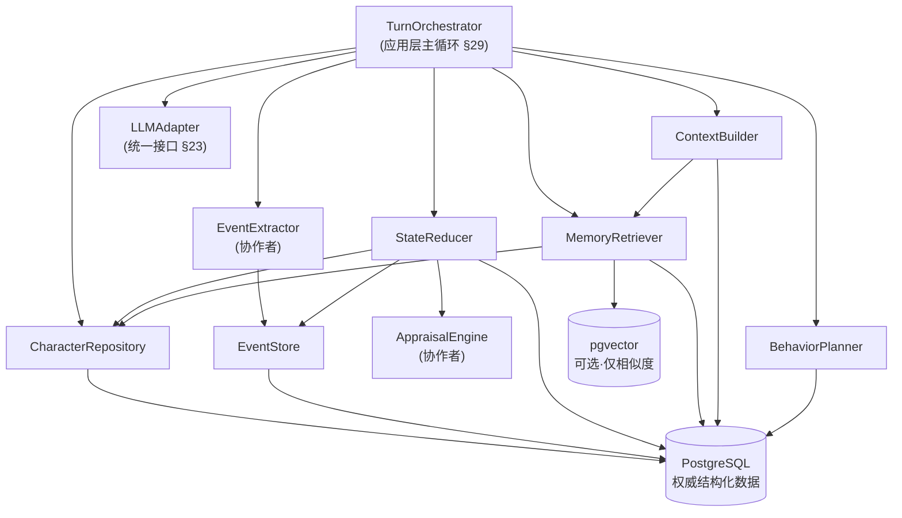
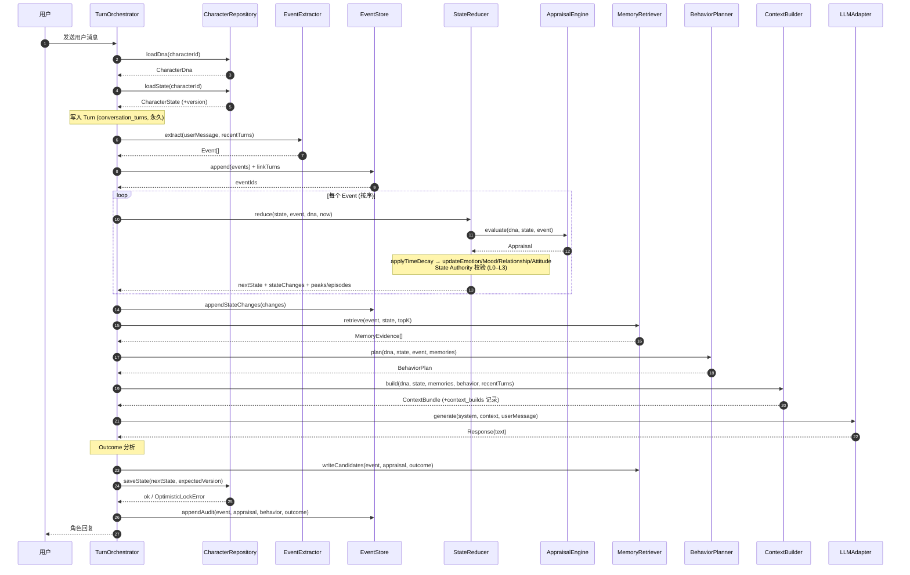

# Virtual Character OS v1.0 · Runtime Core 基线设计

> **文档类型**：架构设计 / Runtime Core Baseline Design
> **版本**：v1.0（Runtime Core 基线）
> **状态**：设计基线，可进入工程实现
> **范围**：只描述 Runtime Core 六个核心模块的设计，不含 UI、不含 AI 酒馆前端、不含实现代码。
> **上游权威依据（唯一）**：
> 1. 《Virtual Character OS v1.0 技术规格》—— 重点 §2 / §9 / §10 / §26 / §28 / §29 / §46 / §50–§59
> 2. 《Virtual Character OS v1.0 数据库 Schema 设计说明》
> 3. 《Virtual Character OS v1.0 PostgreSQL Schema》（可执行 DDL）
> 4. 《GPT 关于模型情绪注入讨论记录》（Runtime Core 边界与六模块的由来）
>
> **与本项目现有 AI 酒馆的关系**：本设计属于**独立于 AI 酒馆（Vue/TS 前端）的新系统**。AI 酒馆是前端应用，Virtual Character OS 是位于 LLM 之上的**角色运行时**。本文件不改动 AI 酒馆任何代码。

---

## 0. 文档说明：为什么要写“两套视图”

需求方明确要求本设计同时服务两类读者。**产品视图不是开发视图的翻译**——它回答的是**“这个模块在模拟人物的哪个心理机制、可调什么、坏了会怎样”**，而不是“这个模块有什么函数”。

| 视图 | 面向 | 只回答 |
|---|---|---|
| **开发人员视图** | 工程师 | 代码结构、TS 接口签名、数据结构、数据流、依赖、错误与降级 |
| **产品视图** | 产品 / 编剧 | 模拟哪个心理过程、可调参数及调高调低的效果、故障时的用户可见异常、产品/编剧可直接拍板的决策 |

**产品视图的四个固定问题**（每个模块都必须回答，用于强制它“不变成翻译”）：

1. **心理机制类比**：它在模拟人类的什么过程？
2. **可调参数**：调高 / 调低分别让角色显得怎样？
3. **异常表现**：模块出问题时，用户会看到什么？
4. **可参与决策**：产品 / 编剧能直接拍板什么？

---

## 1. Runtime Core 总览

### 1.1 六个核心模块与主链路

讨论记录末尾已确定 Runtime Core 的边界为六个核心模块，主链路为：

```
用户消息 → Turn → Event Extraction → Appraisal → StateReducer
  → (Emotion / Mood / Relationship / Attitude) → Memory Decision → Context Retrieval
  → Behavior Planner → LLM Adapter → Response → Outcome → Event Log
```

| 模块 | 一句话职责 | 对应规格章节 |
|---|---|---|
| **CharacterRepository** | 角色的“持久化身体”：读写稳定人格 DNA 与动态状态投影 | §4 / §17.2 / §28 / §56.3 |
| **EventStore** | 角色的“经历账本”：append-only 保存 Event / StateChange，链接 Turn | §8 / §52 / §55 |
| **StateReducer** | 角色的“心理反应器”：由事件推出新的情绪/心境/关系/态度（纯函数、可 Replay） | §9 / §10 / §26 / §27 / §28 |
| **MemoryRetriever** | 角色的“记忆浮现”：混合检索相关记忆 + 决定哪些经历值得长期记住 | §15 / §53.1 / §54 |
| **ContextBuilder** | 角色的“此刻脑内”：把有限的相关信息组装成给 LLM 的上下文 | §20 / §53 |
| **BehaviorPlanner** | 角色的“意志”：决定“怎么做”，而不是直接“说什么” | §16 / §29 |

> **两个协作者（不在六模块之列，但主链路需要）**：`EventExtractor`（把 Turn 变成 Event）与 `AppraisalEngine`（把 Event 解释为对角色意味着什么）。
> **本设计的处理**：`EventExtractor` 作为 **EventStore 的上游协作者**，`AppraisalEngine` 作为 **StateReducer 的协作者**（规格 §26 伪代码中 `appraise()` 就在 `updateCharacterState` 内部调用）。详见 §12「规格缺口」。

### 1.2 模块依赖与调用顺序图



**读图约定**：
- 实线箭头 = 调用 / 依赖方向。
- 主循环只发生在 `TurnOrchestrator`（对应 §29 `handleTurn`），六个模块**互不直接编排彼此**（低耦合）。
- `StateReducer` 依赖 `CharacterRepository`（读 DNA）、`AppraisalEngine`（评价）、`EventStore`（产出 StateChange）。
- **任何模块都不直接调用 LLM**，只有主循环经 `LLMAdapter` 调用一次（§2.7 / §17.2）。

### 1.3 分层

| 层 | 内容 | 是否属于 Runtime Core |
|---|---|---|
| 应用层 | `TurnOrchestrator`（主循环编排）、`handleTurn` | 是（编排，不含心理逻辑） |
| 领域层 | 六模块 + 两个协作者 | **是（本文件重点）** |
| 基础设施层 | PostgreSQL / pgvector / LLMAdapter / Cache | 否（接口在领域层定义，实现外置） |

---

## 2. 全局约束契约（所有模块必须遵守）

这些是**跨模块的硬约束**，来自规格原则，任何模块实现都不得违反。

| # | 契约 | 来源 | 对六模块的约束 |
|---|---|---|---|
| C1 | **State ≠ Prompt** | §2.1 | 状态持久化在 Repository，不放在 Prompt 里；Prompt 只是 ContextBuilder 的一次输出 |
| C2 | **State Authority：LLM 无直接写权限** | §2.7 / §17.2 / §56.1 | LLM 只能“提议变更”；核心字段由 StateReducer + Validator 决定是否接受 |
| C3 | **Event Sourcing + Projection** | §55 | 历史事件不可覆盖；当前状态是事件的投影，可 Replay 重建 |
| C4 | **原始历史不可变** | §50.1 / §54.1 / DDL §12 | `events` / `state_changes` / `conversation_turns` 只追加，不 UPDATE/DELETE（DDL 触发器强制） |
| C5 | **时间只作用于可变状态** | §2.6 / §10 | 不同变量不同半衰期；Personality 默认不自动衰减（§28 L3） |
| C6 | **Mutation Level 分层** | §28 / §56.2 | L0 可自动 / L1 记录原因 / L2 需证据累积 / L3 默认锁定 |
| C7 | **乐观锁 + 租户隔离** | §56.3 / §56.4 | 状态写入带 `version`；所有查询带 `tenant_id` |
| C8 | **所有长期变化可审计** | §47.6 / §35 | 任何核心状态变化都保存来源 Event / 时间 / 证据 / 原因 |

**Mutation Level 速查（§28）**：

| Level | 属性示例 | 默认规则 | 半衰期量级 |
|---|---|---|---|
| L0 FAST | `Emotion.anger` / `Mood.valence` / `Attention` | 可自动变化 | 分钟级 |
| L1 | `Mood` / `Relationship` | 可自动变化，**必须记录原因** | 小时～天级 |
| L2 | `Preference` / `Belief` | 需要证据累积（`repeated_event_count`） | 月级 |
| L3 | `Personality` / `Core Values` | **默认禁止自动修改** | 不自动衰减 |

---

## 3. 模块一：CharacterRepository（角色仓库）

### 3.1 职责边界

| 做 | 明确不做 |
|---|---|
| 读取角色稳定层（Character DNA：人格/价值观/信念/目标/边界） | ❌ 不做 Appraisal / 心理计算 |
| 读取 / 写入动态状态投影（Emotion / Mood / Relationship / Attitude / Preference） | ❌ 不做时间衰减计算（由 StateReducer 做） |
| 乐观锁版本检查（`version`）与租户隔离（`tenant_id`） | ❌ 不做记忆检索 |
| Snapshot 读写、状态审计写入 | ❌ 不调用 LLM |
| 人格版本管理（`character_versions`） | ❌ 不决定“该不该变”（那是 State Authority 的职责） |

> 一句话：**Repository 只负责“安全地存与取”，不负责“算”。**

### 3.2 开发人员视图

```ts
/** 稳定层：Character DNA（不因单轮模型输出自动修改，§4.1） */
export interface CharacterDna {
  characterId: string;
  version: number;                       // character_versions.version_no
  identity: Identity;                    // character_profiles.identity
  traits: Record<string, TraitValue>;    // character_traits
  values: Record<string, ValueEntry>;    // character_values
  beliefs: Belief[];                     // character_beliefs
  goals: Goal[];                         // character_goals
  boundaries: Boundaries;                // character_profiles.boundaries
  speechProfile: SpeechProfile;          // character_profiles.speech_profile
  behaviorRules: BehaviorRules;
}

/** 动态层：Character State（事件的投影，§4.2） */
export interface CharacterState {
  characterId: string;
  version: number;                       // 乐观锁
  emotion: Record<string, EmotionEntry>; // character_emotions
  mood: MoodEntry;                       // character_mood
  relationships: Relationship[];         // character_relationships + relationship_dimensions
  attitudes: Attitude[];                 // character_attitudes
  preferences: Preference[];             // character_preferences
  updatedAt: string;                     // ISO 8601 UTC
}

export interface CharacterRepository {
  loadDna(characterId: string): Promise<CharacterDna>;
  loadState(characterId: string): Promise<CharacterState>;
  /** 乐观锁写入；version 不匹配抛 OptimisticLockError（§56.3） */
  saveState(state: CharacterState, expectedVersion: number): Promise<void>;
  saveSnapshot(characterId: string, eventSequence: number, state: CharacterState): Promise<void>;
  loadLatestSnapshot(characterId: string): Promise<Snapshot | null>;
  appendAudit(entry: AuditEntry): Promise<void>;   // state_audit_logs
}
```

**关键数据结构**：

| 结构 | 说明 |
|---|---|
| `EmotionEntry` | `{ key, intensity[0,1], baseline, halfLifeSeconds, sourceEventId?, updatedAt, version }` —— 对应 §10 的 lazy decay 存储 |
| `MoodEntry` | `{ valence[-1,1], arousal[0,1], baselineValence, baselineArousal, halfLifeSeconds, version }` |
| `Relationship` | `{ targetId, relationshipType, status, dimensions: Record<dim,{score,baseline,version}> }` |
| `Attitude` | `{ targetId, targetType, dimensions: Record<dim,{score[-1,1],baseline,confidence,salience,version}> }` |

**依赖**：PostgreSQL（唯一权威存储）；无领域内依赖（最底层模块）。

### 3.3 产品视图

- **心理机制类比**：Repository ≈ 一个人的**长期人格 + 此刻的身体/心理激素水平**。它不思考、不评价，只是“存放我是谁、我现在处于什么状态”。角色“看起来像不像本人”取决于这里存的人格 DNA 是否稳定。
- **可调参数及效果**：
  - `baseline`（情绪/关系基线）：调高正向基线 → 角色**平时就更阳光**；调低 → 角色**平时偏阴郁**。
  - `half_life_seconds`（存储于此）：见 StateReducer（决定情绪能“撑”多久）。
  - `locked` / `mutable`（trait / value / belief）：锁定后角色**永远不会因为剧情改变核心性格**。
- **异常表现（用户可见）**：
  - 乐观锁冲突未处理 → 角色状态**跳变或回退**（“刚才还很亲密，突然像陌生人”）。
  - 人格字段被意外覆盖 → 角色**“换了个人”**（人格漂移，§1.2 的典型问题）。
  - 租户隔离失效 → 角色**串号**（A 角色的记忆出现在 B 角色身上）。
- **产品 / 编剧可直接决策**：每个角色的人格基线数值、哪些人格/价值观字段**永久锁定**、情绪基线（角色的“性格底色”）。

### 3.4 与数据库 Schema 的对应

| 用途 | 表 |
|---|---|
| 角色主实体 / 版本 | `characters`、`character_versions` |
| 稳定层 | `character_profiles`、`character_traits`、`character_values`、`character_beliefs`、`character_goals`、`archetypes` |
| 动态层 | `character_emotions`、`character_mood`、`character_relationships`、`relationship_dimensions`、`character_attitudes`、`character_preferences` |
| Replay / 审计 | `state_snapshots`、`state_audit_logs` |

### 3.5 待验证假设

| ID | 假设 | 依据状态 |
|---|---|---|
| A-R1 | `NUMERIC(5,4)` 精度足以表达情绪/关系的可分辨差异 | 工程推导 |
| A-R2 | 单角色状态可一次全量加载（无分页需要）在 v1.0 规模成立 | 待实测 |
| A-R3 | Snapshot 频率（每 N 事件）在性能与 Replay 速度间的最优点 | 待实测（§46 无对应项，建议补充） |

---

## 4. 模块二：EventStore（事件存储）

### 4.1 职责边界

| 做 | 明确不做 |
|---|---|
| Append-only 写入 `events`（不可变，C4） | ❌ 不判断事件重要性（那是 Appraisal 的职责） |
| 建立 Event ↔ Turn 多对多链接（`event_turn_links`） | ❌ 不决定是否写记忆（那是 MemoryRetriever 的职责） |
| Append-only 写入 `state_changes`（因果账本） | ❌ 不修改/删除历史（DDL 触发器强制拒绝） |
| 按 character / target / time / type 查询事件 | ❌ 不做状态计算 |
| 提供 Replay 用的事件流读取（配合 Snapshot） | ❌ 不调用 LLM |

### 4.2 开发人员视图

```ts
export interface DomainEvent {
  id: string;
  tenantId: string;
  characterId: string;
  actorId?: string;
  targetId?: string;
  eventType: string;                    // 受控词典，如 promise_broken / romantic_intention
  importance: number;                   // [0,1]，初始值，后续由 Appraisal 细化
  payload: Record<string, unknown>;
  occurredAt: string;                   // ISO 8601 UTC（真实发生时间，§54）
  createdAt: string;
}

export interface StateChange {
  characterId: string;
  eventId: string;
  stateType: 'emotion' | 'mood' | 'relationship' | 'attitude' | 'preference';
  targetId?: string;
  dimension: string;                    // 如 trust / affection / anger
  oldValue: number | null;
  delta: number;
  newValue: number | null;
  reason: Record<string, unknown>;      // 审计：为什么这么变
}

export interface EventStore {
  append(event: NewEvent): Promise<DomainEvent>;
  linkTurns(eventId: string, turnIds: string[], role: 'evidence'|'trigger'|'context'): Promise<void>;
  appendStateChanges(changes: StateChange[]): Promise<void>;
  listByCharacter(characterId: string, filter?: EventFilter): Promise<DomainEvent[]>;
  streamForReplay(characterId: string, afterSequence: number): AsyncIterable<DomainEvent>;
}
```

**依赖**：PostgreSQL。被 `StateReducer`（写 StateChange）与主循环（写 Event）依赖。

### 4.3 产品视图

- **心理机制类比**：EventStore ≈ 一个人的**人生经历账本 / 病历**。它记录“发生了什么”，**只记不改**。角色日后能解释“我为什么变了”，全靠这本账。
- **可调参数及效果**：
  - `event_type` **词典**（哪些事情算“事件”）：词典越细 → 角色对世界越敏感、剧情越可追溯；越粗 → 角色“记不住细节”。
  - `importance` 初始值：影响该事件是否容易被后续检索到。
- **异常表现**：
  - 历史可被改写 → 角色“记忆篡改”，无法回答“角色为什么突然讨厌 Alice”（§5 / §50.1）。
  - 事件缺失或 Turn 未链接 → 角色**失忆**（记得情绪、不记得原因）。
  - 事件重复写入 → 同一件事被**反复触发**（情绪被放大、态度被过度改变）。
- **产品 / 编剧可直接决策**：`event_type` 事件词典、哪些剧情节点算“高重要度事件”。

### 4.4 与数据库 Schema 的对应

| 用途 | 表 |
|---|---|
| 世界事件（Append-only） | `events` |
| 事件 ↔ 原始 Turn | `event_turn_links` |
| 状态变化因果账本（Append-only） | `state_changes` |
| 事件 ↔ Episode | `emotion_episode_events` |

> DDL §12 通过 `trg_events_immutable_update` / `trg_state_changes_immutable_update` 触发器**在数据库层强制不可变**，任何 `UPDATE/DELETE` 抛异常——这是 C4 的物理保障。

### 4.5 待验证假设

| ID | 假设 | 依据状态 |
|---|---|---|
| A-E1 | 一个 Turn 抽取的 Event 数量有稳定上界（避免事件爆炸） | 待实测 |
| A-E2 | `event_type` 词典的合理规模（太粗/太细的边界） | 待实测 |
| A-E3 | `occurred_at`（真实发生时间）与 `created_at`（入库时间）分离足以支撑时间推理 | 研究依据（§44 R5） |

---

## 5. 模块三：StateReducer（状态归约器）——Runtime Core 的核心

### 5.1 职责边界

| 做 | 明确不做 |
|---|---|
| **纯函数**：`(state, event, appraisal, dna, now) → nextState + stateChanges` | ❌ 不持久化（Repository 做） |
| Time Decay（lazy decay 计算，§27） | ❌ 不检索记忆 |
| 更新 Emotion / Mood / Relationship / Attitude / Preference | ❌ 不生成文本 |
| **State Authority 校验**：拒绝越权（L3）变更（§28） | ❌ 不直接调用 LLM |
| 产出 Peak / Episode 候选（§11） | ❌ 不做 Turn→Event 抽取 |
| 可 Replay / 可测试（§29 / §55） | |

> 这是全系统**唯一可以“改变角色心理状态”的地方**，也是 C2（LLM 无写权限）的落点。

### 5.2 开发人员视图

```ts
export interface Appraisal {
  importance: number;
  goalRelevance: number;
  valueViolation: number;
  betrayal: number;
  threat: number;
  loss: number;
  socialSignificance: number;
  surprise: number;
  targetSalience: number;
}

export interface AppraisalEngine {                    // StateReducer 的协作者
  evaluate(input: {
    dna: CharacterDna;
    state: CharacterState;
    event: DomainEvent;
  }): Promise<Appraisal>;
}

export interface ReduceResult {
  nextState: CharacterState;
  stateChanges: StateChange[];
  peaks: PeakCandidate[];                             // 超过峰值/动态阈值时产生
  episodes: EpisodeCandidate[];                       // 连续事件聚合
  rejected: RejectedMutation[];                       // 被 State Authority 拒绝的变更（审计）
}

export interface StateReducer {
  /** 纯函数；给定相同输入必须得到相同输出（可 Replay） */
  reduce(input: {
    dna: CharacterDna;
    state: CharacterState;
    event: DomainEvent;
    appraisal: Appraisal;
    now: string;
  }): ReduceResult;

  /** 时间衰减（§27）：X(t) = X0 · 2^(-t/H) */
  applyTimeDecay(state: CharacterState, now: string): CharacterState;
}
```

**核心公式（来自规格，原样保留）**：

```
Impact = EventIntensity × PersonalitySensitivity × RelationshipRelevance
       × GoalRelevance × ValueViolation            // §9.3
new_emotion = clamp(old_emotion + Impact, 0, 1)     // §9.3
decay: X(t) = X0 · 2^(-t / H)                        // §10.1
decayToBaseline: baseline + (value-baseline)·2^(-t/H) // §27
ΔAttitude = EventImpact × PersonalitySensitivity × TargetSalience × EvidenceWeight // §12.2
```

**主更新伪代码（§26，保持结构）**：

```ts
function updateCharacterState(dna, state, event, appraisal, now): ReduceResult {
  const decayed = applyTimeDecay(state, now);
  const nextEmotion      = updateEmotion(decayed.emotion, appraisal, dna, event);
  const nextMood         = updateMood(decayed.mood, appraisal, nextEmotion);
  const nextRelationships= updateRelationships(decayed.relationships, appraisal, event, dna);
  const nextAttitudes    = updateAttitudes(decayed.attitudes, appraisal, event, dna);
  // State Authority：对 L3 字段的越权变更直接拒绝并记录
  return { nextState: { ...decayed, emotion: nextEmotion, mood: nextMood,
            relationships: nextRelationships, attitudes: nextAttitudes, updatedAt: now },
           stateChanges, peaks, episodes, rejected };
}
```

**依赖**：`CharacterRepository`（读 DNA）、`AppraisalEngine`（评价）、`EventStore`（写 StateChange）。

### 5.3 产品视图

- **心理机制类比**：StateReducer ≈ **一个人被某件事触动后的心理反应**。同一件事，落在不同人身上反应不同——敏感的人受打击更重，重承诺的人对失约反应更强，暗恋对象的一条消息能让人心跳加速。**这是整个系统最像“心理”的地方。**
- **可调参数及效果**：

| 参数 | 调高 → 角色显得 | 调低 → 角色显得 |
|---|---|---|
| `sensitivity`（人格敏感度） | **玻璃心 / 情绪化**，同一件事更容易被影响 | **钝感 / 冷静**，不容易被触动 |
| `half_life`（半衰期） | 情绪**持续更久**（记仇、长情） | 情绪**快速平复**（健忘、翻篇快） |
| `major_event_threshold` | 更难触发“重大事件”级态度转变（更稳重） | 更容易因一件事**彻底改变态度** |
| `repeated_event_count`（爱→讨厌阈值） | 需要**更多次**伤害才变心（更忠诚） | 更**容易变心**（更薄情） |
| `value_violation` 权重 | 角色对“违背自己价值观”的事**反应更激烈** | 对原则问题**更宽容** |

- **异常表现（用户可见）**：

| 故障 | 用户看到什么 |
|---|---|
| 情绪不衰减（半衰期 ∞） | 角色**永远记仇**，一次争吵后永远冷淡 |
| 衰减太快 | 角色**像失忆**，上一轮还愤怒，下一轮若无其事 |
| LLM 能直接写状态（C2 失效） | 角色**自我认知崩坏**，随口一句话就改写人格（§17.2 的猫例子） |
| L3 未被锁 | 角色**性格漂移**，几轮对话后“换了个人” |
| 态度单事件直接翻转 | 角色**情绪化到不真实**，一次小误会就“绝交” |

- **产品 / 编剧可直接决策**：每种情绪的**半衰期**（角色“气多久”）、角色**敏感度**、**爱→讨厌需要几次事件**、态度转变的**阈值条件**。这些正是规格 §46 列为“必须可配置”的参数。

### 5.4 与数据库 Schema 的对应

| 用途 | 表 |
|---|---|
| 情绪投影 | `character_emotions`（含 `half_life_seconds` / `baseline` / `version`） |
| 心境投影 | `character_mood` |
| 关系 / 态度 / 偏好投影 | `character_relationships`、`relationship_dimensions`、`character_attitudes`、`character_preferences` |
| 变化账本 | `state_changes` |
| Peak / Episode | `emotion_episodes`、`emotion_episode_events` |
| 审计 | `state_audit_logs` |

### 5.5 待验证假设

| ID | 假设 | 依据状态 |
|---|---|---|
| A-S1 | 各情绪默认半衰期（Anger 5min / Joy 15min / Sadness 30min …，§10.2） | 待验证（§46-1） |
| A-S2 | 人格维度间的具体权重 | 待验证（§46-2） |
| A-S3 | `Impact` 的**线性乘积**组合形式成立 | 待验证（§46-3） |
| A-S4 | 爱→讨厌所需事件数阈值（默认 `repeated_event_count = 3`） | 待验证（§46-4） |
| A-S5 | Appraisal 各维度 → Emotion/Relationship 的映射系数 | 待验证（§46-9） |
| A-S6 | Peak / Episode 的自动切分阈值 | 待验证（§46-6） |

---

## 6. 模块四：MemoryRetriever（记忆检索器）

### 6.1 职责边界

| 做 | 明确不做 |
|---|---|
| 混合检索：target / time / importance / semantic / emotional salience（§53.1） | ❌ 不做状态更新 |
| 时间有效性过滤（`valid_from` / `valid_until`，§54） | ❌ 不做 Appraisal |
| **Memory Decision**：判断哪些经历值得长期记住 | ❌ 不生成文本 |
| 建立 Memory ↔ Event/Turn 来源链接（`memory_sources`） | ❌ 不调用 LLM |
| 返回 Top-K 证据供 ContextBuilder 使用 | ❌ 不做向量之外的事实来源（vector 只是排序信号） |

### 6.2 开发人员视图

```ts
export type MemoryType = 'semantic' | 'episodic' | 'relational' | 'procedural';

export interface MemoryEvidence {
  memoryId: string;
  memoryType: MemoryType;
  content: string;
  targetId?: string;
  importance: number;
  emotionalSalience: number;
  score: number;                       // 混合检索综合分
  validFrom?: string;
  validUntil?: string;
}

export interface RetrievalQuery {
  characterId: string;
  event?: DomainEvent;
  state: CharacterState;
  targets?: string[];
  topK: number;                        // §46-7：Top-K 待校准
}

export interface MemoryRetriever {
  retrieve(query: RetrievalQuery): Promise<MemoryEvidence[]>;
  /** Memory Decision：从事件/结果中筛选值得长期保存者 */
  writeCandidates(input: {
    characterId: string;
    event: DomainEvent;
    appraisal: Appraisal;
    outcome: Outcome;
  }): Promise<MemoryRecord[]>;
}
```

**混合评分（工程框架，权重为待校准参数，§53.1）**：

```
score = w_recency   * recency
      + w_semantic  * semantic_similarity
      + w_target    * target_match
      + w_importance* importance
      + w_emotion   * emotional_salience
```

**依赖**：`CharacterRepository`（读角色上下文）、pgvector（可选，仅相似度）、PostgreSQL。

### 6.3 产品视图

- **心理机制类比**：MemoryRetriever ≈ **“此刻什么东西浮上心头”**。人不是把一生所有事同时想起来，而是当前话题/人物/情绪会把**最相关的几件事**拉进意识。这就是“联想”的工程化。
- **可调参数及效果**：

| 参数 | 调高 → 角色显得 | 调低 → 角色显得 |
|---|---|---|
| `topK`（召回条数） | **联想丰富 / 话痨**，但可能跑题 | **简洁 / 健忘** |
| `w_recency` | **关注近期**（“你上次说……”） | **念旧 / 沉溺往事** |
| `w_importance` | **念念不忘大事** | **大大咧咧、不记仇** |
| `w_emotion`（情绪显著性） | **对情感强烈的往事更敏感** | **理性、就事论事** |
| `w_target` | **对当前人物高度聚焦** | **更容易串联无关人物** |

- **异常表现（用户可见）**：

| 故障 | 用户看到什么 |
|---|---|
| 只做向量检索（§12 讨论的典型错误） | 角色**反复想起表面相关但无用的片段**（满屏 Alice 却不知哪条重要） |
| 召回过少 | 角色**失忆**，忘了关键承诺 |
| 召回过量 | 上下文被噪声淹没，角色**答非所问** |
| 忽略 `valid_until` | 角色**把过期事实当现在**（“你喜欢的咖啡” 其实已戒） |
| 无来源链接 | 角色“**凭空记住**”没发生过的记忆 |

- **产品 / 编剧可直接决策**：召回条数 Top-K、各权重（更念旧还是更关注当下）、**哪些记忆算“高价值”**、时间有效性规则。

### 6.4 与数据库 Schema 的对应

| 用途 | 表 |
|---|---|
| 长期记忆 | `memories`（含 `valid_from` / `valid_until` / `importance` / `salience`） |
| 记忆来源证据 | `memory_sources`（→ `events` / `conversation_turns`） |
| 检索压缩层 | `conversation_segments`、`context_summaries` |
| 向量（可选） | `memories.embedding`（pgvector，DDL §13 注释） |

### 6.5 待验证假设

| ID | 假设 | 依据状态 |
|---|---|---|
| A-M1 | 召回 Top-K 的合理默认值 | 待验证（§46-7） |
| A-M2 | 混合检索各权重（`w_recency` 等）的默认值 | 待验证（§46-7 / §53.1） |
| A-M3 | 向量检索作为“排序信号而非事实来源”在实现上不引入偏差 | 工程推导 |
| A-M4 | Segment 粒度（10～30 轮）对检索质量的影响 | 待实测 |

---

## 7. 模块五：ContextBuilder（上下文构建器）

### 7.1 职责边界

| 做 | 明确不做 |
|---|---|
| 把 Identity / State / Recent Turns / Memory / Events / Episodes / Goals / Behavior Plan 组装为**有限** Context | ❌ 不做检索（MemoryRetriever 做） |
| 分层、排序、token 预算裁剪（§53） | ❌ 不改变角色状态 |
| 记录 `context_builds` / `context_build_items`（可观测性 / Debugger） | ❌ 不调用 LLM（LLMAdapter 做） |
| 保证 State ≠ Prompt（C1）：Context 是一次性产物，不是状态存储 | |

### 7.2 开发人员视图

```ts
export interface ContextBundle {
  system: string;                     // 稳定人格锚点（§17.1）
  layers: {
    identity: ContextLayer;
    state: ContextLayer;              // Emotion / Mood / Attention / Active Goals
    recentTurns: ContextLayer;
    relevantMemories: ContextLayer;
    relevantEvents: ContextLayer;     // Events / Episodes
    behaviorPlan: ContextLayer;
  };
  totalTokens: number;
  buildId: string;                    // → context_builds.id
}

export interface ContextBuilder {
  build(input: {
    dna: CharacterDna;
    state: CharacterState;
    behavior: BehaviorPlan;
    memories: MemoryEvidence[];
    recentTurns: Turn[];
    events: DomainEvent[];
    episodes: Episode[];
    tokenBudget: number;
  }): ContextBundle;
}
```

**推荐分层顺序（§53 / Schema 说明 §15）**：

```
L1 Identity → L2 Current State → L3 Recent Turns
→ L4 Relevant Memory → L5 Relevant Events / Episodes
→ L6 Active Goals → L7 Behavior Plan
```

**依赖**：`MemoryRetriever`（取记忆证据）、`CharacterRepository`（取 Identity/State）、PostgreSQL（写 `context_builds`）。

### 7.3 产品视图

- **心理机制类比**：ContextBuilder ≈ **“这一瞬间脑子里同时装着什么”**。人在回应前，脑海里同时浮现：我是谁、我现在心情如何、对方刚说了什么、这让我想起哪些往事、我打算怎么做。**角色“说话像不像本人”，取决于这里装对了没有。**
- **可调参数及效果**：

| 参数 | 调高 → 角色显得 | 调低 → 角色显得 |
|---|---|---|
| `tokenBudget`（总预算） | 信息更全，但**可能啰嗦/跑题** | 更聚焦，但**可能忽略细节** |
| Recent Turns 轮数 | **更贴合当下语境** | **更依赖记忆、可能接不上话** |
| 记忆层预算 | **更念旧、更有厚度** | **更当下、更轻** |
| Identity 层是否常驻 | 常驻 → **人格稳定** | 缺失 → **人格漂移** |

- **异常表现（用户可见）**：

| 故障 | 用户看到什么 |
|---|---|
| Identity 层被裁剪 | 角色**人格漂移**（几轮后“不是那个人了”） |
| Recent Turns 缺失 | 角色**接不上话**（“你说什么？”） |
| 预算失衡（记忆挤掉近期对话） | 角色**答非所问**，沉浸往事 |
| 不记录 `context_builds` | 无法回答“**为什么角色这轮这么说**”（Debugger 失效，§57） |

- **产品 / 编剧可直接决策**：七层**顺序与保留优先级**、各层**token 预算**、哪些信息**永远保留**（如 Identity、当前 Behavior Plan）。

### 7.4 与数据库 Schema 的对应

| 用途 | 表 |
|---|---|
| Context 构建记录 | `context_builds` |
| Context 来源与排名 | `context_build_items`（`source_type` / `rank` / `relevance_score` / `token_count`） |
| 分层来源 | `characters`/`character_profiles`、`character_emotions`/`character_mood`、`conversation_turns`、`memories`、`events`/`emotion_episodes`、`character_goals`、`behavior_plans` |

### 7.5 待验证假设

| ID | 假设 | 依据状态 |
|---|---|---|
| A-C1 | 七层顺序对人格一致性最优 | 工程推导，待评测 |
| A-C2 | 各层 token 预算默认值 | 待实测 |
| A-C3 | Recent Turns 的默认轮数（§20.3 提及 3～10 条记忆） | 待实测 |
| A-C4 | Context 长度与角色一致性之间存在最优点 | 待评测 |

---

## 8. 模块六：BehaviorPlanner（行为规划器）

### 8.1 职责边界

| 做 | 明确不做 |
|---|---|
| 由 DNA + State + Event + Memories 决定 **Response Strategy**（§16） | ❌ 不生成自然语言（LLM 负责“自然语言化”） |
| 输出 `assertiveness / warmth / directness / emotion_expression / constraints` | ❌ 不改变角色状态 |
| 施加**边界约束**（如“不辱骂”“不立即终止关系”） | ❌ 不做记忆检索 |
| **阻止人格漂移**：把“状态”翻译成“可执行的表达指令” | ❌ 不调用 LLM |

### 8.2 开发人员视图

```ts
export interface BehaviorPlan {
  goal: string;                        // 如“表达失望，同时维护关系”
  strategy: string;                    // 如 gentle_confrontation
  assertiveness: number;               // [0,1]
  warmth: number;                      // [0,1]
  directness: number;                  // [0,1]
  emotionExpression: Record<string, number>;  // { anger: 0.42, sadness: 0.38 }
  constraints: string[];               // 边界：["不辱骂","不立即终止关系"]
  speechDirectives?: Record<string, unknown>; // → behavior_plans.speech_directives
  confidence: number;
}

export interface BehaviorPlanner {
  plan(input: {
    dna: CharacterDna;                 // 价值观 / 边界 / 目标
    state: CharacterState;
    event: DomainEvent;
    memories: MemoryEvidence[];
  }): Promise<BehaviorPlan>;
}
```

**关键：规格 §16 明确禁止 `Conversation → LLM → Response` 直连**，必须先经 Behavior Planner：

```
Conversation → Appraisal → Character State → Behavior Planner
→ Response Strategy → LLM
```

**依赖**：`CharacterRepository`（读 DNA/边界/目标）、PostgreSQL（写 `behavior_plans`）。

### 8.3 产品视图

- **心理机制类比**：BehaviorPlanner ≈ **“决定怎么做”的意志层**，而不是“说什么”的表达层。人生气时可以选择**克制地表达不满**，也可以**摔门走人**——选哪个由价值观、边界和关系决定。**这一层是“角色还是本人”的最后一道闸。**
- **可调参数及效果**：

| 参数 | 调高 → 角色显得 | 调低 → 角色显得 |
|---|---|---|
| `assertiveness` | **强势、直接表达诉求** | **退让、回避冲突** |
| `warmth` | **温和、照顾对方** | **冷淡、疏离** |
| `directness` | **直来直去** | **委婉、绕弯** |
| `constraints`（边界规则） | 规则越多 → 角色**越守底线** | 规则缺失 → 角色**可能越界** |

- **异常表现（用户可见）**：

| 故障 | 用户看到什么 |
|---|---|
| Planner 缺失（LLM 直连） | 角色**情绪化输出 / 人格漂移**（“为什么突然这么冲”） |
| `constraints` 失效 | 角色**越界**：辱骂、突然绝交、说 OOC 的话 |
| 策略选择与关系不匹配 | 对陌生人像对恋人、对恋人像对陌生人（§1.2 的典型问题） |

- **产品 / 编剧可直接决策**：**策略库**（有哪些回应方式）、**边界规则**（角色“绝不做”的事）、不同关系下的表达倾向。

### 8.4 与数据库 Schema 的对应

| 用途 | 表 |
|---|---|
| 行为计划 | `behavior_plans`（`goal` / `strategy` / `constraints` / `speech_directives` / `confidence`） |
| 决策输入 | `character_values`、`character_profiles.boundaries`、`character_goals` |

### 8.5 待验证假设

| ID | 假设 | 依据状态 |
|---|---|---|
| A-B1 | 策略库（strategy 枚举）的合理粒度 | 工程推导，待补 |
| A-B2 | `assertiveness/warmth/directness` 由状态到数值的映射规则 | 待验证 |
| A-B3 | Behavior Plan 对 LLM 输出的实际控制力（LLM 是否遵从） | 待评测（§46 无直接项，建议补充） |

---

## 9. 端到端时序图（一次用户消息的完整链路）



---

## 10. 错误与降级处理

| 场景 | 处理策略 | 用户可见后果（设计目标） |
|---|---|---|
| **乐观锁冲突**（`saveState` version 不匹配） | reload state → 重算 reduce → retry（§56.3） | 无感知，状态不跳变 |
| **AppraisalEngine 超时/失败** | 降级为“事件直接按 importance 施加温和影响”，并记 audit | 角色反应略“平”，但不崩 |
| **MemoryRetriever 失败** | 跳过记忆层，仅用 Identity + State + Recent Turns 构建 Context | 角色暂时“想不起往事”，但仍能正常对话 |
| **向量服务（pgvector）不可用** | 降级为结构化检索（target/time/importance），跳过 semantic（Schema 说明 §20） | 联想略弱，不阻塞回复 |
| **LLMAdapter 失败** | 重试 → 仍失败则返回兜底话术，且**不写状态**（避免状态与输出不一致） | 角色“暂时沉默”，不产生错误记忆 |
| **EventExtractor 抽取异常** | 记录原文 Turn，事件延后补抽；**不阻塞 Turn 落库** | 角色先记住原话，稍后补理解 |
| **State Authority 拒绝变更** | 记录 `rejected` 到 audit，继续处理其他变更 | 核心人格不被污染 |
| **事务部分失败** | 核心写操作同一事务（Schema 说明 §20）；向量化/摘要异步、失败不回滚核心 | 状态一致，向量可后补 |
| **超长对话** | Segment 摘要压缩 Recent Turns，原文永久保留（§51.4） | 角色不“爆上下文”，细节仍可回溯 |

**降级总原则**：**状态写入的原子性 > 记忆/向量的丰富度**。向量、摘要、Embedding 属于“增强”，绝不能让它们阻塞核心状态提交（Schema 说明 §20）。

---

## 11. 待验证假设汇总

规格 §46 已列 10 条，本节在其基础上按模块归位并**扩充**（标注「新增」的为本次设计补充）。

| # | 假设（规格 §46） | 归属模块 |
|---|---|---|
| 1 | 每种 Emotion 的默认 half-life | StateReducer |
| 2 | 不同人格维度之间的具体权重 | StateReducer |
| 3 | `Impact` 的线性乘积组合形式 | StateReducer |
| 4 | 爱→讨厌所需事件数量阈值 | StateReducer |
| 5 | 多少次重复经历足以改变 Preference / Belief | StateReducer |
| 6 | Peak 与 Episode 的自动切分阈值 | StateReducer |
| 7 | Memory 的召回 Top-K | MemoryRetriever |
| 8 | Personality Drift 的报警阈值 | （v1.1 Drift Detector） |
| 9 | Appraisal 对 Emotion / Relationship 各维度的映射 | StateReducer |
| 10 | Cloud 与 Local LLM 在相同 State 下的一致性 | LLMAdapter / 评测 |

**新增假设（本次设计补充）**：

| ID | 假设 | 归属模块 |
|---|---|---|
| N1 | Snapshot 频率的最优点 | CharacterRepository |
| N2 | 一个 Turn 的 Event 抽取数量上界；`event_type` 词典规模 | EventStore |
| N3 | 混合检索各权重默认值 | MemoryRetriever |
| N4 | Segment 粒度（10～30 轮）对检索质量的影响 | MemoryRetriever |
| N5 | Context 七层顺序与各层 token 预算 | ContextBuilder |
| N6 | Behavior Plan 对 LLM 输出的实际控制力 | BehaviorPlanner |

> **所有上述参数必须做成可配置项**，并在 `evaluation/` 中建立实验记录，不得硬编码（§46 结尾要求）。

---

## 12. 规格缺口与建议补充

> 以下为设计过程中发现的**规格含糊或未覆盖**之处。按任务要求：**如实标注，不自行发明机制**。

| # | 缺口 | 说明 | 建议 |
|---|---|---|---|
| G1 | **六模块未含 EventExtractor 与 AppraisalEngine** | 讨论记录给出六模块，但主链路包含“Event Extraction”与“Appraisal”。二者是独立职责，却不在六模块命名内。 | 建议明确：`EventExtractor` 归为 EventStore 上游协作者；`AppraisalEngine` 归为 StateReducer 协作者（本文件即按此处理，§1.1）。**是否升格为独立模块需需求方确认。** |
| G2 | **`EventExtractor` 是否用 LLM** | 规格未明确 Event Extraction 的实现方式（LLM 抽取 or 规则）。这直接影响 C2（LLM 无写权限）的边界。 | 建议补充：抽取结果必须经 State Authority 校验，且抽取失败不得阻塞 Turn 落库（本文件 §10 已按此设计）。 |
| G3 | **OutcomeAnalyzer 未定义** | §29 主循环出现 `outcomeAnalyzer.analyze(result)`，但规格未给出其输入/输出/职责。 | 建议补充 Outcome 的结构定义与“Outcome → 新 Event”的规则（§59 链尾“Outcome → New Event”）。 |
| G4 | **Peak 与 Episode 的产生主体** | §11 定义 Peak/Episode 概念，但未说明由谁产生（StateReducer？独立引擎？）。 | 本文件归入 StateReducer 的 `ReduceResult`（peaks/episodes 候选）。建议确认。 |
| G5 | **Memory Decision 的归属** | 主链路有“Memory Decision”，但未明确属于 MemoryRetriever 还是独立模块。 | 本文件归入 MemoryRetriever（`writeCandidates`）。建议确认。 |
| G6 | **`salience` / `confidence` 的更新规则** | 表结构有 `salience`/`confidence` 字段，但规格未给更新公式。 | 建议补充：由什么事件、按什么规则更新（否则角色“在意程度”无法演化）。 |
| G7 | **Relationship 与 Attitude 的重叠边界** | §2.4 说两者“有重叠但不应完全合并”，但未给字段级边界。 | 建议补充：`trust/affection/attraction` 等同时出现在两表中的**权威来源**（哪张表说了算）。 |
| G8 | **`character_preferences` 与 `character_attitudes` 的差别** | 两表结构几乎一致，规格 §11 给出概念区分但无实现级规则。 | 建议补充：何时写 Preference、何时写 Attitude。 |
| G9 | **Episode 的“未解决”状态** | §50 提到“尚未解决的 Episode”，但 `emotion_episodes` 无显式“未解决”标志（仅 `recovered_at`）。 | 建议补充：未解决 Episode 的判定规则（如 `recovered_at IS NULL` 是否等价）。 |

---

## 13. 附录：术语与参数速查

### 13.1 术语对照

| 术语 | 含义 | 权威来源表 |
|---|---|---|
| Turn | 说了什么（原始消息，永久） | `conversation_turns` |
| Event | 发生了什么（不可变） | `events` |
| State | 角色现在怎样（投影） | `character_emotions` / `character_mood` / … |
| StateChange | 状态为什么变（因果账本） | `state_changes` |
| Memory | 长期记住什么 | `memories` |
| Episode | 多个事件组成的连续经历 | `emotion_episodes` |

### 13.2 面向产品 / 编剧的“可调旋钮”总表

| 想改变角色的…… | 调哪个模块 / 参数 | 效果方向 |
|---|---|---|
| 脾气大不大（易不易被惹） | StateReducer · `sensitivity` | 高=玻璃心，低=钝感 |
| 气多久 / 记不记仇 | StateReducer · `half_life` | 高=长情/记仇，低=健忘 |
| 会不会变心 | StateReducer · `repeated_event_count` | 高=忠诚，低=薄情 |
| 多念旧 | MemoryRetriever · `w_recency` | 高=关注当下，低=念旧 |
| 联想的丰富度 | MemoryRetriever · `topK` | 高=话痨，低=简洁 |
| 说话像不像本人 | ContextBuilder · Identity 层常驻 | 常驻=稳定，缺失=漂移 |
| 强势还是退让 | BehaviorPlanner · `assertiveness` | 高=强势，低=退让 |
| 角色的底线 | BehaviorPlanner · `constraints` | 规则越多越守底线 |
| 性格底色 | CharacterRepository · `baseline` | 高=阳光，低=阴郁 |

---

**文档结束**

> 本文件为 Runtime Core 的**设计基线**，不含实现代码。实现阶段请以本文件的接口签名为准，并严格保持 C1–C8 全局约束。
