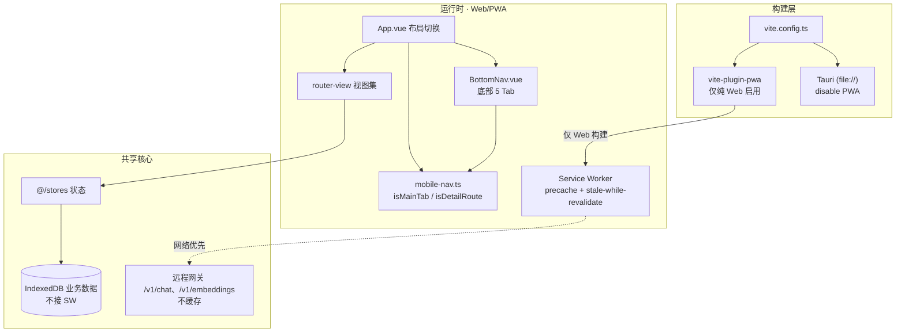
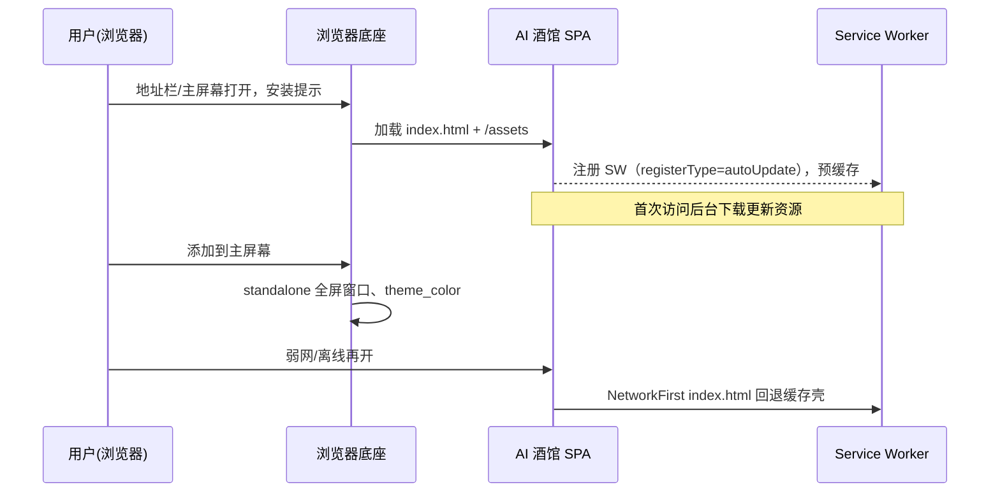

# AI 酒馆 · 移动端 PWA 软件设计文档

> 版本：v1.0
> 日期：2026-08-24
> 上游依据：`docs/design/mobile-ui-design.md`（UI 设计改进文档）、`docs/dev/mobile-pwa-plan.md`、现有 Web 应用降级架构
> 适用范围：AI 酒馆（Vue 3 + TypeScript + Vite，Tauri 2 桌面与纯 Web 双形态）
> 文档类型：概要设计（HLD），Brownfield 扩展（存量 Web 应用上新增移动端 PWA 形态）
> 阅读对象：前端 / QA / 设计

---

## 1. 设计概览

### 1.1 目的与范围

在现有 Web 应用基础上，让「AI 酒馆」在手机上成为**可安装、可用于核心对话主流程**的 PWA 应用，同时不破坏桌面端现有能力。本设计覆盖四项落地内容：PWA 可安装性、底部导航与路由架构、五个核心页面的移动化布局、触控/输入/安全区适配。具体交付边界见 `mobile-ui-design.md` §1.2/§1.3 与 §9。

本设计**不覆盖**：世界书/编辑器/数据探查等二级子页的完整移动重构、浏览器内本地向量模型推理（继续走网关，离线对话不在本期）。

### 1.2 设计目标与约束

| 类别 | 目标 / 约束 | 来源 |
|---|---|---|
| 可安装 | 浏览器"添加到主屏幕"，独立全屏窗口运行 | `mobile-ui-design §1.1` |
| 主流程 | 新建/进入会话、对话、切换角色、逛市场在手机上流畅 | `§1.1` |
| 触控 | 可点目标 ≥44×44px，间距 ≥8px，防误触 | `§2` |
| 一致性 | 沿用现有深色主题与品牌 token，不新增独立手机主题 | `§2` |
| 兼容 | 桌面端功能与样式不回归，全量测试通过 | `§10` `[Data-backed]` |
| 性能 | 长列表虚拟化/懒渲染，滚动 60fps；过渡 ≤120ms  尊重 `prefers-reduced-motion` | `§2`、`§7` |

### 1.3 关键术语

| 术语 | 含义 |
|---|---|
| 底部导航 | 移动端 ≤640px 下显示的 5 Tab 固定底栏，替代桌面左侧栏 |
| 二级/详情页 | 路由 `isDetailRoute` 判定的页面，移动端隐藏底部导航以沉浸 |
| 安全区 | iOS 视觉安全区域 `env(safe-area-inset-*)`，避开 Home 横条与圆角 |
| 降级导航 | 手机端隐藏 `NavRail`，通过 `App.vue` 响应式与 `mobile-nav.ts` 判定切换 |

---

## 2. 系统架构

### 2.1 架构风格与变更策略

现有应用是**同构 Vue 单页**，同一份业务代码在 Tauri（file://）与纯 Web 下运行，通过构建时环境区分形态。移动端 PWA 复用同一业务代码与降级架构，仅在**纯 Web 构建**追加 PWA 能力（manifest + Service Worker），并在 **CSS 层与组件层**新增移动专属入口与布局。这样桌面逻辑、状态、IndexedDB 存储完全不变，移动端成为同一代码库的另一种渲染形态，而非独立应用。

选择这一策略而非独立移动壳，是因为对话主流程、角色/市场数据、IndexedDB 模型全部集中于现有核心模块；新增一条移动分支或新形态会引入双份状态与同步成本。`mobile-ui-design §3.1` 与 `§12` 明确采纳"复用现有 Web 降级架构 + `vite-plugin-pwa`"。

### 2.2 架构图

架构上有三层边界需要明确：

- **形态边界**：PWA 仅存在于纯 Web 构建（`vite.config.ts` 中 `isTauriEnv` 时 `disable: true`，不生成 manifest/SW）。Tauri 端 `file://` 下 Service Worker 无意义且可能报错，故禁用。这是架构图左侧的分叉。
- **缓存边界**：构建产物（`/assets/*`）走 precache；`index.html` 走 NetworkFirst 离线回退；**远程 AI 网关 `/v1/*` 一律不缓存**，避免陈旧对话数据。IndexedDB 业务数据由应用自身管理，不接入 SW。缓存策略全集见 `mobile-ui-design §12.3`。
- **导航边界**：`mobile-nav.ts` 以路由名集合判定"主 Tab"与"二级页"，是底部导航显隐的唯一事实来源，`BottomNav.vue` 与 `App.vue` 都引用它，避免两处判定漂移。

### 2.3 组件职责与边界

| 组件/模块 | 拥有 | 不拥有 | 依赖 |
|---|---|---|---|
| `App.vue` 布局切换 | 断点决定显示 `NavRail` 还是 `BottomNav`；二级页隐藏底部导航 | 具体页面内容、tab 高亮细节 | `@/core/mobile-nav` |
| `BottomNav.vue` | 5 Tab 渲染、当前 tab 高亮、安全区垫高 | 路由跳转的业务含义、页面内容 | `@/router`、`@/core/mobile-nav`、`@/i18n` |
| `mobile-nav.ts` | `MAIN_TABS` 常量、`isMainTab`、`isDetailRoute` 判定 | 视觉、样式 | 无（纯函数） |
| `vite.config.ts`(PWA 接入) | 纯 Web 构建的 manifest/SW 生成与更新策略 | 运行时行为 | `vite-plugin-pwa` |

### 2.4 关键技术选择与理由

| 选型 | 理由 | 服务的目标 |
|---|---|---|
| `vite-plugin-pwa`（而非手写 SW） | 自动生成 manifest、生成并维护 workbox SW、与 Vite 构建产物序列对齐 | 可安装性、秒开的离线壳 `[Expert judgment]` |
| `registerType: 'autoUpdate'` | 新版本静默后台更新，下次加载生效，免去用户手动刷新 | 低打扰更新 `[Expert judgment]` |
| CSS `@media` 断点（不做 JS 探测） | 响应式随视图宽度即时生效，无 resize 抖动，逻辑简单 | 一致性、性能 `[Expert judgment]` |
| 复用现有系统字体 `font-sans` | 避免下载字体拖慢移动端首屏 | 性能 `mobile-ui-design §7` |
| `font-size ≥16px`（输入框） | 防止 iOS 聚焦自动放大输入 | 输入体验 `mobile-ui-design §7` `[Data-backed]` |

> 版本号等供应商/库具体版本不在本期锁定；迭代中如钉版本，标注 `[To be confirmed]` 后再补。

---

## 3. 模块设计

### 3.1 底部导航（`BottomNav.vue`）

- **职责**：移动端主入口导航。单一职责，负责"渲染 5 Tab 并高亮当前"，不含业务路由判断。
- **输入**：`useRoute().name`、常量 `MAIN_TABS`。
- **输出**：高亮 `active` 的 `router-link` 列表。
- **依赖**：`@/core/mobile-nav`（依赖方向单向且无环）。
- **边界**：不做二级页显隐判定；不决定断点阈值。

5 Tab 映射（`mobile-ui-design §3.1`、`mobile-nav.ts`）：

| Tab | 图标 | 路由 |
|---|---|---|
| 会话 | `chat-circle` | `chat` |
| 角色 | `users` | `character-list` |
| 市场 | `store` | `community-market` |
| 世界书 | `book-open` | `worldbook` |
| 设置 | `gear` | `settings` |

### 3.2 导航路由判定（`mobile-nav.ts`）

- `isMainTab(routeName)`：是否为主 Tab。
- `isDetailRoute(routeName)`：是否为二级详情页（`character-edit/character-new/group/databank/archives/story/random-events/local-model/image-gen/character-version/profile`），移动端隐藏底部导航。

该模块是纯函数 + 常量集，便于 TDD（`tests/core/mobile-nav.test.ts`），不发生渲染或副作用。

### 3.3 布局切换（`App.vue`）

以 CSS 断点控制桌面 `NavRail` 与移动 `BottomNav` 的切换。关键：**底部导航显隐由 `isMainTab`/`isDetailRoute` 决定，断点只决定"用哪种导航"**，两层职责不混淆。

### 3.4 核心页移动化

| 页 | 移动改造要点 |
|---|---|
| 会话列表 | 单列卡片行、顶部「＋」新建、下拉刷新、左滑/长按删除 |
| 聊天详情 | 顶部返回栏、消息流、底部输入区；键盘贴合、输入 ≥16px、停止生成、打字指示 |
| 角色 | 双列卡片网格 + 顶部横向筛选 chips |
| 市场 | 双列卡片流 + 分类/搜索 + 远程下载 |
| 设置 | 全宽单列分组列表、大开关 |

每页均有独立移动 `@media` 查询（统一 640px 断点，见 `design-system-specification.md §8`），覆盖 `ChatView/CharactersView/CommunityMarketView/SettingsView`，详见 `mobile-ui-design §14` 逐页明细。

---

## 4. 数据设计

移动端不新增业务数据模型。会话、角色、市场、设置等全部沿用现有 `@/stores` 与 IndexedDB 存储（`@/storage/indexeddb-adapter`）。本期数据相关变更仅在于 **PWA 缓存策略**，属运行时资源而非业务数据：

| 数据/资源 | 存放方式 | 一致性保障 |
|---|---|---|
| 业务数据 | IndexedDB，应用自身管理 | 不接入 SW，避免双写与陈旧 |
| 静态构建产物 | SW precache + StaleWhileRevalidate | 增量更新，秒开 |
| `index.html` | SW NetworkFirst（回退缓存） | 弱网/离线可开壳 |
| 远程 AI 网关响应 | 不缓存 | 实时对话，无陈旧数据 |

---

## 5. 运行时 / 部署视图

### 5.1 PWA 安装链路

### 5.2 manifest 关键字段

| 字段 | 值 |
|---|---|
| display | `standalone` |
| theme_color / background_color | `#0B0B10`（沿用现有背景 token） |
| start_url / scope | `/` |
| 图标 | `pwa-192x192.png`、`pwa-512x512.png`、`apple-touch-icon.png` |

图标资源当前为简单 SVG 占位主题图标（`public/pwa-icon.svg` 生成），后续可替换正式设计（`mobile-ui-design §11`）。

### 5.3 更新策略

`registerType: 'autoUpdate'`：SW 检测到新版本即自动更新，后台下载、下次加载生效，无需用户手动刷新（`§12.4`）。

---

## 6. 非功能与错误处理

| 关切 | 设计策略 |
|---|---|
| 输入不被遮挡 | 底部输入区避开安全区；随键盘弹起贴合，`env(safe-area-inset-bottom)` 垫高 |
| iOS 输入放大 | 输入控件 `font-size ≥16px` `[Data-backed]` |
| 触控误触 | 可点目标 ≥44×44px；相邻间距 ≥8px `[Research-backed]`（Apple HIG 目标尺寸惯例） |
| 悬停态 | 移动端禁用 `:hover` 依赖，改用 `active` 按压反馈 `[Expert judgment]` |
| 动效 | 过渡 ≤120ms；`prefers-reduced-motion` 尊重减动效 `[Data-backed]` |
| 弱网/离线 | 在线时 SW 预缓存壳与静态资源；离线可开壳，但 AI 对话仍依赖网关，离线对话不支持 `mobile-ui-design §9` |
| SW 安装/更新失败 | `autoUpdate` 后台执行，失败不影响当前页面；下次加载自动重试 |
| 桌面回归 | 所有移动改造经 CSS 断点隔离，桌面 `>1024px` 布局不变；回归验收 `mobile-ui-design §10` |
| 兼容边界 | Tauri `file://` 禁 PWA；两形态由构建环境区分，避免 file:// 下 SW 报错 |

---

## 7. 影响与迁移（Brownfield）

本期为**存量 Web 应用的形态扩展**，不涉及数据迁移或断点切换。

- **新增**：`vite-plugin-pwa`（devDependency）、`mobile-nav.ts`、`BottomNav.vue`、`public/*-icon.png` PWA 图标、`App.vue` 移动布局分支。
- **不改**：桌面路由、`@/stores` 状态、IndexedDB 存储、Tauri 端。
- **回归面**：桌面端视图不应因移动 `@media` 新增而改变；`App.vue` 分支需保证 `>1024px` 行为与之前一致。
- **顺序**：先功能（主流程可跑）再体验（触控/安全区），与 `mobile-ui-design §9` 的"核心导向 A → 全面响应式 B"一致。

---

## 8. 待确认 / 需人工核对

- 断点口径：已统一为 **≤640px 移动 / 641–1024px 平板 / ≥1025px 桌面**。`App.vue`、`BottomNav.vue`、`responsive.css` 及全部视图/组件（原 767/768/760）均已收敛到这一口径（2026-08-24）。
- PWA 图标正式资源未定，当前为占位 `[Hypothesis]`。
- 更新策略 `autoUpdate` 是否对桌面 Web 部署形态（若有独立部署）也适用，需部署团队确认 `[Unverified]`。

---

## 9. 证据标注说明

本文档对设计决策使用四种标注：`[Data-backed]`（来自用户/上游数据，如触控尺寸、进入 16px）、`[Research-backed]`（引述成熟惯例，如 Apple HIG 目标尺寸）、`[Expert judgment]`（工程推断，如 autoUpdate、纯 CSS 断点）、`[Hypothesis]/[Unverified]`（需人工确认的信息缺口，见 §8）。具体库版本、供应商配置等未钉实，涉及时标 `[To be confirmed]`。