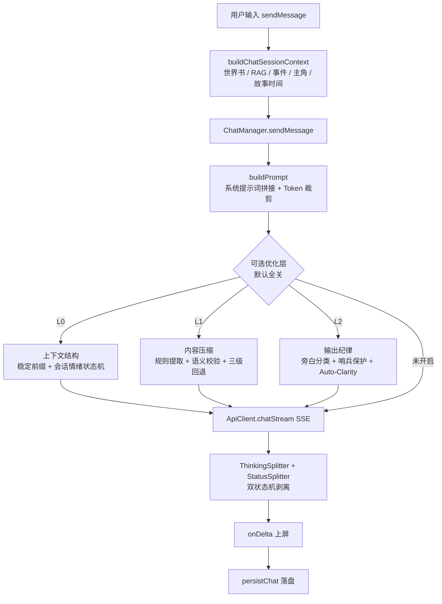

# 对话体验评估与模型选型建议

> 日期：2026-09-21
> 依据：`docs/dev/dialogue-pipeline-分析.md`（对话流程梳理）+ `docs/other/dialogue-models-选型调研.md`（模型调研）
> 结论摘要：**换模型能解决约 1/3 的体验问题；剩下 2/3 中，有两处「已实现但未接线」的工程改进，性价比高于换模型。**

---

## 1. 当前对话流程

### 1.1 主链路



### 1.2 L0–L2 分层运行时（易被误解的一点）

它是**叠加在主链路上的可选优化层，默认全关**（设置页可开），三层各管一事：

| 层 | 职责 | 实现方式 |
|---|---|---|
| **L0** | 上下文结构：字节稳定前缀 + 会话情绪状态机（目标：命中前缀缓存） | 纯规则，零 LLM |
| **L1** | 内容压缩：提取式压缩 + 语义校验 + 三级回退（阈值 70%/80%） | 纯规则，零 LLM |
| **L2** | 输出纪律：旁白分类（状态性/对白/情绪）+ 哨兵保护 + Auto-Clarity 软声明 | 纯规则，零 LLM |

三层**全部 fail-open**（失败不阻塞主流程）。

### 1.3 各阶段与依赖

| 阶段 | 依赖的模型/算法 | 关键位置 |
|---|---|---|
| 上下文组装 | 向量检索（ONNX bge 系列）+ 关键词匹配 | `prompt-builder.ts` / `lorebook.ts` / `embedding.ts` |
| 意图/事件触发 | **规则 + 关键词**（非模型） | `random-events.ts` / 事件命令引擎 |
| 情绪建模 | **情绪词表 + 确定性规则**（非模型） | `output-discipline.ts` `detectEmotion` |
| 记忆检索 | 向量相似度（ONNX 嵌入） | `vector-model-manager.ts` |
| 提示词组装 | Token 计数 + 硬裁剪 | `prompt-builder.ts:245`（`budget = maxContextTokens - reservedTokens`） |
| 生成 | **对话模型（可替换）** | 四个 client（openai 兼容 / anthropic / tauri / local） |
| 输出后处理 | 双状态机 + 规则压缩 | `thinking-parser.ts` / `status-parser.ts` / `output-discipline.ts` |

---

## 2. 关键诊断：2/3 是工程兜底

**这是评估"换模型值不值"的核心结论**（来自对话流程梳理）：

> 约 **2/3 的环节由工程手段兜底**，换模型既不会让它们变好、也不会让它们失效。
> 真正依赖**模型自身能力**的只有 9 类。

| 体验维度 | 主导方 | 换模型的收益 |
|---|---|---|
| 上下文裁剪、Token 计数、流式解析 | 工程 | 无 |
| 情绪识别（当前） | 工程（词表） | 无 |
| 事件/世界书触发 | 工程（关键词） | 无 |
| L0/L1/L2 三层优化 | 工程（规则） | 无 |
| 采样参数回落、命令引擎 | 工程 | 无 |
| **角色演绎质量** | **模型** | **高** |
| **长程一致性** | **模型** | **高** |
| **设定遵守（人设不崩）** | **模型** | **高** |
| **剧情推进与事件演绎** | **模型** | **高** |
| **工具调用 / 状态块结构化输出** | **模型** | **中高** |
| 摘要质量、mood 表达、CoT 推理 | 模型 | 中 |

---

## 3. ⚠️ 最重要的发现：两处「已实现但未接线」

**优先级高于换模型** —— 因为它们零模型成本、且正好命中"长程一致性"这个最痛的点。

### 3.1 摘要能力已实现，但从未被调用

- `src/core/summarizer.ts` 完整实现，`SummarizationConfig` 也已接入设置类型
- **但全项目没有任何调用点**（仅 `settings.ts` / `types` 的**类型导入**）
- 已交叉验证：`grep -rn "summarizer" src/` 除自身与类型引用外**无命中**

### 3.2 记忆机制不完整

- `MemoryStore`（`memory-store.ts`）已实现版本化存储（稳定 ID + 修订号 + 快照 + diff + 恢复）
- 但 `chat.ts:193` 建实例后，**仅在 `:398` 首次种入角色卡 standing 事实**，且**未持久化**
- 向量库**只做检索、没有自动写入**路径

### 3.3 后果：当前上下文管理是「硬裁最早历史」

`prompt-builder` 的策略是 **Token 预算内直接丢弃最早的历史消息**，配合"滑动窗口 + 摘要"的组合**缺失**。

→ **早期剧情会被硬丢失**，长程一致性**完全押在模型的长上下文能力上**。
→ 这解释了为什么"聊久了就忘"——**这不是模型不够强，而是工程没把已有的摘要能力接上**。

**建议：先接线摘要 + 持久化记忆，再谈换模型。** 这是性价比最高的一步。

---

## 4. 模型评估

### 4.1 四个点名模型的核实结果

| 模型 | 核实结论 | 关键信息 |
|---|---|---|
| **Qwen-Character (1.8B)** | ❌ **未找到官方开源模型** | 阿里的角色扮演是「**通义星尘**」，仅在阿里云百炼提供 **API、权重闭源**。`Qwen1.5-1.8B` 真实存在但是**通用模型**，非 RP 专用（被 ChatHaruhi 等当底座用）。社区有同名微调，但**许可多未标注** |
| **Tifa-Deepseek-14b-CoT** | ✅ 准确 | 实名 `ValueFX9507/Tifa-Deepsex-14b-CoT`，基座 **DeepSeek-R1-14B**，14B / **128K** / 中英，带 `<think>` CoT。许可 apache-2.0 **但附加「Tifa 使用协议」**，训练语料含小说版权，HF 标 Not-For-All-Audiences |
| **G4-MeroMero-31B** | ✅ 准确 | 基座 **`google/gemma-4-31B-it`**，31B dense / **256K** / think+nothink 双模，GGUF 齐备。**许可 Apache 2.0** |
| **Index-1.9B** | ✅ 准确 | B 站出品，1.9B / 32K 变体，**有 `Index-1.9B-Character`**（RAG few-shot 做角色扮演），int4/GGUF、已适配 Ollama。代码 Apache-2.0，**权重走 Index Model License（免费商用但非 OSI 协议）** |

### 4.2 许可证是硬约束（本项目 Apache-2.0 且已开源）

| 风险 | 模型 |
|---|---|
| 🔴 **不可用** | **Llama 3.x 全系**（含 Sao10K Lunaris 等**所有 Llama 微调——限制会传递**）、Gemma 3 及更早（自定义 Terms）、MiniCPM（商用需填问卷）、通义星尘（闭源） |
| 🟡 **需谨慎** | Tifa 系列（附加协议 + 版权语料）、Index-1.9B 权重（自定义协议）、社区未标注许可的微调 |
| 🟢 **安全** | Qwen / Qwen2.5 / Qwen3 全系、**Gemma 4 全系**、Mistral-Small-24B、DeepSeek-R1-Distill（MIT） |

> **关键发现**：**Gemma 4 已从自定义协议改为 Apache 2.0** —— `G4-MeroMero-31B` 因此从"许可风险"跃升为"安全区"。

---

## 5. 选型建议（按部署形态）

### 5.1 本地部署（低配硬件）

**硬约束**：本地引擎 `MODEL_REGISTRY` 目前只注册 5 个模型（Qwen2.5 0.5B/1.5B/3B、Llama 3.2 1B/3B），且 **`contextLength` 硬编码 4096**。新增模型**需要改注册表**，并受 WebLLM 可用生态限制。

| 推荐 | 理由 | 代价 |
|---|---|---|
| **① Index-1.9B-Character**（首选） | 1.9B 可 CPU 跑；**RAG few-shot 做角色扮演**（与我们的检索架构天然契合）；中文原生；免费商用 | 权重走自定义协议；需注册进 `MODEL_REGISTRY` |
| **② Qwen2.5-3B-Instruct + 社区 RP LoRA** | 全链 **Apache-2.0** 最干净；3B 在 8GB 内存可跑 | 需自己找/训 LoRA；LoRA 许可需逐个核实 |

⚠️ **本地不适合的**：14B / 31B（即便量化也超出低配硬件）；Tifa 系列（附加协议）。

### 5.2 线上部署（高配硬件 / 自有 API）

**优势**：走 OpenAI 兼容协议，**改配置即可接入，零代码改动**；`maxContextTokens` 可配置。

| 推荐 | 理由 | 代价 |
|---|---|---|
| **① G4-MeroMero-31B**（首选） | 31B dense / **256K 上下文** / **Apache-2.0**；RP 专精；think+nothink 双模正好配合我们的思考强度控件 | 需 ≥24GB 显存（量化后）；中文 RP 实测数据未查到 |
| **② Qwen3-32B** | **Apache-2.0**；中文最强底座；可自训微调 | 非 RP 专精，需额外调教 |
| ③ Tifa-Deepseek-14b-CoT | 14B / 128K，中文叙事强，自带 CoT | **必须剥离 `<think>` 标签**（我们已有能力）；许可需法务确认 |

---

## 6. 建议的行动顺序

```
第 1 步（零模型成本，收益最高）
  接线 summarizer + 持久化 MemoryStore + 补向量库写入路径
  → 直接改善"长程一致性"这个最痛的体验点

第 2 步（配置级，零代码）
  线上接入 G4-MeroMero-31B（Apache-2.0、256K、RP 专精）
  → 长上下文 + RP 能力同时到位

第 3 步（需开发）
  本地注册 Index-1.9B-Character 到 MODEL_REGISTRY
  → 本地体验提升；注意 contextLength 4K 的天花板

第 4 步（可选）
  评估 Qwen3-32B 自训 RP 微调 / Tifa 系列（需先过法务）
```

**一句话结论**：**先接线已有的摘要与记忆能力，再按部署形态换模型** —— 前者零成本且命中要害，后者解决剩下的 1/3。

---

## 7. 未查到 / 待确认

- 通义星尘的参数规模与上下文（闭源未公开）
- G4-MeroMero-31B 的中文 RP 实测数据
- 各模型硬件门槛为按参数量与量化位宽**估算**，非实测
- `Index-1.9B-Character` 的 RAG few-shot 机制与我们的 `lorebook` 架构能否直接复用（值得进一步评估）
