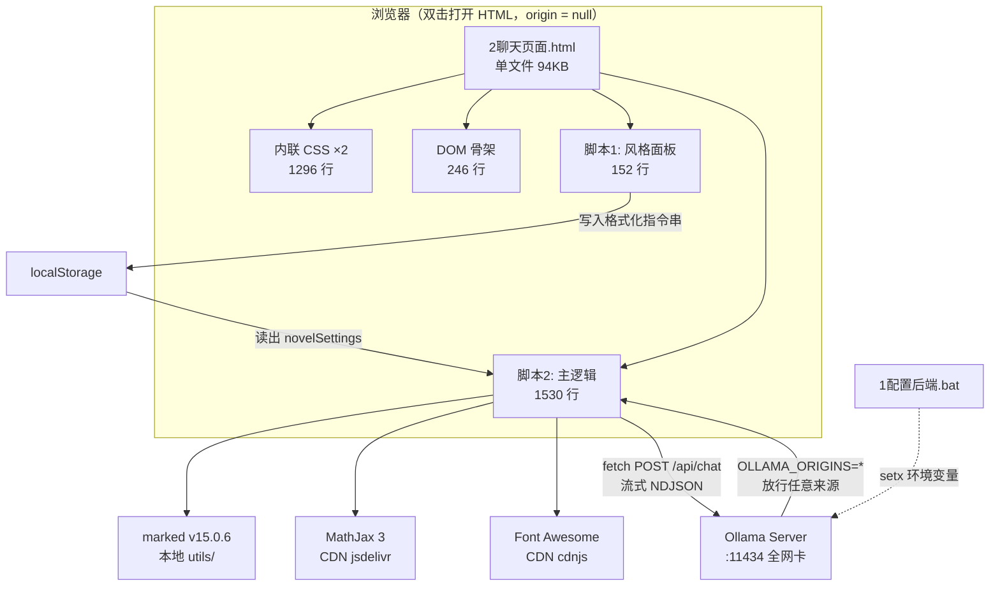
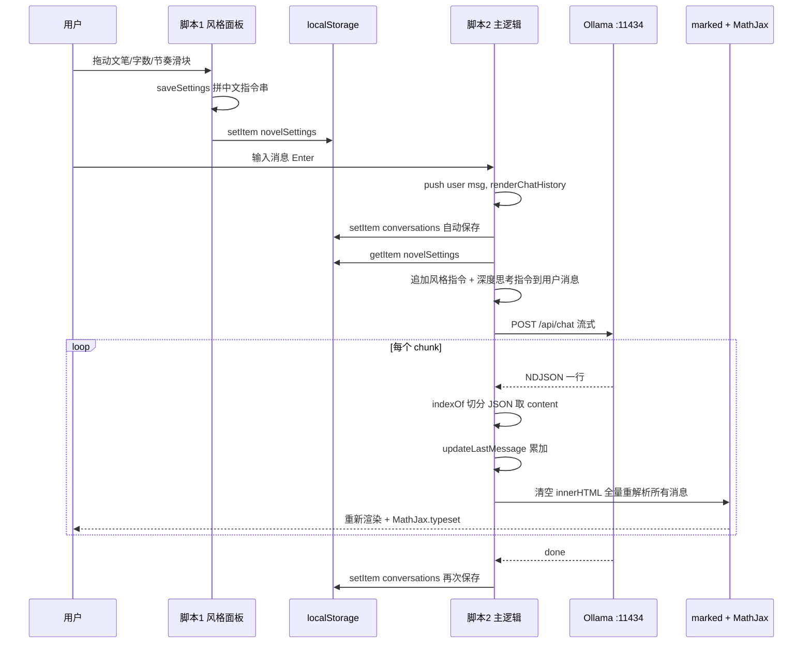

# Tifa-Deepsex-OllamaWebUI 技术/代码架构评审

> 评审人：高见远（架构师）
> 评审日期：2026-09-20
> 评审对象：https://github.com/Value99/Tifa-Deepsex-OllamaWebUI （`main` 分支，最后提交 2026-08-14）
> 评审性质：**只读技术分析**，用于「AI 酒馆」的反向参考与技术借鉴
> 证据来源：全部结论均来自仓库真实源码（通过 GitHub API 拉取原始文件），代码片段标注了行号；未能确认的部分已显式标注

---

## 0. 评审方法与证据基线

`raw.githubusercontent.com` 在本机网络环境不可达，改用 GitHub API 的 `git/blobs` 接口（Accept: `application/vnd.github.raw`）获取原始字节。实际拉取并完整分析的文件：

| 文件 | SHA | 大小 | 分析方式 |
|---|---|---|---|
| `2聊天页面.html` | `aa1bee157dbc3f7b1d3d8326139430229c6cf5a8` | 94,751 B / 3,244 行 | 全量 Read + Grep 定位 |
| `1配置后端.bat` | `e1ec8d47e9df808591456c0ad1f2c6619f8f0f1c` | 914 B | 全量 Read |
| `README.md` | `c5a87a781ba595e8475b239a59a5f609f0d2e889` | 2,305 B | 全量 Read |
| `utils/marked.min.js` | `945165e179bb1c265b91085ca8af0a45e9557c0c` | 39,255 B | 头部注释确认版本 |

**结论可信度说明**：主程序为单文件、无构建产物、无混淆，源码即运行代码，因此本报告的所有机制描述均为「实测代码」而非推断。

---

## 1. 整体架构

### 1.1 一句话概括

> **一个 94KB 的单 HTML 文件，把 `<style>`（1,296 行）+ DOM 骨架（246 行）+ 两个内联 `<script>`（1,682 行）全部塞进同一份文档，用原生 DOM API 直接操作、用 `localStorage` 当数据库、用「往用户消息里追加自然语言指令」代替后端配置，直连本机 Ollama 的 `/api/chat` 流式接口。**

它是「零构建、零依赖管理、双击即用」这一设计目标的极致产物，也是一个**没有分层、没有模块、没有测试边界**的典型原型代码库。

### 1.2 文件构成

仓库根目录只有 4 项：

```
/
├── 1配置后端.bat          914 B     Windows 批处理，写 Ollama 环境变量
├── 2聊天页面.html      94,751 B     主程序 = 全部功能
├── README.md            2,305 B     更新日志 + 配置说明
└── utils/
    └── marked.min.js   39,255 B     marked v15.0.6（唯一本地依赖，原样 vendored）
```

注意：`utils/` 目录名暗示"辅助资源"，实际**只有一个文件**——被 vendored 进来的 Markdown 解析器。其余渲染能力（公式、图标）全部走 CDN。

### 1.3 单文件内部组织（按行号分区）

| 行号区间 | 内容 | 行数 | 说明 |
|---|---|---|---|
| 1–13 | `<head>` + 3 个 CDN 引用 | 13 | 字体 / MathJax / Font Awesome，**全部无 SRI** |
| 14–1150 | 内联 `<style>`（主样式） | 1,137 | CSS 变量主题、布局、消息气泡、think 容器 |
| 1153–1167 | 加载屏 + 顶部按钮 | 15 | |
| 1169–1183 | 左侧会话侧栏 | 15 | |
| 1185–1229 | 主区：模型下拉 + 欢迎页 + 消息容器 | 45 | |
| 1231–1265 | 输入区（深度思考 / 设置 / 发送） | 35 | |
| 1268–1323 | 高级参数弹窗 | 56 | 系统提示 / API / 生成参数 / 三个工具按钮 |
| 1325–1398 | 右侧「角色扮演控制」面板 | 74 | 风格滑块 ×3 + 节奏按钮 + 状态栏开关 |
| **1400–1558** | **第二个内联 `<style>`** | 159 | **样式块被切成了两段，中间夹着 HTML** |
| 1560–1711 | 内联脚本 #1 | 152 | 风格面板的设置读写 |
| 1712 | `<script src="./utils/marked.min.js">` | 1 | 本地 vendored |
| 1713–3242 | 内联脚本 #2（**主逻辑，1,530 行**） | 1,530 | 全部业务：请求、渲染、存储、导出 |

**架构判断**：分区是"物理顺序"而非"逻辑分层"。第 1400 行又开了一个 `<style>` 块，说明作者是在既有文件里不断往后追加功能，从未做过结构性整理。两个 `<script>` 之间靠**隐式全局作用域**通信（脚本 #1 把格式化配置写进 `localStorage['novelSettings']`，脚本 #2 再读出来用），这是最典型的技术债信号。

### 1.4 第三方依赖

| 依赖 | 来源 | 方式 | SRI | 体积 | 用途 |
|---|---|---|---|---|---|
| marked **v15.0.6** | `./utils/marked.min.js` | **本地 vendored** | N/A | 39 KB | Markdown → HTML |
| MathJax 3 | `cdn.jsdelivr.net/npm/mathjax@3/es5/tex-mml-chtml.js` | CDN，`async` | **无** | 运行时下载 | 数学公式渲染 |
| Font Awesome 6.4.0 | `cdnjs.cloudflare.com/ajax/libs/font-awesome/6.4.0/css/all.min.css` | CDN | **无** | 运行时下载 | 图标（复制/刷新/主题） |
| Noto Sans SC | `fonts.proxy.ustclug.org`（**中科大 Google Fonts 反代**） | CDN | N/A | 运行时下载 | 中文字体 |

值得注意的两点：
1. **marked 是唯一被本地化的依赖**——因为它是渲染主链路的必需品，离线也要能用。这个取舍是清醒的。
2. 字体走的是 `fonts.proxy.ustclug.org` 这个**第三方镜像**（非 Google 官方域名），说明作者为国内网络做了规避，但也引入了「依赖一个随时可能关停的公益镜像」的新风险。

### 1.5 架构图



---

## 2. 核心链路剖析

### 2.1 Ollama API 调用

使用 **`/api/chat`**（非 `/api/generate`），带 system 消息的消息数组，走流式。

```js
// chat.html:2391-2405
const response = await fetch(`${basePoint}/api/chat`, {
    signal: controller.signal,
    method: 'POST',
    headers: { 'Content-Type': 'application/json' },
    body: JSON.stringify({
        model: chatModel,
        messages: messagesWithSystem,
        max_output_tokens: params.max_tokens,
        temperature: params.temperature,
        top_p: params.top_p,
        repeat_penalty: params.repeat_penalty
    })
});
```

**⚠️ 重大发现：高级参数面板极可能是"装饰品"。**

Ollama 官方 API 文档明确：`/api/chat` 的顶层字段只有 `model` / `messages` / `tools` / `format` / `options` / `stream` / `keep_alive`（新版另有 `think`）。**采样参数必须嵌套在 `options` 对象内**，且控制最大生成长度的字段叫 **`num_predict`**，不存在 `max_output_tokens`。

也就是说：
- `temperature` / `top_p` / `repeat_penalty` 放在顶层 → Ollama 会当作未知字段忽略；
- `max_output_tokens` 即使塞进 `options` 也不是合法键名。

**结论：四个"高级参数"输入框填了不生效，用户以为在调模型，实际一直在用 Modelfile 默认值。**这是一个功能性的隐蔽 Bug，也是 README 声称"支持高级参数调节"与实际实现的落差。（判定依据为官方 API 文档；未在本机起 Ollama 实测，标注为"高概率失效，建议实测确认"。）

另外，**没有使用 Ollama 0.9+ 原生支持的 `think` 字段**，思维链完全靠提示词工程（见 2.3）。

#### 流式处理：手写 NDJSON 切分

```js
// chat.html:2411-2461（节选）
const reader = response.body.getReader();
const decoder = new TextDecoder("utf-8");
let replyContent = '';
let partialChunk = '';

while (true) {
    const { done, value } = await reader.read();
    if (done) break;

    let chunk = partialChunk + decoder.decode(value, { stream: true });
    partialChunk = '';

    let startIdx = 0, endIdx;
    while ((endIdx = chunk.indexOf('}\n', startIdx)) !== -1) {
        try {
            const jsonStr = chunk.substring(startIdx, endIdx + 1);
            const data = JSON.parse(jsonStr);
            if (data.message?.content) {
                replyContent += data.message.content;
                updateLastMessage(replyContent);   // ← 触发全量重渲染
            }
            startIdx = endIdx + 2;
        } catch (e) {
            console.error('解析错误:', e, ...);
            startIdx = endIdx + 2;               // 吞掉错误继续
        }
    }
    if (startIdx < chunk.length) partialChunk = chunk.substring(startIdx);
}
```

**评价**：
- ✅ 用 `TextDecoder({stream:true})` 处理多字节 UTF-8 截断，方向正确；
- ✅ 有 `partialChunk` 跨 chunk 缓冲，基本可用；
- ❌ 分隔符硬编码 `'}\n'`，不兼容 `\r\n` 换行；
- ❌ 用"找 `}` + 换行"代替"按 `\n` 切行"——一旦模型输出内容里出现 `}` 紧跟换行（JSON 内会转义为 `\n`，但服务端若逐字输出仍可能踩中），切分就错位；
- ❌ 解析失败只 `console.error` 后跳过，**静默丢内容**；
- ❌ 完全不检查 `data.done` / `done_reason` / 错误对象，连接中途断开会被当作正常结束。

### 2.2 思维链（CoT）解析机制

**机制：纯文本标签 `<think>` / `</think>`，用 `String.replace` 做字符串替换——不是增量状态机。**

**（a）回传上下文时剥离思考**（2345-2350）：

```js
content: msg.role === 'assistant'
    ? msg.content.replace(/<think>[\s\S]*?<\/think>/gi, '').trim()
    : msg.content.trim()
```

历史中的 assistant 消息**存了思考内容，但回传时剥掉**——省 token，思路正确（很多 WebUI 犯这个错）。

**（b）渲染时把标签替换成 DOM**（2536-2557）：

```js
content = content.replace(/<think>|<\/think>/gi, (match) => {
    if (match.toLowerCase() === '<think>') {
        inThinkBlock = true;
        thinkCount++;
        return `<div class="think-container">
                <div class="think-toggle"><span>思考过程</span><svg .../></div>
                <div class="think-content2" style="display: block;">
                <pre>`;
    } else if (match.toLowerCase() === '</think>') {
        inThinkBlock = false;
        const result = `</pre></div></div>`;
        currentThinkContent = '';
        return result;
    }
});
```

**评价——这是全项目最"糙但有效"的一段**：
- ✅ 思路清晰：把标签当"开关"，替换成可折叠容器，配合 CSS（`.think-content` 左边框 + 灰字 + `pre-wrap`）做出思考区的视觉区分；
- ❌ **`inThinkBlock` / `currentThinkContent` 从未声明**，在非严格模式下被静默创建为全局变量——作者显然是想做增量状态机（存 `currentThinkContent`），但**没写完，变量写了没人读**；
- ❌ **不是增量解析**：每来一个 chunk 都对整个 `replyContent` 重新跑一遍正则替换 + 全量重渲染（见第 6 节）；
- ❌ **流式中间态不可控**：`<think>` 已到、`</think>` 未到时，插入的是**未闭合**的 `<div><pre>`，靠浏览器 HTML 容错自动闭合——能用，但属于"碰巧能跑"；
- ❌ 残留死代码：2629 行还在替换 `___THINK_PLACEHOLDER___`，但全文件从未插入过该占位符。

**关键判断：这套 CoT 方案本质是"Markdown 渲染前的一次性字符串替换"，不是流式的增量状态机。**它之所以看起来能用，是因为它每次都从头重算——用 O(N²) 的代价换来了"不需要维护状态"的简洁。

### 2.3 深度思考 / 思考级别

**请求层做法：往最后一条用户消息的字符串后面追加一句中文指令**（2355-2365）：

```js
if (deepThinkingLevel > 0 && messagesWithSystem.length > 1) {
    const lastUserMsg = messagesWithSystem.findLast(msg => msg.role === 'user');
    if (lastUserMsg) {
        if (deepThinkingLevel === 1) {
            lastUserMsg.content += "\n\n使用<think>思考900字";
        } else if (deepThinkingLevel === 2) {
            lastUserMsg.content += "\n\n使用<think>思考1800字";
        }
    }
}
```

按钮是三态循环（`0 → 1 → 2 → 0`），状态存 `localStorage['deepThinkingLevel']`，每次点击用 `innerHTML` 整体重写按钮内容（含内联 SVG）。

**评价**：
- ✅ **这个"用字数控制思考预算"的产品思路很有意思**——把抽象的"思考深度"翻译成模型能理解的、可量化的 token 预算指令，比"请深入思考"有效得多，是个真正的产品巧思；
- ✅ 追加到 `messagesWithSystem`（由 `map` 产生的**副本**）而非 `chatHistory`，不污染本地历史——这个细节是对的；
- ❌ 完全依赖目标模型（Tifa-DeepsexV2-Cot-0301）**恰好被训练成认这句指令**，换个模型立刻失效；
- ❌ 按钮文案与状态用 `innerHTML` 重写，三处几乎完全重复的 SVG 字符串（1952 / 1960 / 1968），复制粘贴式维护。

### 2.4 角色扮演状态栏："自动适配"是怎么做的

**机制：约定模型在末尾输出一个被 ``` 包裹的 `键: 值` 状态块，前端"嗅探"这个块的格式来决定怎么渲染。**

**（a）提示侧**：风格面板的开关状态被拼成一段中文指令写进 `localStorage['novelSettings']`（1672-1681）：

```js
const statusOutput = `{
风格：${['严谨，工整，标准','清水文，标准','好文笔，活泼','深度思考，发癫文学，文艺'][settings.style]} 
字数：${settings.wordCount-100}字
段落：${paragraphs}
对话占比：${dialogRatio}
状态栏：${settings.statusBar ? '开' : '关'}
}`;
localStorage.setItem(FORMATTED_KEY, statusOutput);
```

然后在发请求前追加到用户消息（2369-2386）：

```js
const novelSettings = localStorage.getItem('novelSettings') || `{...默认...}`;
lastUserMsg.content += `\n\n${novelSettings}`;
```

**（b）渲染侧**：取出消息里**最后一个**代码块，判断它是不是 key-value 格式（2777-2832）：

```js
if (isKeyValueFormat(codeBlock.code)) {          // /^[\s\S]*[\u4e00-\u9fa5\w]+:/
    const lines = codeBlock.code.split('\n');
    for (const line of lines) {
        const [key, value] = splitKeyValue(line);   // 按第一个 ':' 切
        if (!key || !value) continue;
        const keyLower = key.toLowerCase();
        if (keyLower.includes('地点') || keyLower.includes('位置') || keyLower.includes('地址') ||
            keyLower.includes('场景') || keyLower.includes('时间') || keyLower.includes('日期') ||
            keyLower.includes('npc') || keyLower.includes('角色') || keyLower.includes('人物') ||
            keyLower.includes('关系') || keyLower.includes('想法') || keyLower.includes('思考')) {
            // → 渲染成带 emoji 图标的「特殊行」(.teshu)
        }
    }
    // 剩余的 key-value 渲染进 .key-value-container
}
```

匹配到关键词就**自动加 emoji 图标**（2894-2919）：

```js
function addIconToKey(key) {
    const keyLower = key.toLowerCase();
    if (keyLower.includes('地点') || ... ) return '🧭 ' + key;   // 地点/位置/地址/场景
    if (keyLower.includes('时间') || ... ) return '⏱️ ' + key;   // 时间/日期
    if (keyLower.includes('npc') || ... ) return '👤 ' + key;    // 角色/人物
    if (keyLower.includes('好感') || ... ) return '💗 ' + key;   // 好感/关系
    if (keyLower.includes('想法') || ... ) return '💭 ' + key;   // 想法/思考
    return key;
}
```

还有响应式布局降级：值 >20 字 / 含换行 / 含 2 个以上逗号 → 从"横排"切成"竖排"（`.vertical-layout`）。

**评价**：
- ✅ **"格式嗅探 + 关键词加图标"是一个真正值得借鉴的巧思**：不要求模型输出严格 JSON（脆弱），而是容忍任意 key，只对**认识的 key** 做美化，其余原样降级展示。这是典型的**渐进增强**思路，鲁棒性远好于"要求模型输出 schema"；
- ✅ 关键词匹配用 `includes` 而非 `===`，容错好（"当前地点"也能命中）；
- ✅ 状态栏复用"代码浮层"这个已有容器，没有另建一套 UI；
- ❌ **硬编码中英混合关键词表**，无法扩展（要加字段必须改源码）；
- ❌ `splitKeyValue` 按第一个 `:` 切分，值里含 `:` 会截断；中文全角冒号 `：` **完全不支持**；
- ❌ 只处理"最后一个代码块"——模型若在正文里用了代码块，状态栏判定会错乱；
- ❌ `usedKeys` 里 push 的是 `keyLower`，第二次遍历用 `key.toLowerCase()` 比对，逻辑对但可读性差。

### 2.5 风格控制面板

**本质：不是 API 参数，是"提示词注入 + localStorage 跨脚本通信"。**

四个控件（文笔风格 0-3 / 字数 100-2000 / 旁白占比 1-5 / 剧情节奏 慢中快）→ `saveSettings()` → `updateStatusDisplay()` → 拼成中文指令串 → `localStorage['novelSettings']` → 发请求时追加到用户消息末尾。

滑动条视觉用了"轨道 + 进度条"双层叠加（`.slider-track` 在下、`.styled-slider` 透明覆盖在上），进度条宽度用 JS 算百分比（1582-1588）。

**评价**：
- ✅ **产品层面很聪明**：把"文笔风格/节奏/字数"这类**模型行为偏好**翻译成自然语言指令，绕开了"本地模型不支持这些参数"的限制——在没有可控 API 的约束下，这是唯一可行的路径；
- ✅ 段落数由字数/节奏**推导**（`paragraphs = wordCount / paragraphSize`），不是让用户填第二个滑块，交互负担小；
- ❌ **工程层面是坏味道**：两个 `<script>` 块靠 `localStorage` 传数据（写一次读一次），而不是函数调用——这是"全局变量不够用就上持久化"的反模式；
- ❌ `settings.narration` 初始值是 `1`，但 HTML 里 `value="2"`，默认值不一致（1610 vs 1369）；
- ❌ 面板标题写死"仅支持 UltraV2"，功能与特定模型强绑定。

### 2.6 数学公式

```html
<!-- chat.html:12 -->
<script id="MathJax-script" async src="https://cdn.jsdelivr.net/npm/mathjax@3/es5/tex-mml-chtml.js"></script>
```

**没有任何 MathJax 配置**（无 `MathJax = {...}` 全局配置块），因此只能用默认分隔符 `$$...$$` 和 `\(...\)`。每次渲染末尾同步调用：

```js
// chat.html:2685-2691
try {
    MathJax.typeset();
    console.log("23")
} catch (e) {
    console.log("213")     // ← 调试残留：用 console.log("23")/"213" 当断点
}
```

为了不让 Markdown 解析器吃掉 LaTeX 的反斜杠和 `~`，作者用了**占位符替换**的土办法（2619-2628）：

```js
content = content.replace(/\\/g, "aaa@");
content = content.replace(/\[\n/g, "bbb@");
content = content.replace(/\n\[/g, "ccc@");
content = content.replace(/~/g, "ddd@");
content = marked.parse(content);
content = content.replace(/ccc@/g, "\n[");
content = content.replace(/bbb@/g, "[\n");
content = content.replace(/aaa@/g, "\\");
content = content.replace(/ddd@/g, "~");
```

**评价**：这是全文件最"脏"的一段——用魔法字符串 `aaa@/bbb@/ccc@/ddd@` 当转义哨兵。问题是**全局替换**：模型若正常输出 `aaa@` 这段文字就会被还原成 `\`。正确做法是让 MathJax 在 marked 之后处理、或给 marked 配自定义 renderer 跳过数学区段。

### 2.7 代码浮动显示

1. 正则抓所有 ``` 块（2568）；
2. 取**最后一个**，`fullMatch` 从正文里 `replace` 掉（2599，用了 `String.replace` 而非 `replaceAll`，只替换第一处）；
3. 建一个 `.floating-code` 绝对定位浮层，塞进 `document.body`，标题栏可拖拽（2741-2891）；
4. 拖拽位置存在模块级变量 `floatingCodePosition`，**不持久化**。

拖拽是手写的 `onmousedown/onmousemove/onmouseup` 三件套（2697-2739），只支持鼠标，**无 touch 事件** → 手机上拖不动。

### 2.8 核心链路时序图



---

## 3. 数据与存储

### 3.1 存储键清单

| Key | 内容 | 写入时机 | 风险 |
|---|---|---|---|
| `conversations` | **全部会话的完整 messages 数组** | 每次发消息、每次收完、切会话、删会话、清聊天、存参数 | 🔴 最大，无容量控制 |
| `chatParams` | 温度/惩罚/top_p/最大 token + **basePoint** | 点"保存设置" | 中 |
| `rp_settings` | 风格面板 5 项 | 每次拖动滑块 | 低 |
| `novelSettings` | 拼好的中文指令串 | 每次拖动滑块 | 低 |
| `deepThinkingLevel` | "0"/"1"/"2" | 点击深度思考 | 低 |
| `floatCodeEnabled` | "true"/"false" | 保存设置 | 低 |
| `theme` | "light"/"dark" | 切换主题 | 低 |

### 3.2 会话数据结构

```js
// chat.html:2175-2182
const newConv = {
    id: Date.now().toString(),
    title: '新对话',
    created: new Date().toISOString(),
    messages: [],
    systemPrompt: document.getElementById('system-prompt').value,
    model: chatModel
};
```

标题自动取第一条用户消息首行、截断 30 字（2269-2277）。侧栏列表标题再截断 10 字（2116）。

### 3.3 容量风险（**明确的生产事故隐患**）

```js
// chat.html:2280 —— 没有 try/catch
localStorage.setItem('conversations', JSON.stringify(conversations));
```

`conversations` 是**一个键存所有会话**，每次保存都是 `JSON.stringify` 全量 + 全量覆写。浏览器 localStorage 配额约 5MB（按 UTF-16 计约 2.5M 字符）。

**风险链条**：
1. 长对话 + 带思维链（思考内容也存了）→ 单条 assistant 消息可达数万字；
2. 累积到 5MB → `setItem` 抛 `QuotaExceededError`；
3. 该调用**没有 try/catch**，且出现在 `sendMessage` / `requestAssistantResponse` 的调用路径上（2331、2477）；
4. 后果：**正在进行的回复保存失败 → 异常冒泡 → 本次对话丢失**，且用户无任何提示（只有 console）。

另外，每次保存都全量序列化所有会话，意味着**长对话下"发一条消息"要串行化几 MB 数据**，直接卡死主线程（见第 6 节）。

### 3.4 导出

导出为**纯文本 `.txt`**（3207-3230），非 JSON：

```js
const content = chatHistory.map(msg =>
    `${msg.role === 'user' ? '用户' : '助手'} (${new Date().toLocaleString()}):\n` +
    `${msg.content.replace(/<think>.*?<\/think>/gis, '')}\n` +
    '――――――――――――――――――――――――――――――――――――――――――――'
).join('\n\n');
```

用 `Blob` + `URL.createObjectURL` + 临时 `<a download>` 触发下载。

**评价**：
- ✅ 导出时剥离思考内容，体验细节到位；
- ❌ 时间戳是**导出时刻**（`new Date()`）而非消息产生时刻——所有消息时间戳相同，等于没有时间戳；
- ❌ 纯文本不可回导，无法备份恢复；
- ❌ 文件名 `聊天记录_YYYY-MM-DD.txt`，同一天导出多次会覆盖（靠浏览器自动加 (1) 后缀）。

---

## 4. 工程化水平评审

### 4.1 可维护性：**不及格**

| 指标 | 实测值 | 判断 |
|---|---|---|
| 单文件规模 | 94,751 B / 3,244 行 | 主逻辑脚本单块 **1,530 行** |
| 函数数量 | 约 40 个，全部嵌套在 `DOMContentLoaded` 闭包里 | 无法被任何模块 import |
| 模块系统 | 无（无 ESM / 无 IIFE 封装） | 脚本 #1 靠"裸全局变量"，脚本 #2 靠闭包 |
| 状态管理 | 11 个闭包变量（`chatHistory` / `params` / `controller` / `replyIng` …） | 无单一数据源，靠 DOM 反查（如 2560 行 `document.getElementById('float-code-toggle')?.checked` 直接读 DOM 当状态） |
| 可测试性 | **0**——所有逻辑锁在事件回调闭包内 | CI 覆盖率门禁下不可行 |
| 重复代码 | 深度思考按钮 SVG 复制 3 次；`splitKeyValue` 渲染分支复制 2 遍（2802-2826 vs 2849-2873） | |
| 死代码 | `___THINK_PLACEHOLDER___`（2629）、`.mobile-sidebar-toggle`（708 有 CSS 无元素）、`inThinkBlock`/`currentThinkContent`（写了不读）、`thinkCount`（计数了不用） | |
| 调试残留 | `console.log("23")` / `console.log("213")`、`console.log(isFloatCodeEnabled)`、`console.log(JSON.stringify(messagesWithSystem))` | 生产环境满屏日志 |

### 4.2 配置方式：Windows-only，且是"破坏性"的

`1配置后端.bat`（914 B）做了四件事：

```bat
setx OLLAMA_HOST ":11434"        :: 监听所有网卡
setx OLLAMA_ORIGINS "*"          :: 放行任意跨域来源
taskkill /F /IM "ollama*.exe"    :: 强杀 Ollama 进程
start "" "%USERPROFILE%\AppData\Local\Programs\Ollama\ollama app.exe"
```

**评价**：
- ❌ **仅 Windows**，且**硬编码了 Ollama 的默认安装路径**；
- ❌ `setx` 是**永久写入用户环境变量**，不是临时设置——用户跑一次就永久改了系统配置，且脚本**没有任何"撤销"路径**；
- ❌ `taskkill /F` 无条件强杀用户正在跑的 Ollama（可能正在服务别的任务）；
- ❌ `setx` 后**不重启终端读不到**，但脚本直接启动 Ollama，此时新环境变量**对刚启动的进程是否生效取决于父进程环境**——存在时序坑；
- ✅ README 提供了手动配置章节（第 81-92 行），macOS/Linux 用户有出路。

### 4.3 错误处理

| 位置 | 处理 | 评价 |
|---|---|---|
| 模型列表加载（2086） | `.catch(err => console.error(...))` | ❌ 静默，UI 无任何"连不上 Ollama"提示 |
| 请求主流程（2478-2480） | `catch` 里仅 `console.error`，`AbortError` 过滤 | ❌ **网络失败/500 用户完全无感知**，界面就停在"没回复" |
| JSON 流式解析（2451） | catch 后跳过 | ❌ 静默丢内容 |
| localStorage 读取 | 有 `try/catch` | ✅ |
| **localStorage 写入** | **无 try/catch** | 🔴 见 3.3 |
| 中止请求 | `AbortController` + 按钮图标切换 | ✅ 这个做对了 |

### 4.4 移动端适配：**半成品**

```css
/* chat.html:6 */
<meta name="viewport" content="width=device-width, initial-scale=1" />
```

断点只有 3 个：

| 断点 | 作用 |
|---|---|
| `@media (max-height: 830px)` | 隐藏欢迎页示例卡片 |
| `@media (max-width: 799px)` | 同上 |
| `@media (max-width: 768px)` | 侧栏移出屏幕（`left: -260px`），主容器 100% 宽 |

**问题**：
- ❌ **没有 `dvh` / `svh`**，只有 `height: 100vh`（110、189 行）→ iOS Safari 地址栏伸缩时布局跳动；
- ❌ 侧栏 `left: -260px` 后，CSS 里准备了 `.sidebar.open { left: 0 }`（700 行）和 `.mobile-sidebar-toggle`（708 行），但 **JS 里没有任何代码给 sidebar 加 `open` 类，HTML 里也没有 `.mobile-sidebar-toggle` 元素** → **手机上侧栏打不开**，这是明确的**功能缺失**；
- ❌ 无 `env(safe-area-inset-*)` → iPhone 刘海/底部横条遮挡；
- ❌ 浮层拖拽只有 `mousedown/mousemove/mouseup`，**无 touch 事件** → 手机上代码浮层拖不动；
- ❌ 顶部按钮、输入框未针对触摸目标尺寸（44px）优化。

### 4.5 无障碍与 i18n

| 项 | 实测 | 结论 |
|---|---|---|
| `aria-*` 属性 | **0 个**（`grep -c 'aria-' = 0） | 屏幕阅读器完全不可用 |
| `role` 属性 | 0 个 | |
| 键盘可达性 | 仅输入框 Enter 发送；按钮无 focus 样式；弹窗无焦点陷阱 | |
| `<html lang>` | `lang="zh"` | 有，但… |
| i18n 机制 | **不存在**——所有文案硬编码中文（"新建聊天"、"深度思考：低"、"确定要删除此对话吗？"、"没有消息可导出"） | 🔴 100% 中文硬编码 |
| 双语能力 | 唯一"多语言"痕迹是 `isChinesePreferred()`（2922）判断标题显示"代码"还是"Code" | 仅一处，且靠 `navigator.language` 嗅探而非配置 |

---

## 5. 安全与合规风险

### 5.1 风险清单

| # | 风险 | 等级 | 依据 | 影响 |
|---|---|---|---|---|
| S1 | **`OLLAMA_HOST=:11434` 监听全部网卡** | 🔴 高 | `1配置后端.bat:4` | 本机 Ollama 暴露到局域网/公网（若机器有公网 IP 或处在同一 WiFi），任何人可无认证调用你的 GPU 与模型 |
| S2 | **`OLLAMA_ORIGINS=*` 放行任意来源** | 🔴 高 | `1配置后端.bat:12` | 任意网页可用 JS 跨域调用你的本地 Ollama（读取响应）。配合 DNS rebinding 可绕过同源限制。这是**项目必需的**——因为 `file://` 打开时 origin 为 `null`，不放行就完全连不上——但代价是彻底放弃同源保护 |
| S3 | **Ollama 无任何认证** | 🔴 高 | 架构性 | Ollama 本身不提供鉴权；S1+S2 组合 = 开放的推理端点。可被用于算力滥用、模型探测 |
| S4 | **XSS：Markdown 输出未净化直接 `innerHTML`** | 🔴 高 | 2623-2632：`content = marked.parse(content); messageDiv.innerHTML = content;` | marked v15 **已移除 `sanitize` 选项**且默认不转义 HTML。模型输出（或任何可控输入）含 `` 即可执行脚本。全文件 27 处 `innerHTML` |
| S5 | **状态栏渲染二次 XSS** | 🟠 中 | 2807/2818：`keyDiv.innerHTML = addIconToKey(key) + ':'`；2811/2822：`valueDiv.innerHTML = formatValue(value)` | 键名/值仍走 `innerHTML`，`addIconToKey` 只加 emoji 不过滤 |
| S6 | **CDN 依赖无 SRI** | 🟠 中 | 12、13 行 `<script src>` / `<link>` 均无 `integrity` 属性 | MathJax / Font Awesome 若被劫持（CDN 投毒、中间人），直接获得页面完整执行权限。配合 S4 风险叠加 |
| S7 | **字体走第三方公益镜像** | 🟡 低 | 11 行 `fonts.proxy.ustclug.org`（中科大镜像） | 镜像方理论上可注入 CSS；且服务关停即失效 |
| S8 | **无 CSP** | 🟠 中 | 全文无 `<meta http-equiv="Content-Security-Policy">` | 无任何一层兜底，S4/S6 缺少缓解手段 |
| S9 | **自定义 API 端点明文 + 持久化** | 🟡 低 | 1284 行"API地址"输入框；3122-3124 保存；3144 存进 `chatParams` | 代码里**没有 API Key 字段、也没有 `Authorization` 头**（已 grep 确认无 `Authorization`/`apikey`）。所以**不存在 key 泄露**，但：① 端点若为 `http://` 则全部对话明文传输；② 端点地址持久化在 localStorage，任何同源脚本可读 |
| S10 | **`file://` 直开的同源问题** | 🟠 中 | 架构性（README 明确"在浏览器中打开html"） | `file://` 下 origin = `null`，`localStorage` 按文件路径隔离，换目录即丢数据；且 `fetch` 跨域完全依赖 S2 的 `*` 放行 |
| S11 | **导出内容未转义** | 🟡 低 | 3213 | 导出纯文本，风险低 |

### 5.2 风险关系说明

S2 不是"作者疏忽"，而是**架构选择的必然后果**：项目定位是"双击 HTML 即用"，`file://` 页面的 origin 是 `null`，Ollama 的默认 `OLLAMA_ORIGINS` 白名单不接受 `null`，所以**必须**设成 `*` 才能跑通。也就是说：**"零部署便利性"与"同源保护"在这个架构下二选一，作者选了便利性。**这个取舍本身可以评价，但没有第三条路——除非起本地 HTTP 服务（那就不是单文件方案了）。

---

## 6. 性能

### 6.1 最严重的问题：**每个 token 触发一次全量重渲染**

```js
// chat.html:2495-2498
function updateLastMessage(content) {
    chatHistory[chatHistory.length - 1].content = content;
    renderChatHistory(false, chatHistory[chatHistory.length - 1]);
}
```

而 `renderChatHistory`（2500-2693）做了什么？

```js
chatContainer.innerHTML = '';                    // 2520：清空整个容器
chatHistory.forEach((chat, index) => {           // 2523：遍历【所有】历史消息
    // ... 每条都跑：
    content = content.replace(/<think>|<\/think>/gi, ...);   // 正则替换
    content = content.replace(/\\/g, "aaa@"); ...             // 4 次全局替换
    content = marked.parse(content);                          // 全量 Markdown 解析
    content = content.replace(/aaa@/g, "\\"); ...             // 4 次还原
    messageDiv.innerHTML = content;                           // 重建 DOM
});
MathJax.typeset();                               // 2686：全文档公式重排版
chatContainer.scrollTop = chatContainer.scrollHeight;   // 2692：强制滚动
```

**量化**：假设对话已有 N 条消息、本次回复 T 个 token，则：

- Markdown 解析次数 = **N × T**（而非 T）
- DOM 元素创建/销毁 = **N × T**
- MathJax 全文档 typeset = **T 次**
- `innerHTML=''` 触发的重排 = **T 次**

一次 500 token 的回复、20 轮对话 → **1 万次 markdown 解析 + 1 万次 DOM 重建 + 500 次全页 MathJax 重排**。这是 O(N×T) 复杂度，长对话下必然卡死。

### 6.2 其他性能问题

| 问题 | 位置 | 说明 |
|---|---|---|
| `saveCurrentConversation` 全量序列化 | 2280 | 每次发消息/收完都 `JSON.stringify` **所有会话**并写入 localStorage，同步阻塞主线程 |
| `MathJax.typeset()` 同步调用 | 2686 | 是同步 API，未用 `typesetPromise()`，也未限定容器，全文档扫描 |
| 浮层每 chunk 销毁重建 | 2515-2518 / 2682-2684 | 每次渲染都 `querySelector('.floating-code').remove()` 再 `createFloatingCodeBox()`，拖拽位置丢失、闪烁 |
| 无节流/无 rAF 批处理 | 2447 | 每个 chunk 立即 `updateLastMessage`，未按帧合并 |
| 滚动策略粗暴 | 2692 | 无条件置底，用户向上翻历史时会被强行拽回 |
| 无虚拟列表 | — | 消息全部常驻 DOM，无回收 |

### 6.3 唯一做对的

`AbortController` 中止 + 中止时 `sidebar.classList.add('disabled')` → `.sidebar.disabled { pointer-events: none }`（117-119），实现"输出时防误触"。**用一行 CSS 解决交互锁定，是简洁的写法。**

---

## 7. 对「AI 酒馆」的借鉴清单

### 7.1 总表（10 条）

| # | 项目 | 分类 | 具体说明 |
|---|---|---|---|
| 1 | **思维链"标签替换 + 可折叠容器"的交互范式** | 🟢 **值得抄思路**（不抄实现） | `<think>` → 折叠区块（灰字、左边框、默认展开/可折叠），视觉上把"思考"与"回答"分离。交互范式可直接借鉴 |
| 2 | **回传上下文时剥离思考内容** | 🟢 **值得抄**（已是最佳实践） | 2347 行：历史 assistant 消息存了思考，但回传 API 前 `replace` 剥掉。省 token、避免模型复读思考。若我们尚未做，值得补上 |
| 3 | **"格式嗅探 + 关键词渐进增强"的状态栏** | 🟢 **值得抄思路** | 不强制 JSON schema，容忍任意 key，只对认识的 key（地点/时间/好感/角色）加 emoji 图标，其余降级为普通 key-value。鲁棒性远好于严格 schema |
| 4 | **"用可量化指令控制模型行为"的提示词工程** | 🟢 **值得抄** | "使用`<think>`思考900字"把抽象的思考深度翻译成字数预算；风格面板把滑块值翻译成"风格：文艺 / 字数：500字 / 段落：4 / 对话占比：低"。比"请更深入思考"有效得多 |
| 5 | **输出期间用 CSS 一句话锁定交互** | 🟢 **值得抄** | `.disabled { pointer-events: none }`，比逐个 `button.disabled = true` 干净 |
| 6 | **依赖本地化策略** | 🟡 **我们已有且更优** | 作者只本地化了 marked（渲染必需品），其余走 CDN。我们用 Vite 打包，依赖全部进 bundle，离线可用、可校验完整性，已在其上 |
| 7 | **多会话与自动保存** | 🟡 **我们已有且更优** | 我们的 Pinia + 持久化方案有类型、有迁移、有容量策略；对方是单键存全部 + 无 try/catch |
| 8 | **主题切换（暗/亮 + 跟随系统）** | 🟡 **我们已有且更优** | 对方实现正确（localStorage + `prefers-color-scheme` + 只在未手动设置时自动跟随），但我们的设计系统已有对比度门禁保障 |
| 9 | **单文件 / 零构建交付** | 🔴 **不适合我们** | 我们已选定 Vite + Vue3 + TS；单文件会摧毁覆盖率门禁、模块化、类型安全 |
| 10 | **"prompt 注入代替 API 参数"的架构取向** | 🔴 **不适合我们** | 把配置拼成自然语言追加到用户消息，虽然巧妙，但：不可测试、不可 i18n（指令串是中文）、污染对话历史、与特定模型强绑定。我们有结构化配置通道，不应走这条路 |

### 7.2 三项重点评估

#### ① 思维链增量解析 —— **值得落地，但必须自己写增量状态机**

| 维度 | 评估 |
|---|---|
| 结论 | ✅ **值得落地**，CoT 显示已是现代 Chat UI 的标配能力 |
| 抄什么 | **交互范式**（折叠块、视觉区分、默认展开与折叠切换、可复制时剥离） |
| 不抄什么 | **绝不抄它的"每 chunk 全量 replace"实现**——那是 O(N×T) 灾难，在我们的 Vue3 响应式体系下会直接卡死 |

**适配 Vue3 + TS 的实现要点**：

1. **解析器与渲染解耦**：写一个纯函数 `parseThinking(raw: string): { thinking: string; answer: string; inThinking: boolean }`，作为 `src/utils/cot.ts` 独立模块，**零 DOM 依赖** → 可单独单元测试（满足 78% 覆盖率门禁）。
2. **真增量状态机**：维护一个 `CoTState`（`buffer` + `state: 'answer' | 'thinking'`），对每个新 chunk 只处理**新增部分**，而不是重新扫描全文。关键难点是**标签跨 chunk 边界**（`<thi` + `nk>`），做法是：保留一个"疑似标签前缀"缓冲区，只有确认不是标签开头才吐出。
3. **流式安全**：`inThinking === true` 时，把新增内容 append 到 thinking 区，不进 answer 区 —— 这样即使 `</think>` 永远不来，UI 也是正确的。
4. **渲染层用两个响应式字段**：`msg.thinking` / `msg.content` 分开存，模板里两个 `<div>` 分别 `v-memo`，**只有最后一条消息的这两个字段变化才触发 patch**，历史消息不参与重渲染（这是 Vue 相比 `innerHTML=''` 的天然优势，务必用上）。
5. **marked 只解析 answer 区**，thinking 区用纯文本 `<pre>`（对方也是这么做的，这个细节对）。
6. **回传时剥离**：`buildApiMessages()` 里对历史 assistant 消息只取 `content`（思考不入上下文）——若当前已存全量，加一个 `stripThinking()`。

#### ② 角色扮演状态栏 —— **值得落地（我们有多角色场景，契合度最高）**

| 维度 | 评估 |
|---|---|
| 结论 | ✅ **值得落地**。「AI 酒馆」本身就是多角色 + 角色扮演产品，状态栏（好感度、场景、时间、角色关系）是高频需求，且对方验证了"用户吃这一套" |
| 抄什么 | **"格式嗅探 + 关键词渐进增强"的鲁棒性设计** —— 这是本项目最值得学的一点 |
| 不抄什么 | 硬编码的中文关键词表、`innerHTML` 渲染、"只取最后一个代码块"的判定 |

**适配 Vue3 + TS 的实现要点**：

1. **关键词表配置化 + i18n**：把 `{ match: ['地点','位置','场景'], icon: '🧭', i18nKey: 'status.location' }` 抽成 `src/config/statusFields.ts`，**中英两套 match 词表**（满足 i18n 门禁）。
2. **结构化优先，嗅探兜底**（比对方更进一步）：优先尝试把状态块解析为 JSON（`JSON.parse` 失败才降级到按行 `key: value` 切分）。这样模型能力强时结构化，能力弱时也能显示。
3. **分隔符兼容**：同时支持半角 `:` 与全角 `：`（对方只支持半角，是明确的 Bug）。
4. **渲染用组件不用 `innerHTML`**：`<StatusField :label="..." :value="...">`，值走文本插值 → 天然免疫 XSS（满足 CSP 门禁）。
5. **与角色卡绑定**：我们已有"多角色"，可让每个角色卡自带 `statusSchema`（声明该角色关心哪些状态字段），比全局硬编码关键词更符合我们的产品形态——**这是我们可以比它做得更好的地方**。
6. **状态提取位置**：从 assistant 消息**尾部**提取（对方是取最后一个代码块，我们可放宽为"尾部连续的状态块"），并支持"提取后从正文移除"的开关。

#### ③ 风格 / 参数面板 —— **部分值得，但要拆成两层**

| 维度 | 评估 |
|---|---|
| 结论 | ⚠️ **Conditional：交互设计值得抄，"prompt 注入"的传导方式不值得抄** |
| 抄什么 | ① 滑块组的**交互设计**（风格四档带文字标签、字数滑块实时回显数值、节奏三选一 pill 按钮）；② **"字数 + 节奏 → 自动推导段落数"** 这个减少用户输入负担的设计；③ "面板改动即时持久化" |
| 不抄什么 | ❌ 把配置拼成**中文自然语言**追加到用户消息 —— 这会让我们的 i18n 门禁失效（英文用户收到中文指令）、污染对话历史、无法单测 |

**适配 Vue3 + TS 的实现要点**：

1. **分两层，明确边界**：
   - **真正的采样参数**（temperature / top_p / repeat_penalty / max_tokens）→ **走结构化 API 字段**，绝不拼进 prompt。（顺便：对方把参数放顶层导致失效的坑，我们如果接 Ollama 兼容端点，必须放进 `options`，长度字段用 `num_predict`。）
   - **风格/节奏/字数这类"模型行为偏好"** → 走 prompt，但做成 **`StylePreset` 结构化对象 + 模板函数**，模板本身进 i18n（`zh` / `en` 两套模板），而不是拼死的中文字符串。
2. **Pinia store 承载**：`useStyleStore()` 存 `style / wordCount / narration / pace / statusBar`，滑块直接 `v-model` 绑定 store，改动即持久化（我们已有持久化层，不需要像对方那样靠 `localStorage` 跨脚本传数据）。
3. **派生值用 computed**：`paragraphs = computed(() => Math.round(wordCount / PACE_SIZE[pace]))`，天然可测。
4. **组件化**：`<StyleSlider>` 封装"轨道 + 进度条 + 标签"的视觉（对方的双层滑块视觉确实好看），内部走 CSS 变量，符合我们的 CSS 约定门禁。

### 7.3 反向教材（明确不要做的）

1. ❌ **用 `innerHTML` 渲染模型输出** → 我们有 CSP 门禁，且必须防 XSS（对方 S4/S5 是实打实的高危）。
2. ❌ **localStorage 单键存全部会话 + 写入无 try/catch** → 必须有容量策略与降级（对方 3.3 是明确的事故隐患）。
3. ❌ **每 chunk 全量重建 DOM** → 我们的 Vue 响应式 + `v-memo` 天然更优，**不要为了"简单"退回手动 `innerHTML=''`**。
4. ❌ **CDN 无 SRI** → 我们有 CSP 门禁，这条直接不合规。
5. ❌ **硬编码中文文案** → 我们有 i18n 门禁。
6. ❌ **逻辑全锁在 `DOMContentLoaded` 闭包** → 我们有 78% 覆盖率门禁，不可测即不可合。
7. ❌ **`setx` 永久改用户系统环境变量且无撤销** → 我们若有配置脚本，必须可回滚、跨平台。

---

## 8. 未能获取 / 存疑事项

| 项 | 状态 |
|---|---|
| `utils/` 目录内容 | ✅ 已确认**只有** `marked.min.js` 一个文件（通过 GitHub API 列举，非推测） |
| 是否存在其他分支/未合并功能 | ❌ 未核查（本次只分析 `main` 默认分支） |
| `max_output_tokens` 等参数是否真的完全失效 | ⚠️ **基于官方 API 文档判定为"高概率失效"，未在本机起 Ollama 实测**。若需确证，可起 Ollama 后用固定 seed 对比"顶层传参"与"`options` 传参"两次输出差异 |
| README 提到的"在线直接使用"（leftnorth.com）部署版本 | ❌ 未核查，线上版本可能与仓库源码不同步 |
| 模型侧（Tifa-Deepsex GGUF）是否真的响应"思考900字"指令 | ❌ 超出本次静态评审范围，无法验证 |
| 页面实际视觉呈现 | ❌ 未做浏览器渲染验证（环境无浏览器），视觉结论均来自 CSS 代码推断 |

---

## 9. 评审总结

| 维度 | 评分（5 分制） | 一句话 |
|---|---|---|
| 产品创意 | ⭐⭐⭐⭐ | "格式嗅探状态栏""字数化思考预算"是真正的产品巧思 |
| 架构设计 | ⭐ | 单文件 3,244 行、无分层、无模块、无测试边界 |
| 代码质量 | ⭐ | 死代码、调试残留、未声明全局变量、复制粘贴式重复 |
| 性能 | ⭐ | 每 token 全量重渲染 + 全量序列化，O(N×T) |
| 安全性 | ⭐ | 开放端口 + 任意跨域 + XSS + 无 SRI + 无 CSP |
| 工程化 | ⭐ | Windows-only 且破坏性配置、无构建、无 lint、无测试 |
| 移动端 | ⭐⭐ | 有断点但侧栏开关缺失、无 dvh、无 touch 拖拽 |

**对「AI 酒馆」的核心价值**：这个仓库**不提供可复用的代码**，但提供了 3 个经过真实用户验证的**产品/交互范式**（CoT 折叠展示、状态栏格式嗅探、风格滑块组），以及一整套**"如果我们放弃工程约束会变成什么样"的反面教材**。建议按 7.2 节的三项评估，只借鉴交互范式与设计思路，实现层完全重写。

---

*本报告基于 2026-09-20 获取的 `main` 分支源码（HTML SHA `aa1bee1`）。所有代码片段标注了行号，可直接对照原始文件复核。*
